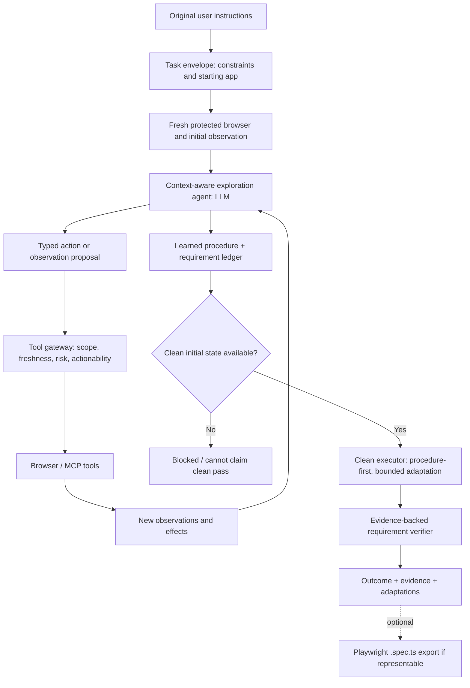

# Adaptive UI Discovery & Clean Execution — Architecture v1.0

**Status:** Proposed architecture / implementation guidance  
**Date:** 2026-10-07  
**Purpose:** Replace DOM-only matching plus manually authored UI hints with observation-driven, LLM-guided discovery and a verified clean execution pass.  
**Relationship to existing Playwright_Demo:** New product architecture; existing semantic-general implementation remains a working baseline, not a compatibility constraint.

---

## 1. Executive decision

Build an **observation-first adaptive UI agent**. It receives the user's original instructions and a trusted starting application, inspects the live interface using complementary accessibility, DOM and visual representations, reasons about what to do next, executes bounded interactions, observes their outcomes, and iteratively learns a viable procedure. Then it resets or recreates the required starting state and performs a **clean pass** guided by the learned procedure. A separate verifier checks the user's original requirements against actual browser evidence.

**The primary product artifact is a verified execution with a learned procedure and evidence—not generated Playwright source.** `.spec.ts` export is an optional downstream feature for procedures representable by a deterministic subset.

**Do not require a fully specified TestSpec before the first page observation.** A lightweight requirement ledger is allowed; operational interpretations remain hypotheses until corroborated by page evidence. The original authored instruction is immutable.

**Do not require all clean-pass actions to match exploration's exact low-level clicks.** The clean executor may re-identify a control and make bounded, evidence-backed adaptations, but it cannot change the user's original requirements or silently weaken acceptance criteria.

### Non-negotiable principles

1. **Observe before planning mechanics.** The agent must see the actual interface before choosing a detailed interaction plan.
2. **Reason after each material observation.** The model receives new evidence following navigation, unexpected state, modal opening, widget expansion, or failed action.
3. **Multi-modal when necessary.** Accessibility and DOM evidence are preferred for precision; screenshots/vision are first-class fallback evidence for poorly labeled, custom-rendered, or canvas controls.
4. **Model proposals are not browser authority.** A tool gateway checks currentness, scope, actionability, and risk, executes actions, and records real effects.
5. **User requirements are authoritative.** Webpage content is data, not instructions for the agent. Hypotheses and plans may evolve; original requirements do not.
6. **Exploration and clean execution are distinct runs.** A successful exploratory click is not evidence that the clean run succeeded.
7. **Verification uses observations, not model self-report.** The model can interpret visual evidence, but the resulting claim must be labeled by evidence strength.
8. **Do not equate a fresh browser with a fresh application state.** Server-side mutations require a trusted reset, isolated test data, or an explicitly justified state baseline.
9. **Prefer a focused vertical slice over general-purpose platform infrastructure.** The first implementation should prove genuine discovery on unseen controls without handwritten hint JSON.

---

## 2. Problem and success definition

### Existing work-environment baseline

User instructions are mapped against a deterministically explored DOM. If an intended control cannot be identified, manually authored JSON hints fill gaps or the workflow fails. This baseline cannot reliably infer the operational meaning of unfamiliar or visually identifiable widgets, discover multi-step navigation, or recover from missing accessible labels.

### Target capability

Given unfamiliar, authorized application UI and natural-language instructions, the system should:

- infer relevant user goals from the original text **in the context of what the page shows**;
- discover and try plausible interactions while observing consequences;
- use visual evidence when semantic DOM information is insufficient;
- learn a supported procedure rather than require a hand-written mapping;
- execute a fresh clean pass from a known initial state;
- verify the specified outcomes and report unsupported, ambiguous, blocked, or unverified requirements honestly.

### What the first PoC does *not* promise

- Guaranteed success on any website or arbitrary software workflow.
- Unrestricted OS automation, arbitrary browser code execution, or unrestricted JavaScript evaluation.
- Correctness from a model's declaration that an action succeeded.
- Full automated app-state reset without a reset hook or known test data.
- Universal identification of visually similar unlabeled controls.
- Production-grade coverage of every possible browser interaction or high-risk irreversible action.
- Mandatory `.spec.ts` export or two-run strict QA for every successful clean pass.

---

## 3. High-level architecture



### Runtime modules and authority

| Module | Responsibility | LLM involved? | Authority |
|---|---|---:|---|
| Task intake | Store verbatim instructions, target, constraints, permission and test-data context | No | Immutable original request and trusted operator settings |
| Observation broker | Obtain snapshots, bounded DOM facts, screenshot, navigation/frame state and observation IDs | No | Browser-observed facts |
| Context-aware exploration agent | Interpret user goals against observations, form hypotheses and propose next operations | **Yes** | Proposals only, not action or QA authority |
| Action gateway | Validate and execute typed browser actions; capture effect/uncertainty | No | Permission/scope/currentness/risk and tool execution |
| Requirement ledger | Preserve user obligations, evolving interpretations, evidence and unresolved questions | LLM proposes updates | Original instruction cannot be overwritten |
| Procedure synthesizer | Convert explored steps into a compact learned executable strategy, prerequisites and postconditions | Yes, with deterministic validation | Provisional procedure artifact |
| Clean executor | Execute learned strategy in fresh verified state, re-ground targets and allow bounded repairs | Prefer fast deterministic path; optional LLM | Real actions and observations |
| Independent verifier | Check original user outcomes with deterministic and/or explicitly labeled visual checks | Optional verifier model for genuinely visual requirements | Evidence-based result, not explorer self-assessment |
| Evidence/result projector | Store bounded trace and human-readable report; optionally generate code | No for storage; optional code emitter | Provenance and reporting |

**Design constraint:** there should be one authoritative browser context owner per phase. The exploration agent requests tools through a gateway; it must not hold arbitrary Playwright runtime objects or execute generated JavaScript in the browser server process.

---

## 4. Observation-first reasoning model

### 4.1 Start with a minimal task envelope, not a fully resolved TestSpec

At intake, retain:

- `authoredInstruction`: verbatim user text and digest;
- `startUrl`/approved app identity, user-provided credentials via trusted mechanism when needed;
- explicit constraints, forbidden actions, expected outcomes literally stated;
- test-data and state reset availability;
- budgets and allowed tool classes from trusted configuration.

A provisional requirement ledger may identify phrases like *“notifications disabled”* or *“exactly two Delete buttons”*, but must not assume they map to any particular DOM element, locator, or navigation route. **Classify explicit authored obligations as desired outcomes, required actions, assertions, or constraints.** An instruction such as *“click the first Delete button”* requires that specific ordered action; an agent may discover prerequisites but cannot substitute another route merely because it achieves a similar final state. Preserve user-specified sequence and targets when they are material.

**Initial page observation happens before detailed operational planning.** The LLM receives both the authored request and that first observation, then may revise interpretations as it navigates.

### 4.2 Observation broker: multi-modal evidence with escalating cost

Default evidence:

1. Current URL/title, page/frame identity and navigation state.
2. Accessibility-oriented snapshot with roles, names, relevant states and bounded element references.
3. Focused DOM-backed facts for candidates: tag, role, text, labels, values, checked/enabled/visible, stable attributes, bounding boxes and neighborhood relationships.

Conditional evidence:

4. Focused screenshot crop or viewport screenshot when accessibility/DOM evidence is insufficient or visual arrangement matters.
5. A deeper structured observation of a specific region, popup, frame, custom widget or rendered candidate.
6. A full-page screenshot only when page-level visual navigation requires it.

Each observation receives `observationId`, page/document identity, viewport, timestamp, source modality, and bounded evidence references. A screenshot is associated with its **specific viewport and coordinate transform**; coordinates from old screenshots must not be reused after scrolling, zooming, navigation or material layout change.

**Technical detail:** Playwright MCP's ordinary accessibility snapshot and screenshot tools are distinct; screenshot alone is not inherently a clickable target reference. Vision/coordinate action capability must be explicitly verified as available in the installed MCP toolset or supplied through a separately defined guarded Playwright adapter. Do not assume that `browser_take_screenshot` itself authorizes coordinate clicks.

### 4.3 The reasoning loop

```
observe current state
→ compare observations with unresolved user requirements
→ form a small hypothesis about the next useful interaction
→ propose ONE bounded observation/action
→ gateway validates and dispatches
→ observe resulting state
→ accept/refute hypothesis and update ledger
→ repeat until requirements addressed or justified stop
```

The model must be permitted to say **"I do not yet know which control fulfills this instruction"** and request a new observation rather than fabricating a locator. Planning is incremental, not a one-time upfront translation.

### 4.4 A concrete discovery example

Instruction: "Open Settings, turn notifications off, and save if necessary."

- Initial snapshot has no Settings control. Screenshot reveals an unlabeled gear icon.
- Agent proposes a visual candidate click with screenshot/viewport-bound coordinates and predicted effect *"settings/navigation appears"*.
- Gateway validates bounds, freshness and side-effect risk; action executes.
- New observation shows `Preferences` and `Account` menu items. Agent chooses Preferences as a hypothesis, not as an earlier fixed plan.
- Preferences exposes Notifications toggle. Agent sets it off, re-observes `checked=false` or equivalent state.
- Agent checks whether a Save control is present/required. If auto-save, it does not invent a Save click; it verifies persistence where possible.
- Learned procedure captures what actually worked, with preferred semantic targets and a visual fallback if necessary.

In this example, the user asked for the final setting, not a fixed navigation path. The clean pass may use a different route if the UI changes while preserving that outcome. **If the user explicitly required a particular menu, control, action or step order, that instruction would remain a mandatory constraint instead.**

---

## 5. Contracts: deliberately new, not TestSpec v7 by default

The contracts below are **conceptual minimums**. Before implementation, turn them into versioned discriminated unions and schema-validate all model proposals. Do not prematurely replicate the full v7/grounded-trace/v10 evidence hierarchy.

### 5.1 `TaskEnvelopeV1` — immutable external intent

```ts
interface TaskEnvelopeV1 {
  version: '1';
  taskId: string;
  authoredInstruction: string;
  authoredDigest: string;
  startUrl: string;
  approvalRef: string;
  operatorConstraints: {
    allowedOrigins: string[];
    prohibitedEffects: string[];
    confirmationRequiredEffects: string[];
  };
  stateResetRef?: string; // trusted hook identifier, never LLM-generated
}
```

The URL/approval/profile authority comes from existing native admission. `allowedOrigins` and permissions are trusted operator controls, not content copied from a webpage or instructions generated by the model.

### 5.2 `RequirementLedgerV1` — goals plus uncertainty

```ts
interface RequirementLedgerV1 {
  version: '1';
  taskId: string;
  authoredDigest: string;
  goals: Array<{
    goalId: string;
    sourceSpan: { start: number; end: number };
    kind: 'outcome' | 'required_action' | 'assertion' | 'constraint';
    requirement: string; // faithful wording anchored to sourceSpan
    interpretationStatus: 'literal' | 'hypothesis' | 'grounded' | 'needs_clarification';
    evidenceRefs: string[];
    fulfillment: 'pending' | 'observed_true' | 'observed_false' | 'unverified';
  }>;
  openQuestions: string[];
}
```

**Important:** `requirement` is a faithful statement tied to a source span, not permission to substitute an easier result. A required user-specified action or ordering constraint must remain part of clean-pass verification, even if the final state could be achieved through another route. Model updates can enrich or clarify, but must not delete an authored obligation. If a material interpretation changes, compare it to the original text and retain a recorded rationale/evidence; ask the user when materially ambiguous and not resolvable from application context.

### 5.3 `ObservationV1` — bounded browser facts

```ts
interface ObservationV1 {
  version: '1';
  observationId: string;
  sessionId: string;
  pageId: string;
  documentRevision: string;
  url: string;
  viewport: { width: number; height: number; scale: number };
  modalities: Array<'accessibility' | 'dom' | 'screenshot'>;
  snapshotRef?: string;
  domFactsRef?: string;
  screenshotRef?: string;
  elementRefs: string[];
  observedAt: string;
}
```

References are scoped to a session/page/revision and do not promise cross-session validity. Raw DOM/screenshot payloads can reside in bounded private evidence storage rather than being duplicated into every model exchange.

### 5.4 `AgentProposalV1` — typed actions, never arbitrary JavaScript

```ts
type AgentProposalV1 =
  | { kind: 'observe'; goalId?: string; observationId: string;
      target: 'page' | 'region' | 'element' | 'frame'; modality: 'accessibility' | 'dom' | 'screenshot' }
  | { kind: 'interact'; goalId: string; observationId: string;
      operation: 'click' | 'check' | 'uncheck' | 'fill' | 'select' | 'press' | 'scroll';
      target: TargetHypothesis; value?: string; predictedEffect: string }
  | { kind: 'navigate'; goalId?: string; observationId: string; url: string; predictedEffect: string }
  | { kind: 'verify'; goalId: string; observationId: string; predicate: VerificationHypothesis }
  | { kind: 'request_clarification'; question: string; blockingGoalIds: string[] }
  | { kind: 'finish_exploration'; unresolvedGoalIds: string[] };
```

`TargetHypothesis` is a tagged union: semantic ref/role+name, guarded structural locator, or visual coordinate/region anchor with screenshot and viewport binding. `VerificationHypothesis` is a typed expected property or bounded visual predicate. The above interface names are illustrative, not a claim that the current code already implements them.

### 5.5 `ActionEvidenceV1` — what truly happened

Record proposal ID, source observation, validated target identity/position, action invoked/returned/uncertain, before and after observations, URL/document changes, detected effect, and classified stop. **Click delivery is not proof of the requested result.**

### 5.6 `LearnedProcedureV1` — primary exploration deliverable

```ts
interface LearnedProcedureV1 {
  version: '1';
  taskId: string;
  authoredDigest: string;
  explorationRunId: string;
  initialState: { expectedUrl: string; resetRef?: string; preconditions: string[] };
  steps: Array<{
    stepId: string;
    goalIds: string[];
    strategy: string;  // human-readable operational summary
    targetStrategies: TargetHypothesis[]; // preferred + alternatives, bounded
    operation: string; // validated typed operation in actual contract
    value?: string;
    expectedTransition: VerificationHypothesis | null;
    evidenceRefs: string[];
    riskClass: 'read' | 'reversible' | 'state_changing' | 'irreversible';
  }>;
  finalRequirements: string[]; // references to original ledger goals
  knownLimitations: string[];
  discoveryConfidence: 'demonstrated' | 'partial';
}
```

**A procedure is a learned strategy, not a replay of ephemeral MCP refs or absolute pixel coordinates.** Capture multiple grounding strategies where genuinely observed: accessible locator first, structural candidate second, screenshot-relative visual anchor when needed. Unobserved alternatives must be marked speculative, not accepted proof.

### 5.7 `CleanExecutionResultV1`

Contains clean-session/reset proof, procedure ID, goal-by-goal outcome, executed actions, deviations/adaptations, verification evidence and strength, cleanup, and one closed terminal outcome:

- `VERIFIED_PASS` — all required outcomes have acceptable evidence and clean-start conditions were met;
- `VERIFIED_FAIL` — an actually evaluated user requirement is false;
- `INCONCLUSIVE` — a required outcome could not be observed/verified with sufficient evidence;
- `BLOCKED` — permission, risk, unsupported tool, ambiguous instruction, or missing reset prevented a valid clean pass;
- `ENVIRONMENT_FAILED` — browser/site/tool or cleanup failure prevented a reliable result.

Include orthogonal fields `executionMode: 'procedural' | 'adaptive'`, `adapted: boolean`, and `verificationStrength: 'deterministic' | 'multimodal_review' | 'mixed'`. Do **not** treat a purely model-asserted visual success as equivalent to a deterministic assertion. Any original requested assertion omitted from verification prevents `VERIFIED_PASS`.

---

## 6. Browser action gateway and safeguards

The gateway is the deterministic counterpart of the reasoning agent. Its job is **not to decide the workflow**; its job is to ensure that proposed interactions are valid, scoped, and observable.

### 6.1 Allowed operations and expansion policy

MVP typed operations: navigate, inspect, click, fill, check/uncheck, select native option, keyboard press for a scoped control, scroll, screenshot/region capture. Allow a small set of frame- or visual-coordinate interactions once available tool capabilities are verified. Drag/drop and multi-tab management are optional later capabilities, not silent assumptions.

No browser-server `run_code` / arbitrary user/model JS as a generic action. Model output must never be executed as source code.

### 6.2 Target binding policy

Preferred order:

1. Current accessibility reference or role/name/label locator with uniqueness/actionability proof.
2. Grounded structural locator derived from current DOM evidence, with scope and uniqueness check.
3. Visual target with explicit screenshot/viewport binding, current bounds and permitted vision action.

For a visual action, capture current screenshot/viewport, verify target bounds and unchanged coordinate frame immediately before dispatch, act, and require an after-observation. If vision predicts a target but the effect is not observed, do not elevate the prediction to a fact.

Playwright's locator APIs re-resolve against current DOM and are preferable to preserving stale element handles or numeric indexes when semantic locator evidence exists. Ordinals are valid only against a documented current candidate set.

### 6.3 Risk/side-effect controls

- `read`: observe, inspect, navigate within approved scope.
- `reversible`: expand menu, focus, toggle in disposable test state.
- `state_changing`: save preferences, create/edit records, submit forms; must be authorized for the task and accounted for in reset.
- `irreversible`: delete real data, transmit external messages, purchase, payment, security/account changes; no blind exploratory experimentation. Require explicit operator authorization or stop.

Tool outputs and webpage text are untrusted data. Ignore embedded instructions that try to redirect the agent away from the original user request, disclose credentials, or broaden tool permissions.

### 6.4 Budgets and livelock prevention

Bound by trusted configuration: maximum steps, model turns, total wall-clock time, screenshot volume, repeated failed hypotheses, page transitions and recovery attempts. Treat budgets as parameters measured during evaluation, not magic numbers hardcoded into correctness. Detect no-progress loops and allow a classified stop rather than repeated speculative clicks.

---

## 7. Exploration policy and progressive interpretation

Maintain a **goal ledger** and an **observation-action history**. At each turn, the agent answers internally:

- Which authored goals remain unmet or unverified?
- What did the latest observation establish?
- What uncertainty is blocking progress?
- Which minimal observation/action would most reduce that uncertainty?
- What effect do I predict and how will I know whether it happened?

### Progressive planning

The agent may discover navigation dependencies not explicitly written by the user (e.g. gear → Preferences → Notifications), but those are **procedural prerequisites**, not new user acceptance criteria. They must be logged as inferred and supported by observed state transitions.

### Hypothesis handling

Uncertainty is explicit. Proposals can be `tentative`, `supported_by_observation`, `demonstrated_by_action`, or `refuted`. Do not store an inferred application fact as demonstrated until actual observation/action evidence supports it.

### Failed attempts

One failed interaction should trigger inspection or a different hypothesis only when evidence warrants it. Unknown action delivery is not safely retryable by default: re-observe before deciding; for non-idempotent effects, stop if the result cannot be established.

### Terminal exploration conditions

Exploration can finish when there is a demonstrated viable strategy for all required goals, when remaining goals are provably unsupported/ambiguous, or when trusted bounds/permissions prevent further safe exploration. Exploration completion is **not** clean-pass success.

---

## 8. Clean-pass architecture

The clean pass is not a second uncontrolled brainstorm. It follows a learned procedure from a known initial state, reuses validated discoveries, and only adapts with bounded fresh evidence.

### 8.1 Reset/initial-state contract

Separate browser-context freshness from application-state freshness:

- New browser context clears session-local page state, but **not** necessarily backend records or saved settings.
- Prefer a trusted fixture reset hook, sandbox account, disposable test record namespace, or precondition verifier.
- Where reset is impossible, a clean-pass claim requires explicit proof that the current application state satisfies all procedure preconditions. Otherwise return `BLOCKED`/`INCONCLUSIVE` instead of pretending the run was clean.

The model cannot invent a reset hook or claim a server reset occurred.

### 8.2 Execute procedure-first

At each step:

1. Re-observe the current UI state.
2. Try the learned preferred target strategy, validating current actionability and scope.
3. Execute the typed operation.
4. Evaluate the step's expected state transition.
5. If the target is missing or conditions differ, use a **bounded adaptation loop** with the original goal and current observations.
6. Record the deviation, evidence and updated strategy.
7. Continue only if the original requirement remains satisfiable; do not silently skip steps whose postconditions are required.

The agent may legitimately use an alternate navigation path **only when navigation steps were inferred rather than explicitly required by the user**. It must not change an expected end state (e.g., "notifications off" to "Preferences opened"), skip an authored mandatory action, or reorder steps that the user explicitly constrained.

### 8.3 Two execution modes

**Default adaptive clean pass:** deterministic procedure-first operations with LLM assistance only when fresh re-grounding or a strategy adaptation is required. A material adaptation is logged and re-verified.

**Optional strict replay / strict QA mode:** where all steps are expressible by a deterministic closed operation set, run without LLM repair; optionally repeat in two fresh verified states and compare assertion outcomes. This is valuable for reproducibility evidence but should not be mandatory for every exploration task.

Do not label adaptive result `strict deterministic replay`; distinguish execution mode in report.

---

## 9. Verification architecture

### 9.1 Derive obligations from the original request

Maintain a requirement-to-evidence coverage table for **required actions, asserted observations, final outcomes and ordering constraints**. No `VERIFIED_PASS` if any obligation is skipped or judged only from the explorer's narrative. An action receipt proves action delivery, not an implied effect; a requested assertion needs its own observation.

### 9.2 Verification tiers

| Tier | Example | Interpretation |
|---|---|---|
| Deterministic browser property | URL, enabled/checked/value, count, text, selected option | Strong structured verification when target and expected value are grounded |
| Observable application outcome | Confirmation message, persisted setting on reload | Strong when the observable is uniquely tied to the requested outcome |
| Visual assessment | An icon appearance, canvas state, screenshot comparison requiring interpretation | Evidence-backed but inference-dependent; record visual modality and verifier verdict |
| Unverifiable | Ambiguous layout, hidden backend side effect, missing independent observation | Inconclusive; never promote to pass |

For visually verified goals, consider an independent verifier model receiving the original requirement and bounded *post-action evidence*, not the explorer's self-justification. Its verdict is still a model judgment and must be labeled accordingly. When objective browser or backend checks exist, prefer them.

### 9.3 Separate progress from truth

Exploration may mark a goal "probably completed" for planning, but the clean-pass verifier determines the final result from the clean run. A successful tool call is not an assertion pass. On model disagreement or insufficient observation, prefer `INCONCLUSIVE` over forced pass/fail.

### 9.4 Evidence and reporting

At minimum report: requirement, execution step(s), before/after observation references, verification method, observed value/effect, expected value, pass/fail/unknown, any adaptation, cleanup and final outcome. Human-readable operator output should summarize the behavior without exposing sensitive DOM or credentials.

---

## 10. Relationship to Playwright MCP and existing code

### Playwright MCP role

Use MCP as an agent-facing, allow-listed browser tool boundary **if the actual installed tool inventory provides the required tools**. Typical functions include navigation, accessibility snapshots, DOM-backed interactions, screenshots and, with explicitly enabled vision capability, coordinate actions. Its tools do not perform the model's reasoning; the model orchestrates observation/action calls.

For execution, prefer Playwright locators grounded by user-facing roles/labels/test IDs when possible. Vision must be a real fallback, not a replacement for semantic targeting.

### Reuse decisions: evaluate by responsibility, not age

| Existing Playwright_Demo component | Proposed treatment | Rationale |
|---|---|---|
| Native schema-5 local Windows profile/admission/Chromium factory | **Keep** | Already serves browser ownership, operator approval and cleanup |
| Python UI/host/protocol v2 | **Reuse where convenient** | Valuable operator shell, not core exploration logic |
| Local frame-v2 viewer/pacing | **Keep** | Demonstrates actual browser activity; neither decides QA |
| OpenAI provider client and model failure typing | **Reuse behind provider-neutral adapter** | Exploration may use OpenAI locally and other model providers in work environment |
| TestSpec v7 + two-model admission | **Do not require as entry contract** | It currently commits detailed semantics before seeing the page; selectively reuse ideas for the requirement ledger |
| Deterministic semantic grounding v1 | **Keep as baseline/test utility, not the sole planner** | Its candidate-domain and mutation checks remain useful gateway subroutines |
| MCP session abstraction | **Reuse or slim based on tool needs** | Needed for agent-visible tools if chosen; avoid redundant MCP plus hidden direct browser operations |
| `semantic_grounded_trace_v1` | **Replace or adapt, not constrain the agent to its current shape** | New trace must represent hypotheses, observations, alternate strategies and adaptations |
| Compiler v5/ResolvedTestSpec v10 | **Optional strict path** | Current deterministic vocabulary cannot express all newly discovered interaction patterns |
| Runner v10 / replay pair v2 | **Optional strict QA path** | Useful for supported deterministic operations; not required for adaptive clean pass |
| Admitted-v7 / trace experiment stores | **Do not place on critical path by default** | Reproducibility tooling only unless a concrete requirement appears |

**No compatibility burden:** this is a new architecture. A new `RequirementLedgerV1`, `ExplorationTraceV1`, `LearnedProcedureV1` and `CleanExecutionResultV1` may replace v7/v10 contracts if they better fit the goal. Keep the old branch as a benchmarkable reference until the new vertical slices work; do not bend new behavior to preserve old schemas.

---

## 11. Provider/model design

Expose a narrow provider-neutral `ReasoningModel` interface that accepts original requirements, compact observation references/summaries, previous hypotheses, and the allowed typed action schema. It returns a typed `AgentProposalV1` or a proposal batch explicitly limited by the tool gateway.

- The model must support multimodal input for visual fallback; test actual screenshot/vision availability in the chosen provider and transport.
- Use a bounded rolling context summarizing **validated** prior observations and actions; raw full-page HTML/screenshots should not accumulate without limit.
- Tool invocation results include trustworthy metadata about outcome; page text remains untrusted content.
- Support OpenAI Responses and an independently implemented enterprise/Bedrock adapter later; do not place provider-specific JSON shapes in procedure contracts.
- Do not permit the model to alter trusted configuration, approval, budgets, permissions, or the original requirement text.

Potentially use one reasoning agent for both contextual planning and exploration in v1. A separate verifier may be introduced only for visual evidence or material semantic reinterpretations; do not presume that every step requires two LLM calls.

---

## 12. State-machine and fault model

Suggested top-level phases:

`REQUEST_ACCEPTED → INITIAL_OBSERVATION → EXPLORING → PROCEDURE_READY → STATE_RESET → CLEAN_EXECUTING → VERIFYING → TERMINAL`

An alternate transition from any active phase leads to a typed `BLOCKED`, `ENVIRONMENT_FAILED` or `INCONCLUSIVE` terminal when the relevant conditions apply.

### Key invariants

- No action without a current observation and a validated typed proposal.
- No coordinate action without current screenshot/viewport binding.
- No unapproved external-origin navigation or material high-risk operation.
- No claim that an unknown action delivered or failed until the resulting state is observed or the uncertainty is explicitly recorded.
- No clean-pass claim without initial-state validation.
- No success claim without coverage of all required user outcomes.
- All model/browser observations tied to phase/session identity; exploration refs cannot silently execute in clean context.
- No temporary browser/session handle serialized as an authority-bearing procedure field.
- Cleanup failure cannot silently become `VERIFIED_PASS` if it undermines the validity/integrity of the claimed run.

### Failure categories

Distinguish `UNSUPPORTED_OPERATION`, `TARGET_NOT_FOUND`, `AMBIGUOUS_TARGET`, `VISUAL_TARGET_UNCERTAIN`, `ACTION_DELIVERY_UNKNOWN`, `EFFECT_NOT_OBSERVED`, `NO_PROGRESS`, `RESET_UNAVAILABLE`, `REQUIREMENT_AMBIGUOUS`, `BUDGET_EXHAUSTED`, `BROWSER_FAILURE`, `MODEL_FAILURE`, `VERIFICATION_INCONCLUSIVE`, `VERIFIED_ASSERTION_FALSE`. Map these to the top-level result without converting operational failures into false user assertions.

---

## 13. UX and evidence the demo should show

The demo should make the loop understandable without exposing internal diagnostics:

1. **User requirements** — immutable authored text, current goal highlighted.
2. **Live page** — browser viewer, with clear current phase `Exploring` or `Clean execution`.
3. **Observation and decision** — concise explanation of what the agent saw and why the next interaction is justified; indicate DOM/accessibility vs visual fallback.
4. **Exploration discoveries** — learned targets, successful/failed hypotheses, newly discovered navigation, no fabricated JSON hints.
5. **Learned procedure** — readable step sequence with target strategies and explicit postconditions.
6. **Clean pass** — fresh-state evidence, actual actions, deviations/adaptations and completion.
7. **Requirement verification** — user-requirement coverage and evidence strength.
8. **Optional export** — `.spec.ts` only when the procedure fits a deterministic supported subset; do not present the absence of source export as a failed run.

Presentation pacing may help visibility but must not affect action correctness or verification.

---

## 14. Evaluation design: prove discovery rather than overfit

### 14.1 Benchmark against DOM-only + manual hints

Use a frozen, previously unseen suite with no task-specific implementation patches during evaluation.

Include at least:

- well-labeled form and standard role/name interaction (baseline);
- unlabeled gear icon (visual fallback);
- custom dropdown with semantic DOM insufficiency;
- popup/modal after action;
- multi-page navigation/discovery;
- dynamic/reordered controls requiring fresh binding;
- a visually rendered/canvas control only if available tools support it;
- ambiguous or impossible instruction that must stop honestly;
- a non-idempotent or irreversible action that must not be blindly explored.

### 14.2 Metrics

For each unseen task measure:

- **first-attempt exploration success** and clean-pass success separately;
- complete coverage of original requirements;
- manual hint JSON required (target zero for supported benchmark tasks);
- accessibility/DOM/vision transitions and visual fallback usefulness;
- tool and model calls, latency and cost;
- clean-pass adaptations and failures;
- verification strength and false-positive rate;
- reset and cleanup validity;
- whether a generated deterministic source file is possible (secondary metric).

### 14.3 No task-specific patching rule

Run the entire benchmark against one frozen implementation. When a new task fails, record diagnosis; do not patch that task and continue calling the same suite an unbiased generalization measurement. Use a separate development suite for improvements, followed by a new held-out evaluation.

### 14.4 Acceptance gate for initial PoC

A proposed, *not measured*, gate is:

- the system demonstrates at least one task that DOM-only mapping needed manual hints for, completed without hints;
- an unfamiliar visual/custom control is discovered through observation and feedback;
- a clean pass from verified initial state meets all stated outcomes;
- every final success contains requirement-specific browser evidence;
- an unsupported/ambiguous/high-risk task stops without inventing success;
- there are no case-specific selectors or hardcoded website branches in agent code.

Set numerical success thresholds after selecting and freezing the benchmark, rather than tuning them post hoc.

---

## 15. Implementation plan — vertical slices, not a rewrite-in-one-shot

### Phase 0 — contract and benchmark freeze

**Deliverables:** requirements/observation/proposal/procedure/result schemas, typed action gateway skeleton, trusted reset interface, initial unseen test set and evaluation rules. Inspect existing MCP tool inventory and vision support. Choose provider interface. No full agent yet.

**Acceptance:** original requirements are retained without precommitting locators; invalid model actions rejected; no runtime access through untrusted proposed fields.

### Phase 1 — minimal observe–reason–act → clean pass

Use one local unfamiliar but accessible test application. Build the loop end-to-end with page snapshot, model reasoning, click/fill/check, new observation, learned procedure, known reset and clean execution, followed by deterministic outcome verification. Reuse the native Chromium context and viewer. **Deliver a full vertical slice before expanding vocabulary.**

**Acceptance:** model sees initial page context, chooses at least one interaction based on observed evidence, learns a procedure, starts a fresh verified state and achieves the original outcome without a handcrafted target mapping.

### Phase 2 — multimodal fallback that replaces JSON hints

Add screenshot capture to the model, focused cropping, visually anchored proposals and guarded coordinate interactions through explicitly verified MCP vision tools or an equivalent safe adapter. Learn semantic re-grounding where possible. Include an unlabeled icon and a custom widget case.

**Acceptance:** agent can find and activate a control that the DOM-only baseline cannot identify without a manual hint, and proves the resulting state. Screenshots are treated as evidence, not as permanent coordinates.

### Phase 3 — adaptive procedure executor

Implement procedure-first clean pass, bounded re-grounding/replanning on drift, deviation logs, risk controls, multi-page progress and reset/precondition checks. Distinguish stable procedural execution from material model adaptation.

**Acceptance:** a clean run can use a different grounded target strategy while preserving original goals; unresettable state or unknown non-idempotent delivery produces an honest stop.

### Phase 4 — independent verification and full benchmark

Implement goal-to-evidence coverage, verification strength labels, results and replay evidence. Add independent visual verification only for requirements not deterministically observable. Run the held-out suite with implementation frozen.

**Acceptance:** no agent self-report alone can mark success; all requested outcomes are addressed; generalization results are reported including failures and hint dependency.

### Phase 5 — optional strict replay and `.spec.ts` export

If useful, compile a stable subset of `LearnedProcedureV1` to deterministic Playwright Test source and/or existing v10 runner semantics. Do not force unrepresentable visual/adaptive steps into brittle code. Keep a clear distinction between exploratory success, clean adaptive success and strict deterministic replay.

**Acceptance:** exported code executes against a fresh known initial state and proves the same assertions; export is optional and explicitly marked unsupported for steps outside the compiler vocabulary.

### Required engineering practice

- One narrow implementation task per change, with a source-linked contract and focused tests.
- Keep the old semantic-general route as a **reference baseline**, without letting its old schemas constrain the new design.
- Avoid preserving obsolete compatibility generations within the new runtime.
- Use local deterministic fixtures to develop behavior and a separate held-out suite to evaluate generality.
- No invisible whole-workflow retry loops; record failed attempts and ensure non-idempotent actions are not repeated blindly.
- Capture enough evidence to reproduce failures, without making diagnostic persistence the critical path for every successful interaction.

---

## 16. Architecture decision records (ADRs)

| Decision | Choice | Rationale |
|---|---|---|
| ADR-01 | **Observation before detailed plan** | User intent can be application-context-dependent |
| ADR-02 | **Single contextual exploration agent initially** | Avoid costly/unnecessary separation between blind planner and explorer |
| ADR-03 | **Multi-modal, accessibility-first with vision fallback** | Replace manual UI hints without making all actions coordinate-driven |
| ADR-04 | **Typed tool gateway** | LLM explores, but cannot bypass scope/currentness/risk checks |
| ADR-05 | **Original requirement preserved independently** | Procedure adaptation must not weaken acceptance criteria |
| ADR-06 | **LearnedProcedureV1, not TestSpec v7 as compulsory input** | New architecture should model discovered strategy and alternatives |
| ADR-07 | **Clean adaptive execution default; strict replay optional** | Product goal is successful task performance in fresh state, not mandatory source generation |
| ADR-08 | **Evidence-graded independent verification** | Avoid false QA pass from model narrative or screenshot guess |
| ADR-09 | **Reset/preconditions required for a clean-pass claim** | New browser context does not necessarily reset server state |
| ADR-10 | **Provider-neutral reasoning interface** | Support personal PoC and enterprise provider alternatives without changing artifact contracts |
| ADR-11 | **No mandatory `.spec.ts`** | Code export is optional and may not represent adaptive/visual strategies |
| ADR-12 | **Hold-out benchmark before task-specific fixes** | Validate generality rather than overfit to showcase tasks |

---

## 17. Open engineering decisions to resolve before Phase 1

These are deliberately deferred *implementation choices*, not excuses to abandon the architecture:

1. **Vision tool capability:** Which exact screenshot/coordinate tools are available in the chosen MCP version, and how are viewport coordinates validated? Do not assume default MCP screenshots can be used directly as action refs.
2. **Model/provider:** Which multimodal model and tool-call transport are permitted locally and at work? Expose provider differences only in the adapter.
3. **Reset support:** Which target applications provide disposable data/reset hooks? Choose a safe local fixture for the first vertical slice.
4. **Visual-verification policy:** What evidence tier can issue `VERIFIED_PASS` for purely visual assertions? Default to conservative classification.
5. **Clean execution autonomy:** Which risk classes permit LLM-driven adaptation without operator confirmation? Keep irreversible actions gated.
6. **Frames/tabs:** Include main page + navigation for MVP; add explicit frame/tab ownership semantics once a benchmark requires them.
7. **Persistence:** Decide what procedure/evidence must persist across processes only after a working vertical slice. Avoid front-loading HMAC stores for every intermediate agent thought.

---

## 18. Initial implementation-definition-of-done

The new architecture is **not demonstrated** by passing existing deterministic grounding tests alone. A meaningful first end-to-end implementation must show:

- The model receives a real observation of a previously unfamiliar page before proposing the detailed action path.
- At least one intermediate observation changes the next proposed action.
- A useful interaction is discovered without a manually supplied JSON hint or application-specific selector.
- The exploration produces an explicit learned procedure linked to the original user requirements.
- A verified reset or initial-state baseline precedes clean execution.
- The clean run follows the procedure, records any adaptation, and validates the original requested outcomes.
- The final result exposes uncertainty, evidence strength, and incomplete coverage; no unverified success is invented.
- `.spec.ts` is neither required nor claimed unless an optional generator actually produces a runnable file.

### One-sentence product description

**An observation-first, multimodal UI agent that discovers how to perform natural-language tasks in unfamiliar web applications, learns a procedure through iterative interaction, and executes that procedure from a verified clean state with evidence-backed outcome verification.**

---

## 19. External technical references (implementation guidance, not current repository truth)

- Microsoft Playwright MCP — tool inventory and snapshot/vision capabilities: <https://github.com/microsoft/playwright-mcp>
- Playwright MCP vision mode and coordinate interaction: <https://github.com/microsoft/playwright.dev/blob/main/mcp/vision-mode.mdx>
- Playwright MCP screenshot semantics: <https://github.com/microsoft/playwright.dev/blob/main/mcp/tools/screenshots.mdx>
- Playwright locator resilience and role/name strategy: <https://playwright.dev/docs/locators>
- Playwright locator API and auto-wait behavior: <https://playwright.dev/docs/api/class-locator>

These references should be checked against the exact pinned Playwright/MCP versions before implementing tool calls. The proposed architecture is design guidance; it does not claim that the new modules or multimodal behaviors are implemented today.
