# Current semantic-general architecture

This document describes the checked-out PoC after cleanup A1–D2. **Current source is authoritative if this document and code diverge.** Retired architectures are under [archive/](archive/README.md); experiment evidence is under [experiments/](experiments/README.md).

## Objective and active path

The PoC accepts natural-language UI test instructions that fit its [supported vocabulary](supported-capabilities.md). It creates a faithful semantic representation, uses a protected live browser session to discover supported mechanics, compiles those mechanics against a **second fresh browser session**, and checks them in **two further fresh Playwright sessions**. Ambiguous or unsupported paths stop without inventing a QA result.

```mermaid
flowchart LR
  UI[Python Streamlit UI] --> Admission[Native public-target admission]
  Admission --> Host[Python host / protocol v2]
  Host --> Node[Node CLI / semantic-general-v1]
  Node --> Intent[Primary interpretation, canonicalization, fidelity review / TestSpec v7]
  Intent --> Ground[MCP session / grounding v1 / trace v1]
  Ground --> Compiler[Fresh browser / compiler v5]
  Compiler --> Resolved[Authenticated ResolvedTestSpec v10 store/readback]
  Resolved --> Run1[Fresh runner v10 session 1]
  Run1 --> Run2[Fresh runner v10 session 2]
  Run2 --> Pair[Replay pair v2 store/readback]
  Pair --> Result[ResultRecordV2 / safe projection / UI]
```

The UI launcher, host, and v2 result validation live in [`src/playwright_demo/`](../src/playwright_demo/). The Node CLI and bounded request/result protocol live in [`app/subprocess/`](../app/subprocess/). [`agentic-workflow.ts`](../app/local/agentic-workflow.ts) is the single product route despite its historical name. It checks native config and exact target approval before [`semantic-general-workflow.ts`](../app/local/semantic-general-workflow.ts) creates a browser. Direct Node requests pass the same approval check. An in-process offline fixture authority exists only in the test harness, not the production CLI. The ordinary semantic result carries `report.kind: 'unavailable'`; the validated v2 terminal still appears in the UI.

## Authority boundaries

| Boundary | May decide | Cannot decide |
|---|---|---|
| Primary model and independent reviewer | Proposed semantic steps, target wording, desired effects, verification meaning; faithfulness | Trusted profile, target approval, browser locator, replay operation, QA verdict |
| Deterministic normalization/admission | Shape, authored literals, relation/ordinal consistency and admitted TestSpec v7 | Invent missing meaning or resolve page ambiguity |
| Browser grounding | Candidate domain, identity, supported mechanic, observed state and action receipt | Extend semantic vocabulary or issue QA |
| Compiler v5 | Whether fresh current evidence corresponds to historical trace; resolved operations | Treat historical observations as current or repair intent with a model |
| Runner v10 and pair v2 | Execute guarded operations/assertions; derive agreement and QA from completed runs | Reinterpret instruction or silently repair changed targets |

The trusted source and [semantic TestSpec](../app/domain/semantic-intent-v3.ts) use **source contract v3** and **TestSpec schema v7**. The primary model returns closed structured extraction. Code validates structure, canonicalizes authored same-target/created-by/any-matching relations, then checks canonical semantic invariants. An independent second model compares a semantic-only projection with the original instruction; deterministic literal checks supplement that review. Only a faithful verdict with no issues and an exact trusted-source match yields an in-memory admission capability ([interpretation boundary](../app/interpretation/semantic-intent-v3.ts), [admission issuer](../app/domain/semantic-intent-v3.ts)). Historical `deferred` prompt/provenance literals remain in current admission records; they do not select a retired workflow.

## Grounding v1 and trace v1

[`McpExplorationSession`](../app/exploration/mcp.ts) owns the protected browser session. [`SemanticGroundingSessionV1`](../app/exploration/semantic-grounding-v1.ts) reads a complete candidate domain for the intended target in the main frame, including role/name/context and ordered identity. The domain proves an authored ordinal against the whole set; unqualified repeated targets are ambiguous. `same_as_step` relates to a previous selected identity; `created_by_step` requires one newly observed candidate. Captures are invalidated/repeated across mutation and checked again before action dispatch. Navigation, click/activation, native checkbox/radio checked state, native single-select, and editable value are the supported action mechanics. Exploration executes a grounded action only to establish its effect and records an action receipt. Verification witnesses cover URL, count/existence, boolean properties, value, and native selected option. Bounded resulting-state observation can wait for an authored effect. The [trace contract](../app/domain/semantic-resolved-v10.ts) issues a **semantic grounded trace v1** as an in-memory capability for the next stage.

## Compiler v5 and ResolvedTestSpec v10

The source trace records **historical** observations. [`semantic-trace-compiler-v5.ts`](../app/exploration/semantic-trace-compiler-v5.ts) opens a fresh protected browser, reconstructs and re-grounds each step, checks trace lineage and source/current correspondence, and rejects stale or weak evidence at point of use and before action dispatch. Only current compiler evidence may seal the [ResolvedTestSpec v10](../app/domain/semantic-resolved-v10.ts).

Resolved v10 is a **declarative deterministic replay artifact**, not Playwright source code. It contains profile/trace/compiler provenance, ordered candidate-domain guards, target identity and supported operations: navigation; click, check, uncheck, native `select_option`, fill; count, boolean-property, value, URL, and native-option assertions. It includes bounded resulting-state wait instructions. The accepted artifact is written to and authenticated through [`SemanticCompilerV5Store`](../app/evidence/semantic-compiler-store-v5.ts); replay consumes its trusted readback capability. The current implementation generates **no Playwright Test `.spec.ts` file**.

## Runner v10, replay pair v2, and QA

[`semantic-v10.ts`](../app/runner/semantic-v10.ts) starts a fresh session, reconstructs candidate domains, proves count/order/ordinal/relation/identity guards, invokes the specified Playwright operation, and evaluates the resolved assertion. It does not call a model or repair a changed locator. Non-click actions also prove the requested resulting state; click delivery alone is not a QA assertion. Bounded waits handle eligible resulting-state checks.

[`semantic-replay-v2.ts`](../app/interpretation/semantic-replay-v2.ts) requests two sequential fresh runner sessions. They must preserve resolved/trace/compiler/profile provenance, complete the same deterministic assertions, have separate session identities, and verify cleanup. The [pair contract](../app/domain/semantic-runner-v10.ts) derives agreement. An authenticated [`SemanticReplayV2Store`](../app/evidence/semantic-replay-store-v2.ts) readback is required before the workflow projects [ResultRecordV2](../app/domain/agentic-result-v2.ts). Matching completed passes yield `QA_ASSERTION_PASSED`; matching completed assertion failures yield `QA_ASSERTION_FAILED`. Disagreement yields `REPRODUCIBILITY_FAILED`. Browser, binding, provider, compilation, cleanup, and incomplete-replay stops remain non-QA. [Protocol v2](../app/subprocess/protocol-v2.ts) and its [Python validator](../src/playwright_demo/protocol_v2.py) keep those categories closed.

## Browser trust and persistence

[`native-profile.ts`](../app/profile/native-profile.ts) defines strict schema 5: `local-windows`, bundled `playwright-chromium-windows`, profile identity, presentation mode, browser options, and trusted timeouts. Its validated native JSON serialization determines the fingerprint. [`native-admission.ts`](../app/profile/native-admission.ts) binds the exact approved public URL to profile reference and fingerprint. Both Python admission selection and direct Node execution require this binding before browser creation. Reviewed DNS addresses and inspection digest are **approval metadata only**. **The current local Chromium runtime does not enforce network egress or DNS pinning.** [`local-context.ts`](../app/profile/local-context.ts) enforces Windows, launches bundled Chromium with a restricted environment, applies context/timeouts/auth state, and closes/final-checks the session. There is no Docker backend or runtime backend selector.

Product-authoritative persistence consists of **accepted Resolved v10 write/readback** and **replay-pair v2 write/readback**. Separate private diagnostic stores cover invalid primary output, interpretation normalization, exploration/viewer activity, compiler trace/rejection/seal, and runner observations. These are not QA authority, although primary invalid-output readback and some awaited compiler diagnostic writes can cause non-QA workflow stops ([boundary](../app/interpretation/semantic-intent-v3-boundary.ts), [composition](../app/interpretation/semantic-general-production-v1.ts)). The admitted-v7 and grounded-trace-v1 stores are for fixed-input reproducibility tools and tests; the ordinary workflow passes admission and trace in memory, without writing those experiment stores.

## Live view, pacing, and limits

Optional [`local-frame-channel.ts`](../app/observability/local-frame-channel.ts) streams bounded JPEG frames over a private authenticated loopback channel to Python [`local_frame_viewer.py`](../src/playwright_demo/local_frame_viewer.py) and [`local_frame_ui.py`](../src/playwright_demo/local_frame_ui.py). It correlates exploration, compilation, and both replay phases. The wire retains a historical `deferredViewerVersion` field; the transport is **frame-v2**, not a retired deferred route. Viewer preflight failure can stop the request as an environment failure; later frame unavailability remains observational. [`demo-action-pacing.ts`](../app/runner/demo-action-pacing.ts) adds an optional presentation pause. Neither frames nor pacing contribute to QA authority.

The current machine does not generate `.spec.ts`, support arbitrary browser mechanics, improvise unrestricted model-driven browser recovery, handle multiple frames, native multi-select, custom dropdowns, drag/drop, or arbitrary keyboard sequences. Public-target availability and page stability are external dependencies. Unsupported or ambiguous instructions stop at interpretation/grounding/compiler or replay as a **non-QA** outcome; only completed deterministic assertions can produce QA.
