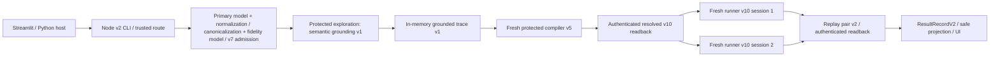

# Current-state architecture and staleness audit

Audit date: 2026-10-06. Scope: source-level, read-only reachability audit of the checked-out tree, including its uncommitted work. No provider, public target, Docker, or stability cohort was run. `ACTIVE_PRODUCT` below means reachable in a selected live UI/host route; it does **not** mean that route is the default, released, or independently proven against a public target. Classification is about current reachability, not age. Source links are relative to the repository root.

## Executive finding and actual entry graph

The semantic PoC is **natural language → two model interpretation calls → admitted semantic TestSpec v7 → protected browser grounding and execution → issued semantic grounded trace v1 → fresh browser compiler v5 → persisted ResolvedTestSpec v10 → two fresh deterministic Playwright API runs (runner v10/replay pair v2) → ResultRecordV2 and safe projection → Python UI**. It does **not** generate a `.spec.ts` file or invoke Playwright Test to execute generated source. `@playwright/test` supplies Chromium, browser contexts, locators, element handles, and assertions implemented by this repository's runner. The model does not author replay operations below admission. See `src/playwright_demo/streamlit_app.py`, `ui_workflow.py:121-127`, `host.py`, `app/subprocess/agentic-cli.ts:23-38`, `app/local/agentic-workflow.ts:30-64`, `app/local/semantic-general-workflow.ts`, and `app/interpretation/semantic-general-production-v1.ts`.

**Phase A2 update (2026-10-06):** Ordinary launch is now `ui_launcher.py` → Streamlit `streamlit_app.py`/`ui_shell.py` → `ui_workflow.py` → Python `host.py` → built `dist/subprocess/agentic-cli.js` → `agentic-entry.ts` → semantic branch of `runAgenticLocalWorkflow`. Absent workflow/backend selectors use `semantic-general-v1` and a declared native schema-5 local-Windows profile. Retired workflow values and an explicit Docker backend fail closed before product execution. Python admission `select` requires native schema 5 and exact approved target/profile binding; the semantic factory receives local-Windows explicitly. The old v1 CLI, older v2 branches, Docker dispatch, and parser default still exist for compatibility/direct low-level callers, but are outside ordinary product launch. The v2 projection uses `report-projection-v2-cli.ts` and Python `report_projection_v2.py`; product live view uses the local frame stream.

**Phase B1/B2 reachability update (2026-10-06):** `goal-directed-v1` and `structured-action-v1` production execution, TestSpec v4/v5, successful traces v3/v4, compiler attempts v2/v3, resolved v7/v8, accepted-v8 readback, and their runner branches have been retired. Neither route can be selected by the ordinary product or called through the remaining internal workflow dispatch. Explicit retired selector tests remain. The older rows below are retained as the audit's historical baseline where not superseded by this note; current source and the cleanup plan checkpoints govern implementation.

**Phase B3 reachability update (2026-10-06):** `agentic-exploration-v1` is also retired. Its M7 interpretation/controller, current-state exploration, trace v2, compiler v1, resolved v6 persistence/readback, and runner-v6 execution branch have been removed. TestSpec v2/v3 and older runner machinery still serve legacy v1, while deferred-action keeps its separate v6/v9 lineage and shared verification primitives. The MCP protected-browser/session abstraction remains on the semantic-general product path. The agentic row and related historical classifications below describe the pre-B3 snapshot and are superseded by this update.

**Phase B4 reachability update (2026-10-06):** `deferred-action-v1` is also retired. The internal route/gate, TestSpec v6, action-goal v2, trace v5, compiler v4, resolved/runner/replay v9, deferred stores/readback, and deferred Python/Node projection are removed. ResultRecordV2 and the Python v2 protocol now admit semantic-general only; the v1 wire remains for legacy. Shared semantic provenance literals, MCP, local frame streaming/viewer, action pacing, committed-document readiness, and Docker/profile compatibility remain. Deferred rows and classifications below describe the pre-B4 audit snapshot and are superseded by this update. Old deferred local artifacts are intentionally unsupported.

**Phase B5 reachability update (2026-10-06):** Legacy v1 is retired too. The v1 Node/Python subprocess and report contracts, local workflow/CLI, TestSpec v2/v3, resolved v2-v5, locator/runner, LocalArtifactStore, v1 UI branches, and legacy P4 event/image channels are removed. Shared primitives were extracted for current v2 callers. Semantic-general is the only production workflow; Docker schema-3/4 profiles, isolated browser, network-policy compatibility, RFB gateway, and mixed viewer protocol remain for Phase C. The historical route/version/test rows below are superseded by this update. Old legacy local artifacts have no readback support.

**Phase C2 reachability update (2026-10-07):** The Docker/schema-3/4 profile and browser lineage, runtime network policy/proxy, backend dispatch/default, RFB/noVNC viewer, container infrastructure/scripts, old schema-3 configs and exclusive tests are removed. Semantic-general uses only native schema-5 trusted config and approval, `local-context.ts` bundled Chromium, and local frame-v2 viewing. The native profile keeps schema version 5 and the fingerprint of the same valid serialized profile. Reviewed DNS addresses/inspection digest are approval metadata rather than runtime egress controls. `PLAYWRIGHT_DEMO_BROWSER_BACKEND` is rejected when nonempty as an obsolete configuration value; it cannot select local or Docker execution. Direct Node requires native exact URL/profile/fingerprint approval before browser creation, except for the explicit in-process loopback test fixture capability. All older Docker/profile/viewer rows and links below are historical audit findings, not current reachability. Phase D still owns full documentation archival.

| Boundary | Input → output; authority and persistence |
|---|---|
| UI/host | Authored instruction, approved target/profile reference → closed subprocess request. No model or browser. Python validates response; host protocol v2 on semantic route. |
| Interpretation | Trusted source contract v3 → model primary structured output → structural normalization v2 / canonical relations / deterministic validation → independent model fidelity verdict → trusted TestSpec v7/admission v3. Two LLM calls, no browser. Admitted artifact is **in memory** on ordinary route. Invalid completed primary output writes authenticated private diagnostic; rejected normalization can write private diagnostic. Stops are interpretation/environment, never QA. |
| Grounding | Trusted admission → browser-current candidates, action/verification witnesses and receipts (`semantic_capability_discovery_v1` / semantic grounding v1). Browser participates; no LLM. Successful ordered trace `semantic_grounded_trace_v1` is issued **in memory**. Exploration diagnostics are written. Failed exploration is non-QA. |
| Compiler | In-memory issued trace and admission → new browser, fresh re-grounding/correspondence/freshness → compiler v5 attempt and ResolvedTestSpec v10. No LLM. Compiler diagnostics write trace/rejection/seal; accepted resolved bundle is authenticated and immediately read back from `SemanticCompilerV5Store`. Rejection is non-QA. |
| Runner/replay | Authenticated v10 readback capability → two sequential new browser sessions, runner v10 records → replay pair v2. No LLM/MCP repair. Runner private diagnostics may write; pair is persisted and read back before terminal projection. Only matching, complete, cleaned up runs with assertions can yield QA. |
| External | Pair readback → `ResultRecordV2` with semantic lineage → safe report projection v2 / Python validation / UI. No browser/model. Report and terminal expose bounded safe fields, not raw model, page, locator, or private trace content. |

## Routes and selection

`app/subprocess/agentic-cli.ts:23-33`, `app/local/agentic-workflow.ts:30-64`, Python `ui_workflow.py:95-127`, and `ui_shell.py:574-584` recognize these choices. UI selection is fixed by launch environment, not a per-form switch.

| Route | Selection/default | Source → trace/exploration → compiler → resolved → runner | Why reachable |
|---|---|---|---|
| `legacy` | Retired in B5; explicit selector fails closed | TestSpec v2/v3, resolved v2-v5, v1 CLI/runner/store/projection removed | Historical documentation and negative route tests only. |
| `agentic-exploration-v1` | Retired in B3; explicit selector fails closed | M7 trace v2, compiler v1, resolved v6 and runner branch removed | Historical documentation and negative route tests only. |
| `goal-directed-v1` | Retired in B1; explicit selector fails closed | v4/trace v3/compiler v2/resolved v7 removed | Historical docs and negative tests only. |
| `structured-action-v1` | Retired in B2; explicit selector fails closed | v5/trace v4/compiler v3/resolved v8 removed | Historical docs and negative tests only. |
| `deferred-action-v1` | Retired in B4; explicit selector fails closed | TestSpec v6, trace v5, compiler v4, resolved/runner/replay v9 removed | Historical documentation and negative route tests only. |
| `semantic-general-v1` | Ordinary Python UI and direct v2 CLI default; explicit same value accepted temporarily; no semantic gate | v7/source v3 → semantic grounding/trace v1 → compiler v5 → resolved v10 → runner v10/pair v2 | Sole product launch route, with native schema-5 local Windows required. |

No older workflow retains an executable CLI or internal dispatch. The v2 protocol accepts semantic-general records only; obsolete selectors fail closed and do not map to semantic-general.

## Version and module map

| Contract/module | Producer → principal consumer | Classification and supersession |
|---|---|---|
| `SemanticIntentTestSpecV3Schema`, `schemaVersion:'7'`, source v3, `semanticMode:'intent_v2'`, normalization `semantic_intent_normalization_v2`; `app/domain/semantic-intent-v3.ts:39-49` | `semantic-intent-v3.ts` normalization/admission → grounding and compiler | `ACTIVE_PRODUCT`; file suffix v3 is the intent contract generation, **not** TestSpec version. |
| Semantic admission v3, primary/fidelity `..._v2` and prompt `..._p2`; `app/domain/semantic-intent-v3.ts:119-144` | Trusted deterministic admission → grounding/compiler/store | `ACTIVE_PRODUCT`; identifiers remain “deferred” named although semantic route uses them. |
| Semantic grounding evidence/witness/action receipt v1, candidate domain v1; `app/domain/semantic-grounding-v1.ts`, `semantic-resolved-v10.ts` | protected grounding → trace/compiler/runner domain | `ACTIVE_PRODUCT`. |
| Semantic grounded trace v1; `app/domain/semantic-resolved-v10.ts:80-105` | local workflow → compiler v5 | `ACTIVE_PRODUCT` in memory; separate persisted trace store is `ACTIVE_TEST_ONLY`. |
| Compiler v5 / resolved v10; `app/exploration/semantic-trace-compiler-v5.ts:673-685`, `app/domain/semantic-resolved-v10.ts:65-71` | fresh compiler → store → runner | `ACTIVE_PRODUCT`. |
| Runner v10 / replay pair v2; `app/domain/semantic-runner-v10.ts`, `app/runner/semantic-v10.ts` | authenticated resolved → pair/ResultRecordV2 | `ACTIVE_PRODUCT`. |
| TestSpec 2/3 and resolved 2–5; old runner | Former legacy v1 compatibility | Removed in B5, including old artifact readback. |
| TestSpec v4/v5, traces v3/v4, compilers v2/v3, resolved v7/v8 | Former goal-directed/structured production | Removed in B1/B2; historical documentation and explicit negative route tests remain. Shared deferred verification record/assertion primitives keep older filenames but do not restore these contracts. |
| Deferred TestSpec v6 and extraction/source contracts, trace v5, compiler v4, resolved v9, runner v9 | Former deferred production | Removed in B4; old local artifacts have no readback support. Current semantic v7 provenance literals with historically deferred names remain active. |
| Execution profiles unversioned, 2, 3, 4, 5; `app/profile/contracts.ts:31-73` | trusted configuration/catalog → context factory | 5 `ACTIVE_PRODUCT`; 3/4 `ACTIVE_COMPATIBILITY` for selectable Docker; unversioned/2 `ACTIVE_COMPATIBILITY` for legacy/local fixtures. |
| Python/Node subprocess protocol v1 and v2, result v2, report projection v1/v2 | CLIs → host/UI | v2 is `ACTIVE_PRODUCT` on semantic route; v1 remains legacy compatibility. Deferred v2 projection was removed in B4. |
| Current local frame stream and mixed RFB viewer gateway | host/UI → private observation channel | `ACTIVE_PRODUCT` frame stream; Docker/RFB gateway remains Phase C compatibility. Legacy P4 event/image channels were removed in B5. Neither viewer path is QA evidence. |

The original inventory had 118 TypeScript test files and 21 Python test files; B1–B3 removed route-exclusive suites, so those counts are historical. Static TypeScript imports alone are insufficient because `.mjs` scripts, built `dist`, Python subprocesses, and artifact readback also reach code. The untracked stores and stability scripts are present in this checked-out state, so a clean checkout may differ.

Reachability summary by exact generation (the detailed schemas above remain authoritative for fields):

| Version(s) | Classification | Demonstrated reference |
|---|---|---|
| TestSpec v7; source v3; normalization v2; admission v3 | `ACTIVE_PRODUCT` | `semantic-intent-v3.ts` → `semantic-general-workflow.ts`. |
| Grounding v1, grounded trace v1, candidate domain v1 | `ACTIVE_PRODUCT` | `semantic-grounding-v1.ts` → `semantic-trace-compiler-v5.ts`. |
| Compiler v5; ResolvedTestSpec v10; runner v10; pair v2 | `ACTIVE_PRODUCT` | `semantic-general-production-v1.ts` → stores → `semantic-replay-v2.ts`. |
| Legacy TestSpec v2/v3 and resolved v2–v5 | Retired in B5 | No production execution or artifact readback remains. |
| Deferred TestSpec v6, trace v5, compiler v4, resolved/runner/replay v9 | Retired in B4 | No production execution or artifact readback remains. |
| Agentic trace v2, compiler v1, resolved v6 | Retired in B3 | No production importer, generation, readback, or executable route remains. |
| Trace v1 and earlier deferred provider/source formats | Retired in B4 | Old deferred artifact readback is unsupported. |
| Admitted-v7 store storage v1 and standalone grounded-trace store storage v1 | `ACTIVE_TEST_ONLY` | References in `scripts/`/`tests/`, absent from ordinary `app/local/semantic-general-workflow.ts` imports. |
| Primary/normalization/exploration/compiler/runner diagnostic record versions | `ACTIVE_DIAGNOSTIC` | Their named stores and conditional or best-effort writes in active semantic call chain. |
| Schema-5 local-Windows profile and v2 host/result/projection contracts | `ACTIVE_PRODUCT` | `selectActivePocBrowserProfile`, `context.ts`, Python `ui_workflow.py`. |
| Legacy/unversioned and schema-2/3/4 profiles, v1 host/projection contract, viewer/RFB v1 | `ACTIVE_COMPATIBILITY` | Trusted config union, backend branch, legacy/older route UI. |
| Modules with no cross-language reference demonstrated | `UNKNOWN` | No deletion inference made from one-language static imports. |

## Browser backend and execution profiles

**Phase A1/A2 state:** Trusted config declares a schema-5 local-Windows profile directly; ordinary product selection requires it and uses its canonical fingerprint unchanged. Native public approval binds the exact target URL, profile reference, fingerprint, and reviewed DNS pins without a Docker network-policy object. The semantic `ProtectedContextFactory` receives `local-windows` explicitly and on Windows launches bundled Playwright Chromium through `chromium.launch` with a restricted browser environment (`app/profile/context.ts`). Local Windows schema 5 forbids `networkPolicyRef`. A Docker-schema-to-schema-5 conversion remains only for older explicit compatibility callers and is rejected by ordinary product selection. The local browser does not enforce the Docker proxy's DNS pin/egress policy.

**No ordinary production/demo path requires or selects Docker.** Docker remains executable from historical/direct callers: `parseTrustedBrowserBackend(undefined|'')` still returns `docker-isolated` for compatibility, and schema-3/4 profiles can reach `IsolatedBrowser.open`. The Python UI, admission `select`, and v2 product CLI now reject an explicit Docker selector and require native schema 5; an unset selector does not reach Docker on that path. Experiment drivers and old direct factory callers may still inherit the parser's Docker default, so they need explicit scrutiny until Phase C. Docker verification scripts, images, MCP browser bootstrap, RFB/noVNC bridge and Docker-specific tests remain compatibility/test infrastructure. `app/profile/admission.ts` retains native and historical approval builders; `app/local/contracts.ts` retains the old-schema transform only for compatibility callers.

## Interpretation authority

`createOpenAISemanticIntentModelsV3` in `semantic-intent-v3-adapters.ts` uses the shared Responses provider boundary (`app/interpretation/openai-responses.ts`); `interpretSemanticIntentWithEvidenceV3` in `semantic-intent-v3-boundary.ts` is shared by the UI route and fixture preparation. The primary model proposes a closed structured semantic step sequence: navigation, action intent/effect/target, verification observable/comparator/expected, and dependencies. It cannot choose trusted profile, approval, browser backend, executable selector, or QA verdict. `SemanticIntentPrimaryWireV3Schema` validates wire shape. `normalizeSemanticIntentV3` validates structure, then `canonicalizeSemanticRelationsV3` derives relations and ordinals from trusted authored clauses, then full semantic validation checks dependencies and consistency. Canonicalization can override a model's `any_matching`/relationship candidate where the authored text says otherwise; it rejects contradictory or unowned relations. An independent model reviews the canonical semantic projection against the original instruction. A faithful verdict, deterministic literal/shape checks, and `admitSemanticIntentV3` issue the trusted in-process capability. The reviewer is a semantic check, not a proof that arbitrary language is supported. Invalid completed primary output is privately persisted/read back before returning rejection; transport errors are distinct. Older `interpret.ts`/`openai-adapters.ts` serve legacy or shared provider contracts; deferred production adapters were removed in B4. The “deferred” names in v7 admission metadata are misleading but active.

## Grounding, compiler, and replay mechanics

`SemanticGroundingSessionV1` uses one protected main-frame browser/MCP session, captures complete eligible-role candidate domains, intersects category/role, exact name and context, records ordered candidates and their identities, and rejects missing/ambiguous targets unless an authored ordinal or explicit `any_matching` resolves them. Ordinal proof contains authored ordinal, complete count, and zero-based chosen index. Same/created-by relations use prior step identity/receipt and prior-state comparison. Grounding re-captures after mutations and immediately before dispatch; a witness expires and cannot be reused. Action families are: activation → click for closed button/link/checkbox/radio/menuitem/tab/switch roles; checked state → native input check/uncheck (radio cannot uncheck); choose → single native select and uniquely owned enabled label/value; set value → editable input fill. It observes complete-set existence/cardinality, URL, visible/enabled/checked/value, and native selected option, including bounded resulting-state wait after a dependency. Action receipts distinguish click delivery (`delivery_only`) from proven check/fill/select state. Unsupported examples include custom select widgets, multiple select, arbitrary keyboard sequences (`press` may be authored but currently mismatches the closed mechanics), drag/drop, multi-frame targets, and unbounded dynamic search. No LLM improvisation fills these gaps (`app/exploration/semantic-grounding-v1.ts:342-550`).

Compiler v5 is a separate fresh browser session because historical trace witnesses show what happened during exploration, not what is current enough to authorize replay. It validates trace/admission/profile lineage, navigates the historical path, re-grounds each step, compares source/current target, domain, mechanic and observations, validates pre-action current freshness immediately before dispatch, executes the action with the grounding session's own dispatch guard, and seals deterministic resolved steps. Historical records remain correspondence evidence; compiler-current witnesses are temporal authority. A successful compiler produces v10 only after full acceptance and cleanup, then `SemanticCompilerV5Store` authenticates readback. Deferred compiler v4 was removed in B4; agentic compiler v1 was removed in B3 (`semantic-trace-compiler-v5.ts:364-685`).

Runner v10 reconstructs the resolved closed role/domain on a new browser page, checks complete count/order and ordinal/relation/identity guards, executes `page.goto`, `click`, `check`, `uncheck`, `selectOption(value)`, or `fill`, and reads boolean property, value, native selected option, URL, or count assertions. It uses bounded settling for resulting state and records guard, observation, invocation, effect, stop and cleanup. `PLAYWRIGHT_DEMO_ACTION_PAUSE_MS` adds presentation pacing **after** a successful action receipt; it is excluded from execution evidence. Private runner diagnostics can record click/count timing but cannot change the step verdict (`app/runner/semantic-v10.ts`). Pair v2 runs sequential fresh sessions and verifies provenance, all step correspondence, completed records, distinct session IDs, verified cleanup, and matching assertion signatures. Two agreeing completed runs with at least one true assertion produce `QA_PASS` → `QA_ASSERTION_PASSED`; matching false assertion results produce `QA_ASSERTION_FAILED`. Disagreement → `REPRODUCIBILITY_FAILED`; zero assertions, incomplete run, browser/runner/cleanup/compilation/exploration/interpretation/provider stops remain non-QA (`app/domain/semantic-runner-v10.ts:63-89`, `app/local/semantic-general-workflow.ts:305-320`).

## Persistent artifacts and ordinary-path cost

All namespaces below are under trusted `artifactRoot`; paths generally include TestSpec ID plus attempt/run ID. “Read” means ordinary route readback, not just an exported reader. Restricted stores authenticate private records; no private payload is stakeholder-safe.

| Store / namespace | Writer → reader on ordinary semantic route | Classification / purpose |
|---|---|---|
| `admitted-semantic-test-spec-v7/`, storage 1 | No ordinary writer/read; stability fixture and store tests use `AdmittedSemanticTestSpecV7Store` | `ACTIVE_TEST_ONLY`; reproducible admission snapshot. |
| `semantic-primary-output-diagnostics-v1/`, storage 1 | Shared interpretation boundary writes **and authenticates readback** only for invalid completed primary output | `ACTIVE_DIAGNOSTIC`; required on that failure branch; persistence failure becomes environment stop. |
| `semantic-interpretation-diagnostics-v1/`, storage 1 | Local workflow writes on invalid source normalization; no ordinary read | `ACTIVE_DIAGNOSTIC`; bounded reason, best effort. |
| `semantic-exploration-diagnostics-v1/`, storage 1 | Local workflow writes on exploration completion/failure; no ordinary read | `ACTIVE_DIAGNOSTIC`; best effort, per-request write overhead. |
| `semantic-grounded-trace-v1/`, storage 1 | No ordinary writer/read; fixture/stability scripts and tests | `ACTIVE_TEST_ONLY`; fixed pre-compiler historical trace reproducibility. Ordinary compiler receives in-memory issued trace. |
| `semantic-compiler-diagnostics-v1/`, storage 1 | Production writes trace, rejection or accepted seal; no ordinary read | `ACTIVE_DIAGNOSTIC`; historical compiler analysis. `writeTrace` is on every successful grounding path before compile. |
| `semantic-compiler-v5-resolved-v10/`, storage 5 | Production `writeCompilationV5` authenticates readback; runner consumes capability | `ACTIVE_PRODUCT`; mandatory accepted artifact transfer. |
| `semantic-runner-diagnostics-v10/` (see `app/runner/semantic-v10-diagnostics.ts`) | Runner best-effort write when diagnostic root passed; no ordinary read | `ACTIVE_DIAGNOSTIC`; per-run timing/probe overhead. |
| `semantic-replay-v2-resolved-v10/`, storage 2 | Production writes pair and authenticates readback; finalizer consumes capability | `ACTIVE_PRODUCT`; mandatory pair lineage/terminal evidence. |
| Legacy `LocalArtifactStore` | Former legacy v1 artifact lifecycle | Removed in B5; semantic compiler/replay stores remain. |
| Viewer frame stream/RFB and P4 live images/events | Ephemeral host channels; no semantic QA store | `ACTIVE_DIAGNOSTIC` observation. Verify any optional video/evidence policy separately before treating it as a semantic persisted artifact. |

The two new pre-compiler reproducibility stores do not add ordinary request I/O today. Ordinary path **does** pay for exploration/compiler/runner diagnostics and mandatory resolved/pair authenticated persistence. Some diagnostics are best effort, but the compiler trace diagnostic write is awaited before compiler work. Removing it would be a behavior decision; no change is made here.

## Stability tools and test relevance

| Script(s) | Question / present value | Classification / placement recommendation |
|---|---|---|
| `semantic-v7-interpretation-stability-experiment.mjs`, `semantic-v7-post-canonicalization-stability.mjs`, `semantic-v7-final-stability.mjs` | Provider extraction/fidelity and digest stability across normalization revisions; historical cohort answers are in matching Markdown reports. | `ACTIVE_TEST_ONLY`; retain reproducible regression drivers, move to `experiments/semantic/` when paths/scripts are updated. Do not preload for normal coding. |
| `semantic-grounding-v1-stability-experiment.mjs`, `semantic-grounding-v1-test-fixture-source.mjs`, `semantic-grounding-v1-test-fixture-stability.mjs` | Provider-derived/frozen fixture, complete-domain and ordinal stability. Local Windows deterministic fixture question has evidence; live generality remains open. | `ACTIVE_TEST_ONLY`; dedicated experiments area. The first still inherits backend default hazard. |
| `semantic-compiler-v5-stability-experiment.mjs` | Fixed trace, fresh compiler correspondence/freshness. Local fixture 10/10 in investigation log; general public-target proof open. | `ACTIVE_TEST_ONLY`; experiment/regression. |
| `semantic-resolved-v10-replay-fixture-preparation.mjs`, `verify-semantic-resolved-v10-replay-fixture.mjs` | Frozen authenticated resolved input preparation/readback; replay cohort was not established in the inspected log. | `ACTIVE_TEST_ONLY`; experiment/regression. |
| `browser-backend-ab-experiment.mjs`, `local-frame-capture-ab-experiment.mjs`, `destination-readiness-experiment.mjs`, `public-navigation-performance-spike.mjs` | Backend, viewer, and navigation investigations. | `ACTIVE_TEST_ONLY`; keep as opt-in tools, separate from normal implementation context. Deferred-dependent compiler/provider/browser spikes were removed in B4. |

Current package `npm test`/`test:fast` selects semantic-general and shared foundation suites; `test:current` adds frame-stream/cancellation and bounded Python host coverage, while `test:compat` still protects legacy/Docker boundaries. The original 118 TS/21 Python counts are historical after B1-B4 removals. `tests/semantic-*`, admitted/grounded stores, and runner diagnostics protect the current semantic route or experiment infrastructure. Remaining `tests/deferred-local-frame-*` and `tests/deferred-live-view-channel.spec.ts` retain historically named shared viewer coverage, not a deferred workflow. Legacy, public admission, profile, and browser tests protect the still-retained compatibility boundary. Docker schema-3 browser fixtures cannot simply be forced onto local Windows: backend/profile validation rejects the mismatch. This is a test-fixture portability issue, not a QA failure.

## Documentation and Codex context

Markdown classification is based on current code and each document's stated generation. `docs/system-overview.md` and large parts of `docs/current-status.md` are **STALE_OR_CONTRADICTORY as a current semantic onboarding path**: the overview calls trace v2/compiler v1/resolved v6 and Docker the released baseline; current status is a chronological journal spanning many generations. `docs/architecture.md`, `implementation-plan.md`, phase 2–4 plans, goal-directed/structured WP documents, and old `runbook.md` are `SUPERSEDED_ARCHITECTURE` for semantic-general implementation, although only agentic-exploration, deferred-action, and legacy remain executable compatibility code. `docs/agentic-exploration-contracts.md`, `agentic-external-outcome-mapping.md`, P3/P4 contracts, `test-spec-schema.md` are `CURRENT_SPECIALIZED_REFERENCE` for the versioned routes they describe, not the v7/v10 lineage. `docs/runtime-investigation-log.md`, Windows/Docker removal/debugging, public-site experiments, compiler/grounding/runner stability reports, `docs/audit/*`, and live-proof files are `HISTORICAL_INVESTIGATION` or `EXPERIMENT_REPORT`; they record evidence but should not guide routine implementation. `docs/system-reality-report.md` and `docs/deferred-poc-system-reality-audit.md` are older generation snapshots. Current v7/v10 truth is chiefly source; this audit is a snapshot, not a replacement for call-site checking.

Document inventory by exact family (a glob assigns the same class to every matching Markdown file unless an exception is named):

| Files | Classification | Use |
|---|---|---|
| `current-state-architecture-staleness-audit.md` | `CURRENT_SOURCE_OF_TRUTH` | Source-linked snapshot of this checkout; re-check code before edits. |
| `system-overview.md`, `current-status.md` | `STALE_OR_CONTRADICTORY` | Historical baseline/journal; their top-level “current” claims do not describe the selected semantic route. |
| `architecture.md`, `implementation-plan.md`, `phase-2-*.md`, `phase-3-implementation-plan.md`, `phase-4-implementation-plan.md`, `runbook.md` | `SUPERSEDED_ARCHITECTURE` | Earlier generation plans and runbook. |
| `test-spec-schema.md`, `agentic-exploration-contracts.md`, `agentic-external-outcome-mapping.md`, `p2-3-subprocess-protocol.md`, `p3-a-public-admission.md`, `p3-b-report-projection.md`, `p4-g0-live-events.md`, `p4-g1-live-images.md`, `p4-g2-headed-viewer.md`, `phase-3-operator-guide.md` | `CURRENT_SPECIALIZED_REFERENCE` | Consult only for the corresponding still selectable older subsystem/contract. |
| `deferred-action-grounding-architecture.md`, `deferred-action-grounding-wp*.md`, `deferred-workflow-generality-audit.md`, `action-goal-semantic-fidelity-architecture.md`, `selected-option-verification-review.md`, `native-owned-option-verification-implementation.md` | `CURRENT_SPECIALIZED_REFERENCE` | Remaining deferred compatibility implementation details; not semantic-general design authority. |
| `goal-directed-*.md`, `structured-action-identity-wp*.md` | `SUPERSEDED_ARCHITECTURE` | B1/B2 removed these executable generations; retain as history until Phase D archive. |
| `structured-action-identity-live-release-gate.md`, `agentic-v2-release-gate.md`, `agentic-exploration-wp2-release-gate.md`, `deferred-action-grounding-*-gate.md`, `native-owned-option-*gate.md`, `semantic-locator-wp1-wp3-release-gate.md`, `p2-*-provider-release-gate.md` | `HISTORICAL_INVESTIGATION` | Generation-specific release evidence, not current semantic acceptance. |
| `semantic-v7-*.md`, `semantic-general-stability-audit.md`, `semantic-grounding-v1-stability.md`, `semantic-compiler-v5-stability.md`, `runner-v10-replay-pair-v2-stability.md` | `EXPERIMENT_REPORT` | Stage-specific cohorts and limitations; read when reproducing those experiments. |
| `windows-native-*.md`, `docker-vs-windows-regression-audit.md`, `browser-backend-ab-experiment.md`, `local-frame-capture-ab-experiment.md`, `live-browser-view-recovery-audit.md`, `destination-readiness-experiment.md` | `EXPERIMENT_REPORT` | Backend/viewer investigation; some observations are time-bound and must not define current defaults. |
| `public-web-acceptance-plan.md`, `public-target-qualification.md`, `playwright-mcp-spike-*.md`, `playwright-mcp-research.md`, `p*-live-proof.md`, `deferred-*-diagnostics.md`, `deferred-*-canonicalization.md`, `deferred-*-reconstruction.md`, `deferred-*-budget*.md`, `deferred-*-retry.md`, `deferred-*-hardening.md`, `native-owned-option-exact-source-proof-closure.md` | `HISTORICAL_INVESTIGATION` | Problem-specific records; consult by incident or compatibility question. |
| `system-reality-report.md`, `deferred-poc-system-reality-audit.md`, `docs/audit/*.md`, `test-suite-rationalization.md`, `runtime-investigation-log.md` | `HISTORICAL_INVESTIGATION` | Prior snapshots/rolling evidence. The investigation log is an index, not architecture authority. |

Some patterns intentionally overlap; the more specific row takes precedence. The Markdown files under `app/` are subsystem notes, not architecture entry points. The two highest-risk misleading documents are `system-overview.md` and `current-status.md`, because their titles and top sections imply current authority while describing earlier selected routes.

**MUST READ for a semantic-general implementation task (about 37 files, grouped by ownership):** `docs/current-state-architecture-staleness-audit.md`; Python `streamlit_app.py`, `ui_shell.py`, `ui_workflow.py`, `host.py`, `public_admission.py`, `protocol_v2.py`, `report_projection_v2.py`; Node `app/subprocess/agentic-cli.ts`, `agentic-entry.ts`, `protocol-v2.ts`, `report-projection-v2.ts`; `app/local/agentic-workflow.ts`, `semantic-general-workflow.ts`, `contracts.ts`; `app/profile/contracts.ts`, `context.ts`, `admission.ts`; `app/interpretation/semantic-intent-v3-boundary.ts`, `semantic-intent-v3.ts`, `semantic-intent-v3-wire.ts`, `semantic-intent-v3-relations.ts`, `semantic-intent-v3-adapters.ts`, `semantic-general-production-v1.ts`, `semantic-replay-v2.ts`; `app/domain/semantic-intent-v3.ts`, `semantic-grounding-v1.ts`, `semantic-resolved-v10.ts`, `semantic-runner-v10.ts`, `agentic-result-v2.ts`; `app/exploration/mcp.ts`, `semantic-grounding-v1.ts`, `semantic-trace-compiler-v5.ts`; `app/evidence/semantic-compiler-store-v5.ts`, `semantic-replay-store-v2.ts`; `app/runner/semantic-v10.ts`. This is a **task map**, not an instruction to paste all files into every context. For narrow work, inspect the call graph and open only affected files.

**READ ONLY WHEN RELEVANT:** private diagnostic stores and contracts, admitted/trace experimental stores, `openai-responses.ts`, provider failure code, `app/profile/isolated-browser.ts`/network, viewer channels and Python live-view modules, compatibility route contracts, package scripts and targeted tests. **DO NOT PRELOAD:** `docs/current-status.md` beyond its latest topical entry, `system-overview.md` as semantic truth, `architecture.md`, WP plans/release gates, investigation log, A/B reports, stability reports, experiment scripts, generated `dist`, or old route suites. Misleading sibling names include `semantic-intent-v3.ts` (v7 TestSpec), `semantic-general-production-v1.ts` (compiler v5/resolved v10), `trace-compiler.ts`/`trace-compiler-v3.ts`/`trace-compiler-v4.ts` versus `semantic-trace-compiler-v5.ts`, `run.ts`/`deferred-v9.ts` versus `semantic-v10.ts`, and Docker `IsolatedExecutionProfileSchema` versus schema-5 `LocalWindowsExecutionProfileSchema`.

## Configuration and stale defaults

| Environment/config key | Reader/default/relevance |
|---|---|
| `PLAYWRIGHT_DEMO_WORKFLOW_VERSION` | Unset launches semantic-general in Python UI and v2 CLI. Explicit `semantic-general-v1` is accepted for migration; retired values fail closed in product entry. Internal compatibility functions remain. |
| `PLAYWRIGHT_DEMO_SEMANTIC_GENERALITY_GATE` / `PLAYWRIGHT_DEMO_DEFERRED_ACTION_GATE` | Neither is read by production routing. Both were route gates, not approval or QA authority. The deferred gate appears only in a negative retired-route test. |
| `PLAYWRIGHT_DEMO_BROWSER_BACKEND` | Unset launches native schema-5 local Windows in product entry. Explicit `local-windows` is accepted temporarily; explicit Docker fails closed. `parseTrustedBrowserBackend` retains its Docker default for old direct/experiment callers only. |
| `PLAYWRIGHT_DEMO_LIVE_VIEW` | `1` enables deferred/semantic private viewer; otherwise absent/off. Local Windows uses frame stream; Docker uses RFB. Viewer failure may stop the request before browser work but cannot assert QA. |
| `PLAYWRIGHT_DEMO_ACTION_PAUSE_MS` | Optional positive bounded decimal parsed by Python and Node; presentation only after actions. Invalid semantic selection is rejected. |
| `PLAYWRIGHT_DEMO_TRUSTED_CONFIG` | Python UI/admission CLI trusted JSON path; holds profiles, network/evidence/live policies, artifact root, retention, public approval. Not user form authority. |
| `OPENAI_API_KEY` | Provider credential read by Node route; absent key stops before interpretation. No request was made in this audit. |
| `PLAYWRIGHT_DEMO_UI_DIAGNOSTICS` | Optional bounded provider/host diagnostic signaling; not QA. |
| `PLAYWRIGHT_DEMO_DEFERRED_VIEWER_{PORT,STREAM_ID,CAPABILITY}` | Ephemeral Python host → Node private viewer channel, no default. Older `EVENT_*`, `IMAGE_*`, `VIEWER_*` channel variables serve P4 legacy observation. |
| `PLAYWRIGHT_DEMO_LIVE_LLM_TESTS`, `...LIVE_LLM_DEBUG`, `...LIVE_BROWSER_TESTS`, `...BROWSER_AB`, `...FRAME_AB`, `...DESTINATION_READINESS`, `...NAVIGATION_SPIKE`, `...LIVE_COMPILER_TARGET_SPIKE`, `...COMPILER_SPIKE_TRUSTED_CONFIG` | Test/experiment opt-ins and config only; not ordinary UI controls. |

## Cost, alignment, and conservative cleanup candidates

| Complexity on ordinary semantic demo path | Burden | Reason |
|---|---|---|
| Interpretation, two provider calls, admission, browser grounding, fresh compilation, two replays | HIGH necessary/safety | Implements the supported natural-language-to-deterministic-automation promise and protects QA authority. |
| Candidate domains, freshness, ordinal/relation guards, independent sessions and authenticated resolved/pair readback | HIGH safety/correctness | Prevents historical or model/browser observations from becoming unchecked QA truth. |
| Exploration/compiler/runner diagnostics and viewer channels | MEDIUM debug/reproducibility | Some per-request I/O and code; useful, but not the source of QA authority. |
| Old agentic/goal/structured/deferred routes and v1/v2 Python/Node wires | HIGH developer context, LOW semantic runtime when not selected | Explicit compatibility, not dead code. |
| Stability cohorts/fixture scripts and pre-compiler admitted/trace stores | HIGH repository context, LOW ordinary runtime | Mostly experiment-only; move as a unit after import/path review. |

| Candidate | Proof/remaining use | Risk / recommended action |
|---|---|---|
| Overview/current-status as onboarding truth | Conflicts with current v7/v10 call graph; current status contains chronological older claims | Low runtime risk; **archive docs** or add a clear current-route banner in a later authorized edit. |
| Implicit Docker default outside product | `parseTrustedBrowserBackend` remains in direct compatibility callers and experiment drivers; product passes local-Windows explicitly | **Consolidate** after Docker compatibility decision. |
| Schema-3/4 profile builders and Docker image/RFB implementation | Still selected by backend and old route tests | High removal risk; **keep** until Docker compatibility is formally retired, then remove after compatibility decision. |
| Deferred v9 and older agentic resolved 2–8 siblings | Router/test/readback imports remain | High behavior risk; **keep/deprecate** only after route-support decision. |
| Admitted-v7 and grounded-trace-v1 stores | Tests/experiments import; ordinary semantic workflow does not | Moderate reproducibility risk; **keep or move experiment** after agreeing whether ordinary runtime should persist them. |
| Semantic interpretation/grounding/compiler/replay cohort scripts | No package runtime caller; invoked directly and record past stability questions | Low ordinary runtime risk, moderate regression value; **move experiment** to dedicated area with path fixes. |
| Older provider prompts/source formats and `deferred` identifiers in semantic admission | Compatibility readback and explicitly selected older paths; v7 metadata still carries names | Moderate provenance risk; **investigate further**, avoid blind rename. |
| Possible zero-import modules | Static names are inconclusive given dynamic imports, `.mjs`, Python and historical artifact readers | Unknown; **investigate further** with cross-language reference graph before any deletion. |

**Product-goal assessment.** Implemented: the model interprets supported natural-language instructions; protected browser grounding turns admitted intent into live mechanics and executes exploration; a fresh compiler creates declarative replay instructions; Playwright browser APIs reproduce them deterministically; two agreeing assertion runs can issue QA. The browser interaction is deterministic grounding, not free-form LLM-controlled exploration on this route. “Arbitrary” means arbitrary **within the closed supported intent/operation vocabulary** and faithful admission; unsupported widgets, ambiguous targets, unsupported mechanics, multi-frame flows, and provider/replay instability stop without QA. The automation is a persisted v10 data artifact plus custom runner, not generated Playwright Test source. Ordinary launch now selects native local Windows without selector variables; historical direct callers still exist. The checked-out source and offline fixture establish route behavior, not a fresh real-provider/public-site acceptance result.
