# Deferred action grounding: architecture decision

**Decision:** Introduce a separate, versioned agentic route in which interpretation preserves an authored **ActionGoal**, M7 chooses a bounded grounding strategy after inspecting the protected page, the runtime proves the selected current target and operation, and a fresh compiler decides whether the strategy has a durable deterministic representation. This is a design decision, not an implemented or released capability. No provider or browser workflow was run for this review.

**Fidelity addendum:** [ActionGoal semantic fidelity](action-goal-semantic-fidelity-architecture.md) supersedes this document's source-fidelity and source-to-browser correspondence wording. It separates probabilistic semantic endorsement from deterministic source/browser proof, requires independent source-first semantic admission, and defines the affected WP1/WP2 interfaces.

**Scope analyzed:** TestSpec interpretation through M7 action selection, protected current-state binding and observations, successful trace, fresh compiler, accepted resolved artifact, and two independent deterministic replays. VerificationGoal behavior, public admission, external v1/v2 separation, and QA authority are constraints rather than redesign targets.

## Evidence and decision driver

The current `structured-action-v1` route is wired as TestSpec v5 → trace v4 → compiler attempt v3 → resolved v8, with an offline gate and no completed real-provider public-target proof. The released route remains `agentic-exploration-v1`/v2/v6. [Current status](current-status.md), [reality report](system-reality-report.md), [production selection](../../app/local/agentic-workflow.ts).

The v5 action contract demands an exact nonempty **authored** accessible name, one role mode, optional named scope, and an exact operation before browsing. Current-state binding proves the selected ref against that intent; compiler v3 reconstructs an exact role/name locator in a fresh session. These are real target-substitution protections, but the early name is a property of this proof method, not a requirement of current-ref exploration. The runtime has role-only count/property reads, while its trusted observation API lacks option enumeration, option-to-control membership, and label-to-control association. [Action intent](../app/domain/action-target-intent.ts), [current-state binding](../app/exploration/current-state.ts), [observation contract](../app/domain/observation-contracts.ts), [compiler](../app/exploration/trace-compiler-v4.ts), [audit](audit/exploration-reality.md).

The smallest high-value change is therefore at the interpretation/action boundary plus a few general trusted grounding reads. It should not widen the model's browser execution authority or weaken fresh compilation. Its cost is a new source/trace/compiler/artifact family and stronger correspondence validation for contextual targets. The live behavior of an actual provider on the successor remains an empirical question. [Capability evidence](audit/capability-evidence.md).

## Authority flow and three action languages

```mermaid
flowchart LR
  U[Authored request] --> I[LLM interpretation: ActionGoal + VerificationGoal]
  I --> V[Trusted source and fidelity validation]
  V --> M[LLM M7: inspect, query, choose strategy and reviewed operation]
  M <--> B[Protected runtime: complete facts, current-state proof, action]
  B --> T[Immutable successful strategy and trace]
  T --> C[Fresh deterministic compiler: correspondence and replayability]
  C --> R[Accepted closed action artifact]
  R --> P[Two fresh deterministic replays]
  P --> Q[QA only on agreeing completed assertions]
```



1. **User action-goal language.** Interpretation retains the verbatim clause and semantic objective, literal argument if any, and every explicit target constraint with source provenance. It cannot assert a browser role, accessible name, frame, option value, label association, or uniqueness that the author did not state. It can express `activate`, `enter_text`, or `choose` as broad effect families; these describe intent, not a Playwright command. A direct *click* is an explicit operation constraint. An absent target name is represented as absent, never fabricated.
2. **Agent grounding language.** M7 composes a small reviewed query algebra over the live page: role and optional name, exact authored constraints, complete match count, current ref, durable frame, uniquely resolved semantic scope, supported control properties, and reviewed association/containment facts. M7 proposes a target, operation, and (for a choice) a bounded interaction plan. The protected runtime calculates facts, checks source constraints and uniqueness, binds a current ref, and executes only approved operations. Model prose and snapshots help select queries but are not evidence-grade.
3. **Deterministic action language.** A fresh compiler derives a closed locator/query and operation sequence from the successful protected strategy. The accepted artifact contains only bounded reviewed operations (`click`, `fill`, `select_option` for the initial successor), literal arguments or separately proven value mappings, frame/scope paths, and checks needed to preserve the goal's target meaning. The runner evaluates that artifact without LLM or MCP repair. This is a proposed successor to v8, not a claim that v8 already supports these forms. [Current replay grammar](../app/domain/schema.ts), [v8 validation](../app/domain/structured-action-compiler.ts), [runner](../app/runner/run.ts).

### Proposed ActionGoal source contract

The illustrative shape below names semantic fields, not final TypeScript or provider JSON. Each goal must have one source step ID, exact authored clause and instruction linkage, an effect family, optional literal argument with its own source span, and an ordered set of **explicit** constraints. Constraints may state role, name, named scope/frame/context, association or relationship, or an explicit uniqueness phrase such as “only text field.” `name` is optional. A user-stated name need not be assumed to equal the browser's accessible name: the source records what was said; the grounding proof must show how the page matches it. A role or label mentioned explicitly cannot be discarded when a more convenient target appears. One goal identifies one intended effect, not a collection of alternative target meanings.

```text
ActionGoal {
  sourceStepId, authoredClause, effect: activate | enter_text | choose,
  explicitOperation?: click | fill | select_option,
  argument?: { authoredText, sourceSpan, purpose: entered_text | choice },
  targetConstraints: [ { kind, authoredText, sourceSpan, polarity, relation? } ],
  prerequisiteContext?: authored semantic phrase
}
```

The source validator must enforce clause coverage, source spans, polarity and negation, argument/target separation, step order, bounded text and size, and rejection of selector/code payloads. It should reject contradictory or materially unclear authored instructions before browsing. It should **not** demand a name, role, replay locator, option DOM value, or frame title merely because a compiler may later want one. Existing `VerificationGoal` remains separate. Navigation still fixes an approved absolute URL before browsing; neither ActionGoal nor page content can grant navigation authority. [Current source schema](../app/domain/schema.ts), [current fidelity safeguards](../app/domain/action-target-intent.ts), [verification goal](../app/domain/verification-goal.ts).

### Operation timing: a bounded hybrid

Interpretation owns the authored effect and any **explicit** operation. `Click the Save button` constrains the terminal operation to a reviewed click on the Save button. `Fill the username field with Jorge` constrains text entry, target and literal. `Choose Option 1` specifies the desired choice but not the browser mechanism: M7 may choose native `select_option` for a proven native select, or a reviewed click sequence for a proven custom combobox/listbox. It cannot invent keyboard scripts, JS, arbitrary coordinates, or a different effect. “Open the only dropdown and choose Option 2” carries an explicit open/activate stage and a choice stage; the action plan may have more than one reviewed step, each separately grounded and replayable. An operation chosen by M7 must fit the effect family, the author's verb constraints, control capability, and protected observed outcome. If a custom control requires an unreviewed operation, exploration stops unsupported.

This hybrid avoids forcing `choose` to mean native `select_option` before observing the page while preserving direct operation wording. The executable operation vocabulary remains closed. An accepted exploratory effect is not itself a QA verdict.

## Grounding model and trusted observations

M7 may refine only dimensions left open by the author. It can discover the role and accessible name, determine a unique frame/scope, inspect controls and their options, and choose a reviewed operation. It cannot replace an authored `Country` constraint with another dropdown, treat `Option 1` as the dropdown's name, infer an explicit button role away, or promote a failed candidate into the successful trace. The candidate set is **all controls satisfying the explicit constraints and reviewed semantic relationship**, with complete enumeration or a protected complete count. The runtime must prove exactly one appropriate candidate at the instant of action; the selected ref must be a member of that set and current, visible, enabled and compatible with the operation. This extends the current ref/epoch/binding checks rather than replacing them. [Current-state checks](../app/exploration/current-state.ts), [witness v1](../app/domain/action-identity-witness.ts).

The current `TrustedObservationResultV1` can count by role without a name and read a property for exactly one match. It cannot list native options with their displayed labels and DOM values, attest which control owns an option, or attest accessible-label association. Its snapshot is expressly not evidence-grade. A role-only count is available, but current **action binding** still requires a named v5 intent. [Observation contract](../app/domain/observation-contracts.ts), [observation implementation](../app/exploration/trusted-observation.ts), [audit](audit/exploration-reality.md).

The initial successor needs these **general**, bounded, runtime-owned grounding capabilities:

| Capability | Trusted result and use | Current state / cost |
|---|---|---|
| Complete semantic candidate query | Roles with optional name, approved frame/scopes, complete count and a short-lived candidate-to-ref binding; unique unnamed/role-only controls are expressible. | Count exists for verification, but it must be linked to the action's selected current ref and constraints. |
| Control option enumeration and membership | For one current candidate control, enumerate bounded options with visible label, actionable DOM value, disabled state and owning control; prove an authored choice maps uniquely to one option/value. Include native and separately reviewed accessible listbox ownership cases. | **New trusted observation primitive.** A general `option` role count is insufficient. Bound size, prove completeness, fail on truncation. |
| Accessible label association | Given authored label text or a current control, return the browser-computed label-to-control association and unique candidate set. | **New trusted observation primitive.** A label string in a snapshot does not prove it labels the chosen input. |
| Semantic containment/ownership | Prove a candidate inside a unique named region/dialog/menu or an option owned by an opened control, with durable ancestry. | Named scope is partly present. Option ownership and possibly field-group ownership need separate reviewed proof. |
| Control capability and post-action state | Prove native select/editability/actionability or reviewed custom control role/ownership; after the action, observe the selected value or selection state with a fresh epoch. | Native-select actionability and some value reads exist; custom choice completion needs reviewed facts. |

Queries must be data, never model-supplied CSS, XPath, JS, arbitrary DOM traversal or locator text. Runtime records completeness, candidate cardinality, frame/state epochs, profile owner and a digest; errors, truncation and stale records cannot establish uniqueness. For “button next to Email,” **spatial proximity alone is not in the initial vocabulary**. If “next to” means a reviewed label/field-group association and the runtime proves one button in that group, it can be grounded. Otherwise this request remains unsupported pending a general relationship primitive; a sentence-specific `next_to_email` rule would be wrong.

## Dropdown case: `Select Option 1.`

This is a contract-path case study for the requested `https://the-internet.herokuapp.com/dropdown` page, not a claim about a captured current DOM or completed provider run. Interpretation emits `effect: choose`, `argument: "Option 1"` with source span, and **no authored control name**. It preserves any explicit wording about a dropdown if present. It does not set a `select_option` value to the displayed phrase without proving the page's option mapping. [Current dropdown limitation](system-reality-report.md), [empirical gap](audit/capability-evidence.md).

In the one-control scenario, M7 requests candidate selectable controls and, for each bounded candidate, trusted option enumeration/membership. Suppose the protected runtime establishes one actionable native select whose option label is `Option 1`, with DOM value `1`. The `Option 1` label is the authored **argument**; `1` is a browser-derived executable value; the native select is the **target**; `select_option` is M7's reviewed **operation**. The runtime proves the candidate is the only control satisfying the goal, binds its current ref, checks that its option still maps uniquely, executes `select_option(..., "1")`, and observes selected value/state freshly. A named control may make this faster, but is not required. A custom combobox can use only a reviewed click plan with protected option ownership and selected-state evidence; otherwise it stops unsupported.

In the two-control scenario, if both appropriate controls contain an enabled `Option 1` and the request gives no distinguishing context, the complete candidate set has cardinality two. M7 cannot pick the first ref or a familiar name. Grounding ends unresolved/ambiguous **before action**; it is not a QA failure. If one control uniquely satisfies an explicit `Country` constraint, an explicit region, or a proven relationship, M7 may narrow the set using that authored constraint and runtime facts. If the second matching control appears only in the fresh compiler context, compilation rejects a nonunique correspondence; if it appears only during replay, replay stops non-QA on changed/ambiguous binding.

The compiler must re-establish the *whole goal predicate* in a separate context: unique selectable control with a unique option whose displayed label matches the authored argument, its mapped DOM value, compatible operation, frame/scope and witnessed post-action effect. A bare role-only locator is sufficient only if the control is uniquely eligible under this entire predicate. Pinning the exploratory `1` value or a discovered accessible name without rechecking the option-to-control association would permit target substitution. The accepted deterministic step must preserve the mapped value and a runner-evaluable closed guard for the association/uniqueness. Replays rerun that guard before acting. If this closed guard cannot be represented or is unstable, compilation stops with no resolved artifact.

## Successful action-grounding proof and trace

The replacement for `ActionIdentityWitnessV1` is a runtime-owned grounding witness, not a model assertion. Its proof chain is:

```text
authored ActionGoal and explicit constraint spans
  → M7 selected reviewed queries / observations and operation plan
  → protected complete candidate set and relationship facts
  → exactly one matching current ref, current frame/epoch and actionability
  → execution with proved argument mapping and fresh effect observation
  → immutable successful strategy linked to source step and protected journal
  → fresh compiler reconstruction of same full goal predicate and operation
  → accepted closed deterministic action or typed non-QA stop
```

The successful strategy should record goal/source digest, authored constraints, ordered observation IDs and protected witness digests, the query/relationship predicates that disambiguated the target, complete candidate count, selected current ref and semantic role/name (including empty name), selected control/option/label associations, reviewed operation sequence, authored argument and any runtime-derived executable value, scope/frame ownership, profile/session/page/state/mutation epochs, actionability/uniqueness proof, execution result, and fresh post-action evidence. It contains **no chain of thought**. A short-lived ref is a correlation key, never durable replay identity. Each preparatory action has its own proof; it cannot silently count as the authored target. Failed candidates and abandoned recovery branches remain restricted diagnostics, outside the successful trace. This follows the existing protected-source/readback pattern for trace v4 and verification strategies. [Trace validation](../app/domain/agentic-trace-v3.ts), [trace assembly](../app/exploration/trace-assembly-v4.ts).

Trace validation must compare the successful strategy with the source ActionGoal, protected observation/action journal and ordered state chain. It must reject a changed explicit constraint, substituted argument, reused/stale observation, nonunique candidate, different selected ref, operation outside the goal's allowed family, unproved frame, or claimed effect not supported by fresh trusted facts. Model success wording does not override those checks. A change in state alone is not proof that the desired action occurred. [Current trace checks](../app/domain/agentic-trace-v3.ts).

## Fresh compilation and deterministic boundary

The fresh compiler gets the immutable source, successful trace and protected witness source in a **new protected session** under the same approved profile/fingerprint. It repeats successful prerequisites and actions in order, queries the same goal-defining semantic predicates and associations, and checks that they lead to exactly one fresh corresponding target. It checks frame ancestry, scoped context, operation capability, option/argument mapping and observed effect. Only then may it derive a durable closed locator/query plus executable operation and guards. It cannot parse English to invent a missing constraint or use an old session ref as a locator. Failure to represent a successful exploratory strategy is a typed **non-QA compilation stop**, including unsupported relation, nonunique fresh target, changed option mapping, no durable frame/scope, or no closed replay form. [Current fresh compiler](../app/exploration/trace-compiler-v4.ts), [current accepted artifact](../app/domain/structured-action-compiler.ts).

The proposed deterministic action vocabulary remains intentionally small: navigate to approved URL; click, fill, or native `select_option` on a compiler-accepted closed target predicate; literal/approved argument; ordered reviewed prerequisites; durable frame/scope; and a guard that re-evaluates the full source-constrained target/association predicate before each replay action. A custom choice is a bounded sequence of reviewed clicks only if each step and resulting option ownership can be compiled. No arbitrary model locator, script, unrestricted spatial predicate, post-compilation repair, or new QA assertion is authorized by this decision. VerificationGoal assertion projection remains independently closed; this action design does not solve temporal or relative verification gaps. [Deterministic audit](audit/deterministic-boundary-reality.md).

Exploratory action success need not be replayable **at the instant M7 acts**. It must become replayable at fresh compiler acceptance, before any resolved artifact is stored or passed to the runner. The runner must recheck unique full-predicate binding in each of two independent fresh contexts and execute the exact accepted operations/arguments. Only agreeing completed deterministic assertions can establish QA pass/fail. Browser drift, ambiguous guards, environment stops and compilation unsupported remain non-QA. The existing approval/isolation and external safe-report boundaries remain intact. [System overview](system-overview.md), [runner](../app/runner/run.ts).

## Ambiguity ownership

| Stage | Ambiguity or rejection owned there |
|---|---|
| Interpretation, before browser | Contradictory or unclear authored effect, unresolved clause segmentation, ambiguous pronoun without a recoverable antecedent, conflicting explicit targets, missing required literal argument, negation/polarity conflict, unsupported requested operation. Mere absence of a target name or role is **not** ambiguity. |
| M7 protected grounding | Zero appropriate controls, multiple controls satisfying all authored constraints, unavailable/truncated relationship evidence, unreviewed custom interaction, stale or unactionable candidate, unclear option-label-to-value mapping. Stop unresolved/ambiguous or unsupported without QA truth. |
| Fresh compilation | A strategy worked in exploration but cannot be expressed as a closed durable target/operation, or fresh state has zero/multiple corresponding candidates, changed association/argument mapping, or unproved frame/scope. Typed non-QA rejection with no accepted artifact. |
| Deterministic replay | Accepted predicate becomes unbindable/ambiguous in a replay context, or execution environment fails. Non-QA automation/environment stop; only completed evaluable assertions contribute to QA. |

## Anti-taxonomy check

All rows use the same ActionGoal fields and candidate/relationship query algebra. A “supported” design path still needs implementation and empirical proof.

| Request | Grounding route and boundary | Extra primitive? |
|---|---|---|
| `Click the Save button.` | Explicit click, name `Save`, role `button`; unique role/name current binding, then fresh correspondence. | Same core semantics. |
| `Click Save.` | Explicit click and name; runtime determines an eligible role, requires one matching control. | Same core semantics. |
| `Select Option 1.` | Choice argument is `Option 1`; find unique owning selectable control, map label to value, choose compatible operation. | General option enumeration/membership. |
| `Choose Option 1 from the Country dropdown.` | Preserve `Country` constraint and option argument; prove Country control and owned option. | Same option primitive plus existing named semantics or label association if Country is a label. |
| `Open the only dropdown and choose Option 2.` | Explicit first activation and then choice; uniqueness applies to dropdown before opening and owned option after. Each stage is proved. | Same option/ownership primitive and reviewed click or native select operation. |
| `Click the button next to Email.` | Preserve button role and `Email` context; permit only a proved label/field-group association that uniquely identifies a button. Literal visual adjacency remains unsupported. | General label/field-group relation if reviewed; **not** a request-specific schema. |
| `Fill the username field with Jorge.` | Preserve `username` target phrase and `Jorge` input separately; use exact name or proved label-to-input association, then fill. | General label association when accessible name alone does not suffice. |
| `Enter Jorge in the only text field.` | Text-entry effect, literal `Jorge`, explicit only-field constraint; runtime proves one editable textbox. | Role-only complete uniqueness. |
| `Open the menu and choose Settings.` | Ground an opener and then an owned `Settings` menu item/option in a bounded plan; prove each stage and fresh correspondence. | Existing named menu scope where sufficient; general menu/option ownership if needed. |

This reduces case-driven pressure only if new requests are expressed by composing these small predicates and the team rejects sentence-specific action variants. The design does **not** make arbitrary visual/spatial language solvable, nor turn every successful exploration into a replayable test. If product evidence demands richer relationships, add one reviewed observation relation with a general truth definition and matching compiler/runner guard, not another interpretation phrase rule.

## Migration and compatibility

Introduce one explicit trusted route, provisionally `deferred-action-v1`: **TestSpec v6 / M7 decision v4 / protected ActionGroundingObservation v1 and witness v2 / SuccessfulExplorationTrace v5 / CompilerAttempt v4 / ResolvedTestSpec v9**. These are proposed version numbers, not existing schemas. Keep `TrustedObservationResultV1` for existing verification; add a separate or strictly versioned grounding contract so v1 records retain their meaning. Keep the v2/v6 released route, v4/v3/v7 goal-directed route and v5/v4/v8 structured candidate readable with their own validators/runners. Do not reinterpret stored v5 intents as goals, silently widen v8, or fall back from a rejected v9 compile to an older compiler. The trusted workflow selection and provider format are version-specific. External agentic ResultRecordV2/projection can remain the public family only after its closed version-aware linkage is reviewed; legacy v1 remains separate. [Workflow selection](../../app/local/agentic-workflow.ts), [external result contract](../../app/domain/agentic-result-v2.ts), [current status](current-status.md).

Suggested minimal sequence, with suggested owning subagents for later implementation (none commissioned here):

1. **`ai-engineer` + `typescript-pro`:** Define TestSpec v6/ActionGoal, source fidelity and strict provider wire; regression for named, unnamed, explicit-role, argument separation, negation and pre-browser ambiguity. Preserve v5 independently. Gain: requests reach browser reasoning without invented names. Cost: new interpretation format and validation surface.
2. **`mcp-developer`:** Define and implement bounded trusted grounding reads for complete candidate sets, option membership/value mapping and label association, plus current-state binding/witness v2 and M7 decision v4. Test one-control and two-control semantics, stale refs, wrong association and custom-control unsupported. Gain: evidence-grade target discovery. Cost: protected API/epoch and completeness complexity.
3. **`typescript-pro`:** Trace v5 assembly/readback and fresh compiler v4 with full-goal correspondence, closed action query/guard, typed non-QA rejection and v9 validation. Test action substitution, frame drift, option mapping drift and failed strategy exclusion. Gain: replayable safety proof. Cost: new artifact family.
4. **`test-automator` + `security-auditor`:** Dedicated v9 runner/orchestration gate and adversarial regression across old routes, external projection and isolation. Test one normal path, one ambiguous path, and a fresh-context change. Gain: confidence without changing released route. Cost: another version-aware runner path.
5. **Independent release reviewer/operator:** Finish offline gate, then seek explicit approval for an approved-public-target real-provider proof. Exercise `Select Option 1` and Add/Remove from actual natural language through two fresh replays, with failure-path evidence and cleanup. Current fixture injection does not prove provider reasoning. [Capability evidence](audit/capability-evidence.md), [existing live gate discipline](structured-action-identity-live-release-gate.md).

## Explicit decisions and confidence limits

1. **Should actions become goals?** Yes. Keep exact authored clauses and constraints; defer browser identity. VerificationGoal remains a separate assertion intent.
2. **What must interpretation decide?** Clause order, semantic effect, explicit verb/role/name/context constraints, literal argument and source provenance, contradictions, and navigation URL. It should not guess browser identity.
3. **What may M7 ground?** Unspecified role/name, current unique target, control/option/label association, compatible reviewed operation, necessary bounded prerequisites, frame/scope and option value mapping, all backed by trusted observations.
4. **Must operation always be fixed early?** No. Explicit `click`/`fill` constrains it; `choose` can select a reviewed native select or click plan after control inspection. The runtime enforces compatibility and the compiler preserves the chosen plan.
5. **How is substitution prevented without a name?** Prove all authored constraints and complete candidate uniqueness at action time, link selected current ref to trusted relationships, and independently reconstruct the same full predicate in compiler and replay.
6. **Why is one-dropdown `Select Option 1` solvable?** A complete trusted query finds one compatible control owning exactly that option, maps its displayed label to executable value, and proves current action/post-state; compilation and replay repeat the predicate.
7. **Why does two-dropdown ambiguity fail safely?** Two satisfying controls make the protected candidate count two; M7 cannot authorize either. Later multiplicity fails compiler or replay non-QA.
8. **New observations?** Yes: bounded complete option enumeration/control membership and label-control association. Existing role-only count needs action-binding linkage; reviewed ownership/context facts may need extension. Arbitrary spatial queries are excluded initially.
9. **When must replayability be established?** In the fresh compiler before emitting v9. M7 may explore a successful but ultimately unrepresentable path; this produces a typed non-QA stop.
10. **Does this reduce case-driven pressure?** Yes, conditionally: the nine examples map to shared effect, constraint, candidate and relationship primitives, with the `next to` limit stated honestly. The risk of moving the taxonomy into relation names is controlled by requiring general protected semantics and compiler/runner guards for every new relation.

**Residual risks, in priority order:** (1) ambiguous semantic correspondence on changed pages; require full-predicate guards in compiler and both replays; (2) incomplete option/label observations; fail closed on truncation or unproved ownership; (3) custom controls needing operations outside the reviewed set; stop unsupported; (4) provider misinterpretation of explicit constraints; strict source fidelity and eventual real-provider proof are necessary. None of the proposed route's capabilities is empirically proven today. No production code, approved-browser session, or credentialed provider workflow was changed or run in this review.

DEFERRED_ACTION_GROUNDING_REVIEW_COMPLETE
