# Deferred PoC system reality audit

## Scope and evidence

This is a read-only audit of the **current working tree** for the gated `deferred-action-v1` route and the exact five-step Dropdown task. No provider call, browser workflow, code change, or replay was performed. Existing workspace edits were left intact. Current code and the persisted anchor stop are the primary evidence; [system overview](system-overview.md) and [current status](current-status.md) provide context, but the overview's v2/v6 flow is not this route.

The anchor is TestSpec `local-885ba047-25b7-4f62-9ee6-1cbfb58737ff`, exploration `exploration-8694ccba-a773-47da-a8a3-84bdc279ee4b`. Its [stop record](../../jobs/structured-action-20260930-220304-1cba42dfafc0461492cfe9745ba14bfa/artifacts/deferred-workflow-stop-v1/local-885ba047-25b7-4f62-9ee6-1cbfb58737ff/terminal.json) was read through `DeferredWorkflowStopStoreV1.readStop` and `readPrivateAccounting`, which verified its HMAC and schema. It reports exploration `EXPLORATION_UNSUPPORTED`, deferred stage `grounding`, category `unsupported`, code `PENDING_OBLIGATIONS`, and verified cleanup. The stop record is restricted evidence; only the bounded conclusions below should enter stakeholder-facing reports.

**Evidence limit:** This job persists no accepted TestSpec, semantic admission, grounding correspondence, candidate observation, or pending-obligation IDs for the anchor. The authenticated stop has `groundingAttempts: []` and `successfulWitnesses: []`. Therefore the exact pending IDs, kinds, and model explanations **cannot be recovered**. Claiming that a particular obligation caused this specific stop would be an inference. This audit instead separates the proven stop boundary from independently predictable code blockers.

## 1. Current active architecture

```mermaid
flowchart LR
  A[Trusted gated deferred selection] --> B[PoC primary semantic extraction]
  B --> C[Fresh fidelity reviewer]
  C --> D[TestSpec v6 poc_v1 + admission v2]
  D --> E[Protected MCP session + root navigation]
  E --> F[Protected state + per-action obligation mapping]
  F --> G[Candidate query + Playwright action + effect witness]
  G --> H[VerificationGoal strategy or native option observation]
  H --> I[Trace v5 authenticated store]
  I --> J[Fresh compiler v4 / resolved v9]
  J --> K[Fresh runner v9 twice]
  K --> L[Authenticated pair + ResultRecordV2 + safe projection]
```

The implementation boundaries below describe the actual route. `Stop` means a typed non-QA result unless stated otherwise.

| # | Boundary; current implementation and artifact | Stops and PoC judgment | Origin |
|---|---|---|---|
| 1 | `interpretDeferredActionTaskPoc` uses the closed primary wire, then `normalizePocSemanticExtraction` to produce `TestSpecV6V2` tagged `semanticMode: poc_v1` ([interpret](../app/interpretation/deferred-action-poc-interpret.ts), [normalize](../app/interpretation/deferred-action-poc-normalize.ts)). | Provider/format failure, malformed semantics, unsupported operations. A primary interpretation remains useful. | Active PoC. |
| 2 | A fresh `PocFidelityWireSchema` reviewer sees original instruction and bounded TestSpec projection; produces faithful/not-faithful verdict ([interpret](../app/interpretation/deferred-action-poc-interpret.ts), [projection](../app/interpretation/deferred-action-poc-normalize.ts)). | Disagreement or unusable verdict stops before browser. Keep this independent semantic check. | Active PoC. |
| 3 | `admitPocSemanticFidelityV2` validates structure, literals, graph and version tuple, issuing `TrustedSemanticAdmissionV2` and an action handoff ([admission](../app/domain/action-semantic-admission.ts)). | Invalid IDs/dependencies/literals stop. Synthetic action source segments still feed inherited grounding. | Mixed: PoC trust decision plus inherited source-accounting shape. |
| 4 | `McpExplorationSession.open` then `navigate(startState.url)` ([production](../app/interpretation/deferred-action-production.ts:151)). | Session/navigation/environment/cleanup failure. Anchor completed session open and root navigation. The authored first navigation step later navigates the same URL again. | Protected browser is active; duplicate navigation is route composition. |
| 5 | `SuccessfulTraceAssemblerV5.create` obtains initial protected state and observation ([assembler](../app/exploration/trace-assembly-v5.ts:94), [production](../app/interpretation/deferred-action-production.ts:160)). | Observation/state mismatch stops. Anchor completed both. | Keep state evidence, simplify only redundant work. |
| 6 | `ActionCandidateGroundingSessionV1.query` enumerates current page/frame semantic candidates and produces `ActionCandidateObservationV1` ([grounding](../app/exploration/action-candidate-grounding.ts:212)). | No candidates, non-unique target, drift, or unevaluable query. Anchor never reached query. Role/name discovery can represent a link. | Active grounding with inherited narrow mapping. |
| 7 | PoC normalization synthesizes `ActionGoalV2` effect, operation, target, argument and prerequisite obligations, IDs and source segments from semantic fields ([normalize](../app/interpretation/deferred-action-poc-normalize.ts:11)). | A dependency/context/role obligation can become pending although interpretation was accepted. The synthetic segments are not authored-byte provenance. | Inherited WP2 obligation contract adapted to PoC. |
| 8 | `validateGroundingCorrespondenceV1` and `admitGroundingMappingV1` demand a total primary mapping; semantic role/context mapping may require a second independent extraction. Any `pending` stops **before candidate query** ([controller](../app/interpretation/action-grounding-controller.ts:41), [mapping](../app/domain/action-grounding-strategy.ts:50)). | `PENDING_OBLIGATIONS`, disagreement, unsupported mapping. The total proof obligation is too strong for ordinary PoC actions. | Earlier production hardening. |
| 9 | Model decision v5 plus optional independent mapping and runtime preparation produce `PreparedActionGroundingV1` ([controller](../app/interpretation/action-grounding-controller.ts:41), [grounding](../app/exploration/action-candidate-grounding.ts:615)). | Model stop, timeout, pending mapping, non-unique target, unsupported control. Keep bounded decision and unique fresh target; simplify duplicate semantic admission. | Mixed. |
| 10 | `executeActionGoalGroundingV1` calls runtime Playwright `fill`, `selectOption`, or `click` on retained ref ([execution controller](../app/interpretation/action-grounding-execution-controller.ts:24), [grounding](../app/exploration/action-candidate-grounding.ts:800)). | Current click preflight permits only native checkbox/radio; ordinary link is `UNSUPPORTED_OPERATION` before dispatch. | Inherited native-effect subset, unsuitable for ordinary link QA. |
| 11 | Runtime checks returned action, same page/frame/node, native effect and retirement, issuing `ActionGroundingWitnessV1` ([grounding](../app/exploration/action-candidate-grounding.ts:864)). | A successful link navigation replaces the document and cannot satisfy same-node native effect proof; action becomes `POST_EFFECT_UNPROVEN`. Keep delivery evidence but permit navigation/disappearing target. | Earlier production hardening. |
| 12 | Ordinary `GoalDirectedVerificationControllerV1.evaluate` or native option V2 observes and records a successful strategy ([production](../app/interpretation/deferred-action-production.ts:187), [verification](../app/interpretation/verification-strategy.ts:162)). | Inherited exact-source fidelity and unhinted URL rule block this wording; native option requires unique owner/option. Useful observations and assertions remain. | Mixed. |
| 13 | `SuccessfulTraceAssemblerV5.finalize` and `SuccessfulTraceV5Store` create and authenticate successful trace v5 ([production](../app/interpretation/deferred-action-production.ts:194), [assembler](../app/exploration/trace-assembly-v5.ts)). | No successful witness/strategy, retirement mismatch, trace integrity or persistence stop. No trace exists for anchor. | Keep successful-path trace; native-only witness assumption needs change. |
| 14 | `compileDeferredSuccessfulTraceV5` opens fresh protected context, reconstructs the path, emits CompilerAttempt v4 and, on acceptance, authenticated `ResolvedTestSpecV9` ([compiler](../app/exploration/deferred-trace-compiler-v4.ts:45), [production](../app/interpretation/deferred-action-production.ts:203)). | Fresh match/effect/source correspondence or cleanup can reject; current compiler repeats native-only click and retirement assumptions. | Keep fresh compilation; broaden action representation. |
| 15 | `runDeferredResolvedTestV9` executes resolved steps without model/MCP repair, producing RunnerRecord v9 ([runner](../app/runner/deferred-v9.ts:139), [verification runner](../app/runner/verification-v9.ts)). | Locator/action/assertion/environment stop. Current click expects native activation/checked-state effect. URL and selected-option assertion primitives exist. | Keep deterministic replay; broaden ordinary click. |
| 16 | `runDeferredTwoFreshReplaysV1`, `DeferredReplayV9Store`, `deferredResultRecordV2`, and safe projection require two fresh, agreeing completed runs ([orchestration](../app/interpretation/deferred-action-replay.ts), [agreement/result](../app/domain/deferred-action-replay.ts:54), [production](../app/interpretation/deferred-action-production.ts:217)). | Disagreement, incomplete run, cleanup, persistence remain non-QA. Only agreeing completed assertions yield QA pass/fail; zero assertions yield `NO_ASSERTIONS`. | Keep for PoC QA authority. |

Artifact handoffs, in the same numbered order: (1) `InterpretationRequest` and primary wire JSON → normalized `TestSpecV6V2`; (2) original instruction plus bounded normalized projection → fidelity wire verdict; (3) normalized spec plus verdict → `TrustedSemanticAdmissionV2`/admission record; (4) admitted `startState.url`/profile → `McpExplorationSession` and navigation result; (5) session plus admission → protected initial state and trace assembler; (6) `ActionCandidateRequestV1` → `ActionCandidateObservationV1`; (7) accepted semantic action fields → `ActionGoalV2` obligations and handoff; (8) action obligations plus primary/independent correspondence → `TrustedGroundingMappingV1` or stop; (9) mapping plus candidate observation → `PreparedActionGroundingV1`; (10) preparation → `ActionExecutionAttemptV1`; (11) execution plus protected post-state → `ActionPostEffectV1` and `ActionGroundingWitnessV1`; (12) `VerificationGoal` plus trusted observations → successful verification strategy or non-QA stop; (13) ordered successful witnesses/strategies → `SuccessfulExplorationTraceV5` readback; (14) trace readback → `CompilerAttemptV4` and accepted `ResolvedTestSpecV9` readback or rejection; (15) resolved v9 readback → `DeferredRunnerRecordV9`; (16) two runner records → authenticated replay pair, `ResultRecordV2`, and bounded safe projection. No model or MCP evidence becomes an assertion verdict by itself.

The active browser uses a disposable Docker context with ordinary outbound networking. Historical DNS pins and destination policy are not the active navigation authority ([context](../app/profile/context.ts), [current status](current-status.md)). The trusted route gate, browser isolation, verified cleanup, separate legacy v1 external contract, and safe v2 projection remain valid boundaries.

## 2. Anchor-run diagnosis

The stop record shows successful `session_open`, `root_navigation`, `initial_observation`, and `initial_protected_state`. `first_grounding_decision` stopped with `PENDING_OBLIGATIONS` after 3,376 ms. There were no execution attempts or successful witnesses. The explicit first navigation step ran before the first action decision; the next action is the Dropdown link. In `prepareActionGoalGroundingV1`, an admitted correspondence containing any `realization.kind === 'pending'` returns this exact code before `runtime.query` ([controller](../app/interpretation/action-grounding-controller.ts:82)). Thus **the immediate stop is an unresolved semantic obligation mapping**, not a failed role/name DOM query, link dispatch, effect witness, or URL check. Those later boundaries were not reached.

| Requested anchor detail | Finding |
|---|---|
| Step ID | Not persisted; first action step in the accepted five-step run, following the authored navigation. |
| Obligation ID(s) and kind(s) | Not persisted. The authenticated record cannot distinguish role/name, context/relationship, prerequisite, or another obligation. |
| Authored semantic requirement | The step requests clicking the link whose text is `Dropdown`. The accepted generated action graph itself is unavailable. |
| Evidence that would discharge it | A complete trusted mapping of each admitted action obligation to a supported target/effect/argument/dependency realization, followed by a unique live candidate. A link role and exact `Dropdown` accessible name/text are straightforward candidate evidence; any extra dependency/context needs explicit supported semantics. |
| Why grounding could not discharge it | The model's admitted correspondence retained at least one pending realization; its contents were not included in authenticated stop accounting. |

`role: link` plus exact name is expressible by the candidate query, so generic link *discovery* is not inherently absent ([grounding](../app/exploration/action-candidate-grounding.ts:334)). `role: dropdown` for step 4 needs `role_semantic` mapping to combobox/listbox with independent endorsement ([mapping](../app/domain/action-grounding-strategy.ts:50)). Prerequisite obligations have no positive realization in that mapping vocabulary and therefore remain pending if the primary model emits them. These are **code-level risk explanations**, not recovered anchor correspondence.

## 3. Five-step capability matrix

Statuses describe the current implementation for this exact task. A downstream `SUPPORTED` cell means the primitive exists in isolation, not that the blocked end-to-end run succeeded. The accepted anchor TestSpec body is unavailable, so interpretation detail is based on the reported accepted five-step run and current normalizer.

| Authored step | Interpreted correctly? | Groundable? | Executable? | Witnessable? | Compilable? | Replayable? | QA-capable? | Reason |
|---|---|---|---|---|---|---|---|---|
| 1. Go to root URL | SUPPORTED | SUPPORTED | SUPPORTED | SUPPORTED | NOT_REACHED | NOT_REACHED | NOT_REACHED | Anchor completed root navigation and reached first grounding; explicit navigate has an observed trace path. Duplicate root navigation costs time. |
| 2. Click `Dropdown` link | SUPPORTED | BLOCKED | BLOCKED | BLOCKED | BLOCKED | BLOCKED | NOT_REACHED | Anchor mapping stopped before query. Role/name candidate lookup can find a link, but native-only click preflight, same-node witness, compiler and runner prevent a full link action. |
| 3. Confirm `/dropdown` URL | SUPPORTED | BLOCKED | NOT_REACHED | BLOCKED | LIKELY_BLOCKED | SUPPORTED | NOT_REACHED | Ordinary goal goes through inherited exact-source fidelity. A generated paraphrase fails source inclusion; the exact authored wording has no `url` token for unhinted URL comparison. URL assertion replay primitive exists but no strategy/trace can currently reach it. |
| 4. Select Option 1 | SUPPORTED | LIKELY_BLOCKED | SUPPORTED | SUPPORTED | NOT_REACHED | SUPPORTED | NOT_REACHED | Unique unnamed native select with Option 1 is covered; `dropdown` role requires semantic mapping and any emitted prerequisite may remain pending. Native selection effect is implemented. |
| 5. Verify Option 1 selected | SUPPORTED | SUPPORTED | SUPPORTED | SUPPORTED | NOT_REACHED | SUPPORTED | SUPPORTED | Native selected-option verifier accepts empty owner constraints plus selection dependency when owner/option are unique; compiler/runner assertions exist. It remains unreachable until prior steps work. |

Step 3's `BLOCKED` concerns semantic strategy admission, not inability to read or compare `page.url()`. Step 4's `SUPPORTED` execution/replay is conditional on unique native control and a successful grounding, as shown by existing protected fixture tests; this is not evidence of the public page succeeding.

For step 3, `dependsOnStepId` is checked against an earlier step ID, not used as a page-specific causal proof ([verification fidelity](../app/domain/verification-goal.ts:41), [trace contract](../app/domain/agentic-trace-v5.ts:141)). Sequential execution still requires a successful link action before reaching the URL goal. If a valid exact URL assertion is formed, the compiler reobserves `current_url` and runner v9 compares the fresh page URL ([compiler](../app/exploration/deferred-trace-compiler-v4.ts:93), [runner](../app/runner/verification-v9.ts:110)). Two agreeing false observations can therefore become an authoritative QA failure; the present strategy stop cannot.

The existing tests leave an important integration gap. [PoC semantic admission](../tests/deferred-poc-semantic-admission.spec.ts:78) accepts a five-step `poc_v1` projection with the link, dependent URL goal, `dropdown` role, and selected-option dependency, but stops before browser work. [Native option verification](../tests/native-owned-option-verification.spec.ts:110) exercises trace v5 through two v9 replays and QA with a **three-step** navigate/select/verify fixture; it omits the link and URL goal and its select lacks the PoC `dropdown` role constraint. [Production integration](../tests/deferred-action-production-wp5a.spec.ts:120) covers unconstrained native choices and action-only replay, not this five-step QA. Thus no existing fixture proves the actual simplified TestSpec crosses all boundaries. This is a test coverage gap, not proof that the downstream schemas reject `poc_v1`: trace v5 explicitly accepts the PoC admission version ([trace contract](../app/domain/agentic-trace-v5.ts:55)), and native v2 branches exist in compiler and runner.

## 4. Predicted blocker sequence

| Blocker | Next boundary after previous fixes | Consequence |
|---|---|---|
| B1 | Total obligation mapping in `prepareActionGoalGroundingV1` | Current anchor `PENDING_OBLIGATIONS` before candidate discovery. Exact pending IDs are unrecorded. A prerequisite/context/role mapping may be involved; do not patch a guessed obligation. |
| B2 | Click preflight in `ActionCandidateGroundingSessionV1.executePreparedGrounding` | Grounded ordinary link returns `UNSUPPORTED_OPERATION` before Playwright click. |
| B3 | Post-click effect witness, trace retirement, fresh compiler, runner v9 | A navigating link cannot satisfy same-page/same-node and checkbox/radio receipt assumptions. Fixing B2 alone cannot yield trace v5, accepted v9, or replay. |
| B4 | Ordinary VerificationGoal controller | Step 3 stops `INTENT_NOT_PRESERVED`: exact-source check conflicts with PoC semantic paraphrase; exact authored wording lacks the `url` keyword required for an unhinted URL comparison. |
| B5 | Select action mapping | `dropdown` needs endorsed semantic role translation; generated prerequisite/context constraints can become pending; two eligible selects remain correctly non-unique. If mapped and unique, current native select works. |
| B6 | Native selected-option owner/option resolution | Supported for unique native select and exact Option 1. If owner is ambiguous or constraint mismatches, typed non-QA stop. This is a conditional data blocker, not an identified implementation gap. |
| B7 | Fresh compiler, v9 replay pair, cleanup/persistence | These are untested with the live simplified PoC task. Existing isolated and mocked fixtures prove portions but do not prove this exact five-step artifact across all boundaries. Any mismatch remains non-QA. |

## 5. Minimal PoC architecture recommendation

Keep the primary LLM semantic extraction, fresh fidelity sanity check, accepted graph/literal validation, disposable protected browser, fresh compiler, declarative v9 replay, two-run agreement, and typed non-QA stops. Let the accepted semantic graph be the action intent. Ground it against current DOM with generic role/name/context matching, uniqueness, and supported Playwright operations. Use a compact runtime-owned action receipt (operation, selected target identity before dispatch, invocation outcome, and post-action browser observation) that can represent same-document changes **and navigation or target disappearance**. A successful click needs proof that Playwright delivered the intended action to the uniquely selected element; it need not prove an unrelated page-specific business effect. The subsequent URL assertion supplies the actual business outcome for this task.

Treat `Confirm it takes you to <URL>` as an exact resulting-URL assertion based on the already accepted PoC semantics and the preceding click dependency. Apply a PoC-aware verification strategy at runtime instead of reapplying historical exact-source clause checks; retain strict validation for historical TestSpecs. Keep native select and selected-option paths, including uniqueness and actual selected-state readback. The compiler should re-ground the same semantic target in a fresh context, execute the same operation, and emit deterministic locators/assertions; replay should not consult the model. Preserve v1/v2 external contract separation, safe projection, isolation and cleanup. This is a coherent action/verification representation change across exploration, trace, compiler and runner, not a single sentence or link special case.

## 6. Architectural dead weight

| Item | Classification | Rationale and disposition |
|---|---|---|
| Fresh compiler, two independent deterministic replays, completed assertion agreement, cleanup and non-QA stops | `KEEP_FOR_POC` | These establish reproducibility and authoritative QA. |
| Protected disposable browser and trusted route selection | `KEEP_FOR_POC` | Needed to isolate model-led exploration and control which workflow runs. |
| PoC-generated exact-source segment/whole-instruction span compatibility scaffolding | `SIMPLIFY` | PoC admission explicitly does not claim authored byte accounting; retain graph/value validation, remove downstream reliance on synthetic provenance. |
| Second per-action source-first endorsement and total obligation correspondence after primary+fidelity admission | `SIMPLIFY` | Duplicates semantic authority and turns ordinary context/dependency into pending. Keep runtime uniqueness and typed uncertainty. |
| Native-only click effect and same-node retirement as the only successful action witness | `BYPASS_ACTIVE_PATH` | Prevents ordinary links; replace with generic delivery plus operation-specific observed consequences across all active stages. Retain native selected-state evidence for selection. |
| Old exact-source VerificationGoal fidelity inside PoC runtime | `BYPASS_ACTIVE_PATH` | Contradicts `poc_v1` semantic admission; keep it for strict historical source mode. |
| Historical DNS pin/destination policy plumbing | `HISTORICAL_ONLY` | Active PoC uses ordinary Docker outbound navigation. Preserve old readers/contracts where needed; do not rebuild network-policy hardening. |
| Legacy v1 and older agentic route adapters/format readers | `HISTORICAL_ONLY` | Keep isolated compatibility; do not make the current PoC depend on them. |
| Multiple authenticated diagnostic stores and provenance digests | `SIMPLIFY` | Keep enough immutable trace/v9/pair linkage for deterministic review and safe projection; reduce redundant in-process proof layers only after active tests cover the new action representation. Persist bounded private pending diagnostics. |
| Unused historical route code | `DELETE_LATER` | No deletion is justified by age alone; defer until usage and migration are established. |

## 7. Prioritized change plan

Each package is a coherent implementation unit. Tests listed are the regressions to retain or add; none were run for this audit. Risk is to **existing active PoC behavior**, not to historical routes, which should stay separately gated.

| Priority | Package: simplify/remove → capability | Affected modules | Regression tests | Risk |
|---|---|---|---|---|
| P0 | 1. Consume the **existing accepted PoC semantic fields** in grounding; leave generated source segments as compatibility data without giving them new semantic authority → stable intent for ordinary UI operations. No new source partition or accounting format. | `deferred-action-poc-normalize`, `action-semantic-admission`, grounding domain types | Exact five-step semantic projection, literal/dependency integrity, negative fidelity cases | Medium |
| P0 | 2. Replace total per-action obligation endorsement with bounded semantic target matching after admission → link and native controls reach candidate query without a second source adjudication. | `action-grounding-controller`, `action-grounding-strategy`, `action-candidate-grounding` | Role/name/context, unsupported constraint, ambiguity, two-match and drift stops | High |
| P0 | 3. Persist bounded private first-decision mapping diagnostics (step ID, obligation IDs/kinds, realization status) on non-QA stops → exact future diagnosis without public leakage. | `deferred-action-production`, `deferred-workflow-accounting`, `deferred-workflow-store` | Authenticated readback, redacted projection, no witness/QA authority from diagnostics | Low |
| P0 | 4. Add generic uniquely grounded click dispatch and delivery receipt → ordinary link/button clicks. | `action-candidate-grounding`, action execution domain | Unique link/button, wrong target, stale ref, thrown/unknown click, native checkbox/radio retention | High |
| P0 | 5. Support navigation and disappearing-target post-action observation in witness/trace → successful ordinary link trace without same-node business-effect proof. | `action-candidate-grounding`, `trace-assembly-v5`, trace schemas | Link navigation, same-page click, target disappearance, wrong destination asserted later, partial action non-QA | High |
| P0 | 6. Carry generic click through fresh compiler v4 and resolved v9 → replayable link action. | `deferred-trace-compiler-v4`, compiler schemas, resolved v9 | Fresh unique target, changed target rejection, navigation, cleanup and compiler rejection | High |
| P0 | 7. Execute generic click in runner v9 with deterministic locator and ordinary Playwright outcome → two fresh replays. | `runner/deferred-v9`, runner schemas | Link navigation twice, no model repair, failure/non-QA, native action compatibility | High |
| P0 | 8. Make ordinary VerificationGoal evaluation PoC-aware and support explicit resulting-URL wording/dependency → step 3 assertion strategy. | `verification-strategy`, `verification-goal`, observation/trace bridge | Exact authored `Confirm it takes you to ...`, faithful paraphrase, wrong URL false assertion, malformed URL, wrong dependency | Medium |
| P1 | 9. Align `dropdown` semantic role with native `combobox`/`listbox` and keep uniqueness/owned option lookup → step 4 from accepted PoC TestSpec. | grounding strategy/runtime | Unnamed unique native select, two selects, Option 1 absent/disabled, role mismatch | Medium |
| P1 | 10. Ensure native selected-option verifier follows preceding select with empty owner constraints → step 5 from PoC spec. | native option controller/observation, trace/compiler/runner v9 | Current `poc_v1` five-step projection, selected true/false, ambiguous owner | Low |
| P1 | 11. Add one closed mocked-provider protected five-step end-to-end fixture through v5/v9/two replays → catches cross-stage shape drift before another live cycle. | `tests/deferred-action-production-wp5a.spec.ts` and focused v9 tests | Exact authored task, two agreeing true/false, disagreement, cleanup, no assertions non-QA | Low |
| P1 | 12. Verify safe stop and QA projection after new action shape → no private payload leak or false QA from automation stops. | deferred workflow store/projection, Python protocol/UI | Authenticated projection, Node/Python enum parity, link/URL stop remains non-QA | Low |
| P2 | 13. Remove active duplicate initial navigation if protected start-state capture can remain equivalent → less latency and fewer environment stops. | `deferred-action-production`, trace initial-state handling | Start state, explicit first navigation, redirect, compiler/replay initial URL | Medium |
| P2 | 14. Isolate historical source/version and network policy adapters from new PoC path; delete only after separate compatibility review → smaller active reasoning surface. | route adapters, profile compatibility, documentation | Legacy v1/v2 separation, historical artifact reads, active Docker navigation | Medium |

Completion criterion: the **exact** five authored steps, with the current PoC primary and reviewer, must produce a validated v6, successful v5, accepted compiler-v4/v9, two fresh completed agreeing v9 runs, and an authoritative QA outcome on a deterministic fixture. A subsequent separately authorized public/provider run is the release proof; no one-at-a-time rerun should substitute for the cross-stage fixture.

## Live verification differential: 2026-10-02

Authenticated stop readback for TestSpec `local-f588e3cd-11a1-4ea4-a670-6f551b69d87c` and exploration `exploration-5bc70c41-9e5d-465f-bc97-fa098c8a9e14` shows that authored step 2 uniquely grounded the `Dropdown` link and received a successful generic-click delivery receipt (`DELIVERY_PROVEN`, Playwright returned in 144 ms). Authored step 4 also uniquely grounded a native select and completed the `Option 1` selection with native effect evidence (`EFFECT_PROVEN`). Step 3 therefore did not stop the sequential run, but its observed URL and true/false comparison were not persisted. The post-click URL is unknown. The `VERIFICATION_UNRESOLVED` stop occurred at authored step 5, the selected-option verification; no trace v5, compiler v4, resolved v9, or replay pair was produced. Cleanup was verified.

The passing [five-step fixture](../tests/deferred-poc-functional-closure.spec.ts) supplies step 3 as an ordinary resulting-URL goal with a null subject/intent and dependency on `s2`. It supplies step 5 as a version-2 native selected-option claim for `Option 1`, `expectedSelected: true`, empty owner constraints, and dependency on `s4`. Its mocked native verifier always requests an observation and then returns a comparison bound to that observation. The live stop artifact stores action attempts and witnesses, but **does not store the accepted TestSpec, either VerificationGoal, verification strategy, native observation, model decision, or current URL**. Thus the exact live step-5 ID/tag/claim/dependency and every semantic-field difference from the fixture are unknown. The observed behavioral difference is that the fixture's step-5 verification resolved while live step 5 returned unresolved.

The precise `VERIFICATION_UNRESOLVED` subpredicate is **not recoverable** from this artifact. If live step 5 used the version-2 native claim, [production dispatch](../app/interpretation/deferred-action-production.ts) enters [NativeOptionVerificationControllerV2](../app/interpretation/native-option-verification-controller.ts), which can return unresolved without a typed stop when the model concludes unresolved, its conclusion lacks an eligible comparison or current evidence, its bounded turns exhaust, or it starts aborted. A typed native-observation error would carry its own stop code. A 30-second deadline is inconsistent with the roughly 2.83 seconds between the completed select and stop persistence. An ordinary-goal tag in the unpersisted live TestSpec cannot be excluded. Accordingly, the defensible cause is **step-5 verification resolution**, not failed link delivery or the step-3 URL strategy; the exact branch and whether semantic extraction differed remain undetermined. Among the requested cause classes, URL observation/comparison failure (4) is unsupported by this stop; the evidence cannot distinguish a live goal-shape difference (1) from a native verification-decision failure (5), and does not establish a normalizer defect (2) or historical URL-hint dependency (3).

The authored URL instruction already supplies current page URL, exact equality, and `https://the-internet.herokuapp.com/dropdown` as expected value. An admitted PoC URL goal needs no additional model hint or source keyword to establish that comparison. Current [PoC URL strategy](../app/interpretation/verification-strategy.ts) has a supported exact-URL path, and reaching step 4 confirms that step 3 did not return unresolved, though it does not prove the URL assertion was true. The live step-4 native selection proves the `dropdown` control was groundable in this run. If step 5 has the fixture's version-2 claim, the current [native reader](../app/browser-action/native-option-state.ts), trace v5, compiler v4, and runner v9 have compatible selected-option and generic-click/URL assertion shapes; none of those downstream stages ran live, so no further live mismatch is established.

The smallest general correction **conditional on confirming a version-2 live claim** is to evaluate its admitted option label and expected-selected boolean with one fresh native observation and a deterministic comparison, preserving typed observation uncertainty. Before attributing this stop to that controller, persist a bounded private accepted VerificationGoal projection and verification-decision/observation status on non-QA stops. This avoids another diagnosis based on an unavailable live goal and does not reintroduce source-text fidelity.

DEFERRED_POC_SYSTEM_REALITY_AUDIT_COMPLETE
