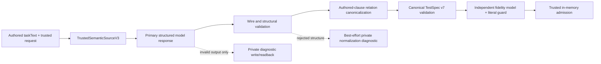

# Lineage 01: instruction to admitted semantic TestSpec v7

**Scope.** This is a source-first review of the production interpretation boundary, ending at the in-memory trusted admission. It does not assess browser grounding, compilation, or replay. [Current architecture](../architecture.md) and [supported capabilities](../supported-capabilities.md) provide orientation; the linked source is authoritative. This review used static inspection and existing offline tests, not a provider call. The example below is illustrative, **not an observed model response or a claim that the public site was visited**.

## Exact production path

[`runAgenticLocalWorkflow`](../../app/local/agentic-workflow.ts) validates the product request, native profile, and exact public-target approval before calling [`runSemanticGeneralLocalWorkflowV1`](../../app/local/semantic-general-workflow.ts). Despite its historical name, this is the sole production route. [`toInterpretationRequest`](../../app/local/product-contracts.ts) combines `taskText` with a newly generated `testSpecId`, selected `executionProfileRef`, and request `targetUrl` as `startState.url`. The instruction text and these trusted fields are separate from model output.

Within this scope, the call sequence is `toInterpretationRequest` → `interpretSemanticIntentWithEvidenceV3` → `interpretSemanticIntentV3` → `models.primary.complete` → primary wire parse → `normalizeSemanticIntentV3` (candidate structural parse → `canonicalizeSemanticRelationsV3` → canonical parse) → `models.reviewer.complete` → reviewer wire parse → `semanticIntentMaterialLiteralMismatchV3` → `admitSemanticIntentV3`. A failed primary-output branch instead writes/reads its restricted diagnostic before returning; a failed normalization branch attempts a private diagnostic in the local workflow.

| Boundary | Input → output and authority | Rejection / persistence |
|---|---|---|
| [`createOpenAISemanticIntentModelsV3`](../../app/interpretation/semantic-intent-v3-adapters.ts), using [`openai-responses.ts`](../../app/interpretation/openai-responses.ts) | Primary prompt and raw authored instruction → one closed structured response. The model proposes step meaning. The provider transport bounds response size and validates its envelope. | Provider refusal, timeout, transport failure, incomplete response, or malformed structured output. No successful primary payload is written by this boundary. |
| [`SemanticIntentPrimaryWireV3Schema`](../../app/interpretation/semantic-intent-v3-wire.ts) | `response.kind` is `extraction`, `unresolved`, or `authored_ambiguity`. Extraction contains 1–100 closed step objects. This checks structure, not fidelity. | Non-extraction is an interpretation unresolved stop. Invalid JSON/wire output is `PROVIDER_OUTPUT_INVALID`; the shared [`interpretSemanticIntentWithEvidenceV3`](../../app/interpretation/semantic-intent-v3-boundary.ts) must persist and authenticate a bounded, payload-free diagnostic before returning that stop. |
| [`normalizeSemanticIntentV3`](../../app/interpretation/semantic-intent-v3.ts) | Trusted source plus extracted steps → TestSpec v7. Code injects version/source fields, checks structural and primitive cross-step rules, canonicalizes relations from authored clauses, and validates the canonical result. No model call. | Unsupported shape/effect, bad dependencies/references/arguments, contradictory relations, or unaccounted repetition stop as `INVALID_SOURCE_REPRESENTATION`. A private normalization diagnostic is attempted best-effort by the local workflow. This is **not** a broad semantic repair stage. |
| [`semanticIntentFidelityProjectionV3`](../../app/interpretation/semantic-intent-v3.ts) and reviewer | Original instruction plus a projection of the **canonicalized** spec → `faithful`/`not_faithful` and up to eight bounded issues. This is the second model call. It sees neither raw primary wire nor browser evidence and cannot edit the spec. | Reviewer transport/format failure or a non-faithful verdict stops. [`semanticIntentMaterialLiteralMismatchV3`](../../app/interpretation/semantic-intent-v3.ts) also rejects certain changed explicit URL, `Option N`, and quoted entered-value literals even if the reviewer says faithful. No ordinary reviewer verdict store is written. |
| [`admitSemanticIntentV3`](../../app/domain/semantic-intent-v3.ts) | Exact trusted-source match, canonical validation, faithful issue-free verdict → top-level-frozen spec, digest/version record, and a process-local `WeakSet`-issued capability. No browser authority is conferred. | Source mismatch, invalid canonical spec, or adverse verdict rejects. Successful admission is passed in memory to grounding; the admitted-v7 persistence store has experiment/test callers, not this ordinary workflow. |

These are **two model calls on the successful path**, using primary and reviewer adapters that can be configured separately but default to the same provider configuration. “Independent” describes the review task and input, not guaranteed independence of model weights, provider, or failure modes. [`interpretSemanticIntentV3`](../../app/interpretation/semantic-intent-v3.ts) maps failures to non-QA interpretation/environment outcomes through the local workflow. The comment in `semantic-intent-v3-adapters.ts` claiming no production workflow imports it is stale: `semantic-general-workflow.ts` imports the adapter directly.

## TestSpec v7 as a semantic contract

The defining schema is [`SemanticIntentTestSpecV3Schema`](../../app/domain/semantic-intent-v3.ts). “V3” in the filename is the **source/intent contract version**; the serialized TestSpec `schemaVersion` is **`7`**. The spec is declarative meaning for later browser grounding, not a locator plan.

| Family | Meaning and origin | Later use / limit |
|---|---|---|
| Trusted source | `testSpecId`, exact `sourceInstruction`, `executionProfileRef`, and `startState.url` come from validated request/trusted composition, not the model. The request's public-target approval is a separate earlier boundary. | Admission checks an exact source match. A navigation URL inside the spec does not grant target approval. |
| Version/provenance | `schemaVersion: '7'`, `sourceContractVersion: '3'`, `semanticMode: 'intent_v2'`, and `normalizationVersion: 'semantic_intent_normalization_v2'` are injected by code. Admission adds source/spec/reviewer digests and version labels. | Contract identity and traceability; these fields do not prove browser feasibility. Historical `qa_deferred_*` labels are provenance, not a live deferred route. |
| Step bookkeeping | Ordered `steps` have bounded `id`, `authoredText`, and nullable `dependsOnStepId` pointing only to a prior step. The model proposes IDs, summaries, and dependency candidates; deterministic validation enforces uniqueness/prior references. | Ordering and dependency structure. `authoredText` is a model summary, not itself a trusted verbatim quote. |
| Navigate | `url` is an absolute approved-format HTTP(S) URL extracted from authored meaning. | Later navigation intent; exact public approval remains separate. |
| Action intent | `target`, `desiredEffect` (`activate`, `choose`, `set_value`, `set_checked`), nullable `value`, nullable `checkedState`, and nullable `authoredMechanic` (`click`, `type`, `press` only when explicitly demanded). The model proposes these; shape/argument rules are deterministic, semantic fidelity is reviewed. | Grounding chooses whether/how the supported effect is possible. “Activate” alone does not select a Playwright click locator. |
| Verification intent | Nullable `subject` for URL checks, otherwise target; `observable` (`exists`, `visible`, `enabled`, `checked`, `selected`, `value`, `url`, `cardinality`), `comparator` (`equals`, `at_least`, `at_most`), and typed `expected`. | Grounding later discovers observable candidates. Validation constrains types/polarity shape, not whether the page satisfies the check. |
| Target identity/relationships | Nullable `category`, `exactName`, `context`, and `ordinal` (1–100) describe author-intended identity. `relation` is `unspecified`, `same_as_step`, `created_by_step`, or `any_matching`; `relatedStepId` links a prior step where applicable. | Model proposes the descriptive fields and relation candidate. Deterministic authored-clause canonicalization **overrides relation and relatedStepId** or rejects contradictory/unowned combinations. It does **not derive or correct** a missing/wrong ordinal, target name, category, context, effect, or polarity; reviewer must catch semantically wrong but schema-valid values. Grounding later proves a target against the page. |

The spec deliberately has **no CSS/XPath/role locator, DOM handle, candidate-domain observation, Playwright operation, browser-current witness, or QA result**. Target `category` is authored language, not a browser-derived role. A `same_as_step` or `created_by_step` relation states intended identity/causality; it is not proof that the browser can establish it. [`parseSemanticIntentTestSpecStructureV3`](../../app/domain/semantic-intent-v3.ts) validates the candidate's primitive references before canonicalization; [`parseSemanticIntentTestSpecV3`](../../app/domain/semantic-intent-v3.ts) checks the final relation/reference/ordinal combination afterward.

## Worked instruction: conceptual admitted shape

The requested Add/Remove Elements instruction can be represented by **eight** ordered semantic steps. This is a schema-compatible teaching example consistent with the [offline repetition fixture](../../tests/semantic-intent-v3.spec.ts); it is not a provider output, browser execution, or assertion that admission occurred for the public URL. The trusted source holds the original full instruction, request start URL, generated ID, and selected profile reference. Each row also has an ID and `authoredText`; dependencies may refer to earlier steps. Here, the dependency chain follows the authored order for illustration.

| Step | Type | Semantic content preserved |
|---|---|---|
| 1 | `navigate` | URL `https://the-internet.herokuapp.com/`. |
| 2 | `action_intent` | `activate`; target category `link`, exact name `Add/Remove Elements`; no ordinal or concrete mechanic. |
| 3 | `verification_intent` | `url` `equals` `https://the-internet.herokuapp.com/add_remove_elements/`; `subject: null`. |
| 4–5 | Two `action_intent` steps | Each has `activate`; target category `button`, exact name `Add Element`; nullable value/checked state/mechanic remain null. The **authored “twice” is expanded into two ordered actions**; one action step with a magic repetition count would not match this schema. |
| 6 | `verification_intent` | `cardinality` `equals` `2` for the `Delete` button domain; no single-element ordinal. |
| 7 | `action_intent` | `activate`; target category `button`, exact name `Delete`, **ordinal `1`**. Relation is canonically `unspecified` here: “first” supplies ordered identity, not `any_matching`. No `.first()`, selector, or DOM index is stored. |
| 8 | `verification_intent` | `cardinality` `equals` `1` for the `Delete` button domain after the activation. |

The authored-clause canonicalizer recognizes action “twice,” requires matching repeated step slots, and clears an odd candidate `any_matching`/`same_as_step` relation where the authored clause does not grant it ([canonicalizer](../../app/interpretation/semantic-intent-v3-relations.ts), [test](../../tests/semantic-intent-v3.spec.ts)). It relies on the primary extraction to supply `ordinal: 1`; the fidelity reviewer checks that “first” was preserved. Grounding later decides whether an ordered `Delete` domain can be proved and whether the first member is actionable. The example URL still requires its own operator approval for an actual run.

## Model authority, deterministic authority, and why review is separate

The primary prompt asks for ordered semantic effects, targets, literal expectations, polarity, authored mechanics, ambiguity, and dependencies; it explicitly forbids invented browser roles, locators, ownership, and ordinals ([prompt](../../app/interpretation/semantic-intent-v3.ts)). The strict [provider JSON Schema and local Zod wire](../../app/interpretation/semantic-intent-v3-wire.ts) enforce bounded types/enums/required fields and a closed unresolved alternative. A schema-valid extraction can still omit a requirement or change meaning. The prompt is instruction, **not enforcement**.

The authority rule is: **authored language → model candidate → deterministic canonical relation/structure → reviewed admitted semantics**. [`canonicalizeSemanticRelationsV3`](../../app/interpretation/semantic-intent-v3-relations.ts) aligns authored clauses with model steps, expands recognized imperative repetitions into source slots, anchors relational phrases to target wording, derives `same_as_step`, `created_by_step`, or `any_matching` from those clauses, and can overwrite a valid but semantically odd candidate relation. A malformed reference may fail structural validation before that override. Clause recognition is bounded lexical logic, not a general language parser; unaligned or contradictory claims stop. This stage can change the model's proposed **relationship meaning** to the meaning it can prove from authored text, but does not generally rewrite actions or targets. Final validation rejects relation/reference conflicts, argument mismatches, invalid predicates, and bad step order.

The reviewer receives `{ originalInstruction, semanticIntent: semanticIntentFidelityProjectionV3(canonicalSpec) }`. The projection includes each step's summary, target intent, effect or observable, expected values, dependencies, and relations, but excludes trusted source/profile and implementation mechanics. It returns only a bounded `faithful`/`not_faithful` verdict and issues; it cannot patch the spec. A negative or malformed review stops before admission. A separate deterministic literal check covers recognized exact URL order, `Option N` choices, and quoted entered values, so a falsely faithful reviewer cannot pass those particular mutations.

**Concrete reason for the second semantic judgment:** a structurally valid spec may invent an exact name, silently change “uncheck” to “click,” lose “disabled”/“absent” polarity, omit a requirement, or paraphrase a contextual phrase as a precise target. These require comparing source meaning with a complete candidate; the current deterministic validators cannot prove all such cases across arbitrary phrasing. Existing [offline negative fixtures](../../tests/semantic-intent-v3.spec.ts) exercise these classes with a mocked reviewer. A separate LLM is a practical guard, **not a logical necessity**: the PoC would still run with one model and deterministic checks, but more schema-valid semantic mistakes could reach grounding. Grounding might reject some, but cannot know the user meant an omitted requirement. Conversely, the reviewer can also falsely accept/reject and adds latency, cost, and a failure mode. Real provider catch rate and disagreement rate were **not measured in this review**.

There is intentional overlap: provider schema and local parsing defend different trust edges; candidate and canonical validation permit relation correction then enforce final consistency; prompt and validator express the same allowed vocabulary at instruction and code levels. The overlap between canonicalization and fidelity is also mostly healthy: canonicalization handles only source-provable relations, whereas review checks broader meaning. Duplicate provider-adapter and interpreter wire parsing protects both production adapter and injected model seams, though its maintenance value should be reassessed if it drifts. Admission repeats canonical validation to ensure the issued capability is not based on an unchecked object. None of these layers proves browser feasibility.

## Admission, diagnostics, and complexity budget

[`admitSemanticIntentV3`](../../app/domain/semantic-intent-v3.ts) requires a canonical valid spec, an exact match to the trusted source, and `faithful` with zero issues. It returns an in-memory capability carrying the spec and digest/version record; [`requireTrustedSemanticIntentAdmissionV3`](../../app/domain/semantic-intent-v3.ts) checks process-local issuance, and [grounding](../../app/exploration/semantic-grounding-v1.ts) refuses an ordinary unissued object. The object is a capability to *attempt grounding*, not an approval to browse a new target, proof of page affordances, or a QA verdict. No browser session has yet begun at this boundary. The ordinary path does not write the admitted spec; [`AdmittedSemanticTestSpecV7Store`](../../app/evidence/admitted-semantic-test-spec-v7-store.ts) supports opt-in reproducibility tools/tests.

**Confirmed integrity limitation; exploitation is not shown.** The issuer freezes the admission, spec, and record **only at their top level**. Nested `steps`/targets remain JavaScript-mutable, while the `WeakSet` check verifies identity but does not recheck `specDigest`. Current production code was not found mutating the admitted object, and request JSON cannot forge the process-local capability; however a future in-process collaborator could change meaning after review. Before adding consumers that share this object, deep-freeze or clone the nested spec at issuance, or verify its digest at use, and add a mutation regression test. This is a small integrity hardening, independent of whether the two-model design is retained.

| Piece | Classification | Evidence and cost/risk |
|---|---|---|
| Primary structured LLM call | `ESSENTIAL_TO_POC` | Turns supported natural language into semantic candidate steps. One provider dependency and latency. |
| Closed wire schema | `ESSENTIAL_TO_POC` | Bounds vocabulary, shape, unresolved outcome, and output size before trust. It cannot guarantee meaning. |
| Structural normalization and canonical validation | `ESSENTIAL_TO_POC` | Injects trusted source/version, rejects malformed dependencies/arguments, and validates the final semantic object. |
| Authored-relation canonicalization | `USEFUL_GUARDRAIL` | Prevents model relation enums from becoming authority. Its lexical clause/slot logic is complex and language-bounded; review changes only against concrete failure data. |
| Independent fidelity LLM | `USEFUL_GUARDRAIL` | Catches schema-valid semantic drift outside deterministic recognition. Adds a full provider call, latency, and potential false judgment. |
| In-memory admission capability and digests | `USEFUL_GUARDRAIL` | Prevents unreviewed specs entering grounding and binds source/provenance. Versions remain useful contract identity; historical provenance labels add naming burden. |
| Deterministic literal guard | `USEFUL_GUARDRAIL` | Catches specific wrong URLs/values despite a falsely faithful review; intentionally incomplete for arbitrary language. |
| Primary invalid-output diagnostic store/readback | `POTENTIALLY_OVERENGINEERED` | Useful restricted, authenticated, bounded failure facts with no model text; however, **awaited write and readback can turn an otherwise malformed-output interpretation stop into `ENVIRONMENT_FAILED`** when storage fails. This is a deliberate operational dependency, not QA authority. |
| Normalization diagnostic store | `REPRODUCIBILITY_OR_DIAGNOSTIC` | Writes closed phase/predicate/step/family only on `INVALID_SOURCE_REPRESENTATION`; best-effort failure does not change the public interpretation terminal. |
| Admitted-v7 store | `REPRODUCIBILITY_OR_DIAGNOSTIC` | Experiment/test readback, absent from ordinary successful interpretation. |

The diagnostic behavior above follows the [shared boundary](../../app/interpretation/semantic-intent-v3-boundary.ts), [local terminal mapping](../../app/local/semantic-general-workflow.ts), and the two [private](../../app/evidence/semantic-primary-output-diagnostics-v1.ts) [stores](../../app/evidence/semantic-interpretation-diagnostics-v1.ts). It is the clearest **potentially overengineered** area for the ordinary demo: the primary diagnostic write/readback is mandatory even though it does not contribute to semantic admission or QA. Its value is reliable private evidence on malformed completed output; its cost is an additional environment failure mode. This is an operational-policy tradeoff, not evidence that the second model or canonicalizer can safely be removed.

## Supported wording and alternative boundaries

At this layer, “arbitrary” means flexible phrasing of the closed navigation, action-effect, target, and verification vocabulary in [the current capability guide](../supported-capabilities.md). A request for a custom widget selection, drag/drop, multi-frame interaction, or arbitrary keyboard sequence cannot be made executable merely by assigning a familiar `desiredEffect`; unsupported meaning should become `unresolved`/`authored_ambiguity` or a non-QA interpretation stop, and browser-specific inability may stop at grounding. The schema does not itself detect every unsupported phrasing, so the primary prompt and fidelity review matter. The interpretation layer should not invent a narrower instruction to make it fit.

| Design | Simplicity | Faithfulness / model-error risk | Grounding burden and demo fit |
|---|---|---|---|
| **A. Current:** primary → structural/canonical validation → reviewer → admission | Highest cost, two model calls and lexical relation logic. | Strongest current separation: relational candidates cannot independently become authority, broad semantic drift gets a second check. Reviewer error remains possible. | Grounding receives a comparatively explicit semantic contract; good for an auditable deterministic story. |
| **B. One model:** primary → deterministic validation → admission | Lower latency/provider cost and fewer stops. | Schema-valid omissions, changed polarity/context, and invented precise targets have no independent semantic check beyond recognized literals. | Grounding cannot recover missing author meaning; viable for a narrower curated demo only after measuring the regression risk. |
| **C. Thinner task:** primary emits less identity/relationship detail; grounding resolves more | Simpler interpretation schema, but moves decisions across an authority boundary. | Preserves less explicit authored meaning unless the browser layer gains a source-aware proof. Risk that page affordances substitute for user intent. | Much larger grounding burden and weaker “model understands before browser” story; requires a deliberate redesign, not a local simplification. |

## Recommendation: `SIMPLIFY_LATER`

**Keep TestSpec v7, canonical relation authority, fidelity review, and admission for the next feature.** They align with the intended story: an LLM expresses supported meaning, the browser later proves mechanics, and untrusted model output cannot directly become replay instructions. The main obscure point is that eight semantic steps and two model calls precede browser interaction; the UI/demo explanation should show this as a *meaning contract*, not generated automation. Prioritize the narrow admission-mutation hardening above before adding another in-process consumer; it does not require a boundary redesign.

The smallest high-value simplification candidate is **the mandatory primary-output diagnostic persistence/readback policy**, not the TestSpec vocabulary: decide whether malformed completed output may return the existing interpretation failure when its private diagnostic store is unavailable. If policy permits best-effort diagnostics, that would remove a storage dependency from an already failed request while preserving semantic admission and QA authority. The tradeoff is loss of guaranteed forensic evidence for that failure. Make this decision with failure-rate/operational evidence; do not change it as a naming cleanup. Separately correct the stale adapter comment when code edits are next in scope.

**Validation and residual risk.** Static call/import inspection checked the normal source path, source schema, canonicalizer, reviewer input, admission issuer, persistence edges, and focused offline tests for repetition, relation override, fidelity mutations, literal mismatch, and diagnostic write failure. No provider or browser was run. The unmeasured risks are real-provider reviewer false acceptance/rejection, latency/cost, and the lexical canonicalizer's coverage beyond its tested English phrasing. Before changing the boundary, use bounded provider-free adversarial fixtures for one normal accepted case, one schema-valid wrong-meaning case, and one admission/diagnostic failure edge; provider behavior would still require separately authorized live validation.
