# Semantic grounding v1: production lineage review

## Scope and finding

This review follows the current production path from an **issued, trusted TestSpec v7 admission** through one protected grounding browser session to issuance of `semantic_grounded_trace_v1`. It stops before compiler v5. The [README](../../README.md), [architecture](../architecture.md), and [supported capabilities](../supported-capabilities.md) describe the active route; the source links below control where wording differs. This is a source review, not evidence from a provider, public site, or stability run.

**Finding:** the LLM interprets the instruction *before* TestSpec admission. No LLM receives page snapshots or chooses browser actions during grounding. Of the proposed descriptions, the current implementation is **B. Deterministic semantic grounding**, neither A (agentic browser exploration) nor C (a hybrid with a model deciding live-page ambiguities). Grounding is a bounded semantic resolver that reads the page, proves a target and supported operation, executes it, and observes the result. The product story is accurate only if “AI interacts with the webpage to figure out how” means that the system acts on AI-authored semantic intent. It is inaccurate if it means an AI agent explores the live page and decides what to try.

## Exact call path and authority

The product entry [runSemanticGeneralLocalWorkflowV1](../../app/local/semantic-general-workflow.ts) obtains `interpreted.admission` after interpretation and then opens [McpExplorationSession.open](../../app/exploration/mcp.ts) using the admitted profile reference and expected effective profile. `McpExplorationSession.open` calls [ProtectedContextFactory.open](../../app/profile/local-context.ts), binds an in-memory Playwright-MCP connection to that **same** protected context, checks tool inventory, and owns cleanup. The workflow constructs [SemanticGroundingSessionV1](../../app/exploration/semantic-grounding-v1.ts) with the admission and attempt ID. Its constructor calls `requireTrustedSemanticIntentAdmissionV3` and checks the profile reference. The admission issuer is [admitSemanticIntentV3](../../app/domain/semantic-intent-v3.ts); an ordinary serialized spec is insufficient.

```mermaid
flowchart LR
  A[Issued TestSpec v7 admission] --> B[McpExplorationSession.open]
  B --> C[Protected native Chromium context]
  C --> D[Authored navigate steps via MCP browser_navigate]
  D --> E[Grounding capture: complete ordered candidate domain]
  E --> F[Select target and prove supported mechanic]
  F --> G[Fresh domain check and Playwright action on element handle]
  G --> H[Receipt, effect read, and later verification observations]
  H --> I[issueSemanticGroundedTraceV1]
```

| Stage and current function | Input → output | Decision and browser operation | Main stop categories |
|---|---|---|---|
| Session: `McpExplorationSession.open`; `SemanticGroundingSessionV1` constructor | Trusted admission, effective profile, attempt → protected context and grounder | Deterministic setup; MCP server/client attached to the protected Playwright context | Invalid admission/profile, launch/context/MCP failure, cleanup failure |
| Navigate: workflow step loop → `session.navigate` | Admitted absolute URL → observed page URL record | Deterministic authored URL; calls MCP `browser_navigate`; response tracking is passive | Invalid URL/scheme, navigation/HTTP/browser failure |
| Discover: `#ready`, `#capture`, `#captureOnce` | Authored target or null → fresh `Captured` domain, raw facts, live handles | Deterministic DOM and Playwright role/name reads; one main-frame page, readiness wait, mutation-guarded scan | No owned page, frame/result limit, unsupported frame, stale scan, browser read failure |
| Bind: `#chooseIndex`, `#evidence` | Complete domain + target semantics → selected index and domain/ordinal/relation proof | Deterministic; no mutation; no candidate selected on insufficient meaning | Empty/ambiguous domain, missing relation, ordinal out of bounds |
| Mechanic: `groundAction` | Selected candidate + action intent → sealed action witness | Deterministic capability tests and second capture; no action yet | Unsupported control, option ambiguity, explicit mechanic mismatch, stale evidence |
| Execute: `executeGroundedAction` | Issued unconsumed witness → sealed receipt | Re-captures domain, checks a connected **element handle**, invokes Playwright `click`, `check`, `uncheck`, `selectOption`, or `fill`, and re-reads state | Expired/stale witness, dispatch/browser failure, effect unproven |
| Verify: `#observe`, `groundVerification` | Verification intent → sealed observation witness | Deterministic browser reads; may wait for a same-document mutation under an authored dependency | Unresolved/ambiguous subject, unsupported property, stale read, browser failure; false assertion is an observation |
| Issue: `issueSemanticGroundedTraceV1` | Admission + ordered navigation/action/verification records → in-memory issued trace | Deterministic schema, digest, step/lineage checks; no browser call | Invalid trace/record linkage |

The workflow executes admitted steps **in order** and calls the trace issuer only after every step has produced its record. It then closes the exploration session; trace issuance is not a QA result. The trace schema and issuer are in [semantic-resolved-v10.ts](../../app/domain/semantic-resolved-v10.ts). The profile and protected context are in [native-profile.ts](../../app/profile/native-profile.ts) and [local-context.ts](../../app/profile/local-context.ts). Public-target approval happened before this boundary; it is not decided by the grounder.

## Candidate-domain construction and target binding

`#captureOnce` requires one owned page and exactly one frame. It scans `a,button,input,select,textarea,[role]` in document order, up to 100 nodes/candidates. It derives tag, input type, an initial role/name hint, parent text, path through ancestor child indexes, visibility, enabled/editable/checked/value facts, and native select options. It then checks eligible roles and any **exact accessible name** through Playwright `getByRole(..., { includeHidden: true })`; the DOM hint alone does not grant membership. The target category maps through a small alias table (`dropdown` to combobox/listbox, `input` to textbox/searchbox, and so on). Context is either a normalized self-category match or a literal substring of the immediate parent's text. This is a narrow context proof, not general container reasoning. A candidate's identity is a digest of frame index/URL, DOM path, role, name, tag, and input type. Its `domainIndex` is its position in the filtered, ordered domain. Visibility and enabled state are recorded; they are required for actions, but hidden controls can still belong to a counted domain. [Grounder capture](../../app/exploration/semantic-grounding-v1.ts); [candidate schema](../../app/domain/semantic-grounding-v1.ts).

The *complete* domain is needed to prove meaning, not merely find a convenient control. One `Add Element` button yields a one-candidate action domain. Two identically named `Delete` buttons yield a two-candidate domain: an unqualified action cannot silently click the first. “First checkbox” proves authored ordinal 1 against the whole ordered checkbox domain and selects index 0. Cardinality/existence verifications consume the whole domain, including a zero-candidate domain, so “exactly two Delete buttons” is a count over all matches rather than a check of one locator.

`#chooseIndex` applies the admitted target semantics: a non-null ordinal wins and becomes zero-based `ordinal - 1`; `same_as_step` requires the selected identity from an earlier performed action to remain in the current domain; `created_by_step` compares the current domain with the complete pre-action identity set and requires exactly one new identity. A category/name/context can itself narrow the domain to one. With no ordinal or relation, a nonempty domain must contain exactly one candidate. `any_matching` does **not** authorize arbitrary first-match action selection; it still needs a unique selected action target. Count/existence observations do not need a selected index. An absent candidate stops `UNRESOLVED_TARGET` for selected actions/properties; two unqualified matches stop `AMBIGUOUS_TARGET`; an excessive ordinal stops `ORDINAL_OUT_OF_BOUNDS`; missing, nonunique, or disappeared relationship targets stop unresolved/ambiguous. These are non-QA `EXPLORATION_UNRESOLVED` terminals in the workflow (with a redacted public reason). The target relation and ordinal originate in [TestSpec v7](../../app/domain/semantic-intent-v3.ts), not in page inference.

## Mechanic selection and action execution

`groundAction` first requires the selected candidate to be visible and enabled. It considers one code-defined mechanic for each semantic desired effect, not a model-chosen menu of possible operations:

| Semantic effect | Proof required | Selected Playwright mechanic |
|---|---|---|
| `activate` | Role is button, link, checkbox, radio, menuitem, tab, or switch | `ElementHandle.click` |
| `set_checked(true/false)` | Native `input` checkbox/radio with known checked state; radio false is rejected | `ElementHandle.check` / `uncheck` |
| `choose` | Native single `select`; exactly one enabled option has the authored label, and its value is unique in that select | `ElementHandle.selectOption(value)`; records owned option proof |
| `set_value` | Editable candidate with readable value | `ElementHandle.fill(value)` |

If TestSpec carries an explicit authored `click`, `type`, or `press` mechanic, it must equal the proved mechanic. There is no free-form `type`/`press` implementation; incompatibility stops `EXPLICIT_MECHANIC_MISMATCH`. A custom dropdown may appear as a combobox/listbox candidate, but `choose` rejects it because `nativeSelect` is false. Native multi-select, frames, keyboard sequences, and arbitrary widgets are likewise outside this operation set. `UNSUPPORTED_CAPABILITY` is an implementation/vocabulary limit, not proof that the website is faulty.

Grounding **executes** actions so later steps see the authored page state: a first Add creates the Delete domain that a later step must count or click. Execution also proves that the selected handle accepted the operation. Before dispatch it checks issued/unconsumed witness identity, a ten-second expiry, session revision, the complete re-captured domain, URL, just-before domain/revision, and handle connectivity. It records a pre-action digest of the whole scanned control state, a `created_by_step` baseline, and an action receipt with command return, before/after URL and state digests, mechanic, timestamp, and resulting state. For `check`, `uncheck`, `fill`, and native selection, re-observation must prove the requested final property or it stops `EFFECT_UNPROVEN`. A click receipt says only `delivery_only`: clicking a link/button does not itself prove a desired downstream assertion. Pure observation would lose causal step ordering, newly created targets, action-delivery evidence, and the ability to compare resulting state against the semantic instruction. It could propose a mechanic, but not establish that the proposed sequence actually works on this page.

## Verification grounding and QA boundary

`#observe` maps URL to current page URL; existence and cardinality to a complete candidate count (existence is `count > 0`); visible/enabled/checked to a selected candidate's boolean property; value to its current value; and selected option to one native select that owns exactly one option with the authored label. An earlier `choose` can provide same-target ownership and option value. It computes `expectedSatisfied` for `equals`, `at_least`, or `at_most`, but still records a false observation. `groundVerification` may wait up to the trusted profile's default/action wait ceiling **only** when the first observation is unsatisfied, settling is enabled, and the verification depends on a prior step. It waits for an actual same-document mutation, then re-observes; it finishes with another consistency read. No wait invents a passing assertion.

The distinctions are: **browser observation** is what this grounding session saw; **assertion truth** is the computed comparison with authored `expected`; **QA authority** belongs to completed later deterministic replay runs and their agreement. A grounded trace can contain `expectedSatisfied: false`; that is not `QA_ASSERTION_FAILED`. Browser/environment and grounding stops also remain non-QA. [Verification implementation](../../app/exploration/semantic-grounding-v1.ts); [trace witness schema](../../app/domain/semantic-grounding-v1.ts).

## Mutation, freshness, and currentness

The scan uses a temporary `MutationObserver` on the document. Any child, attribute, or text mutation during the scan invalidates **all** role/name membership and indexes; `#capture` retries a full scan within the trusted wait window. It checks that candidate handles still correspond to the scanned DOM indexes, then verifies page, URL, frame set, and MCP grounding revision. The revision changes around MCP calls, so an interleaved MCP operation cannot be mistaken for the same grounding state. The grounder serializes reads/actions through `withExclusiveGrounding`.

An action witness is valid only while its 10-second wall-clock `expiresAt` has not passed and its session revision matches. The grounder re-captures and compares the ordered identities and relevant candidate state before execution. It dispatches on the **captured handle**, never a locator that might follow a replacement node into the old index; a disconnected handle causes a stale stop. `same_as_step`/`created_by_step` rebind via current identity sets. Same-document asynchronous changes after an action are handled through the bounded verification wait above. Tests in [semantic-grounding-v1.spec.ts](../../tests/semantic-grounding-v1.spec.ts) cover mutation during capture, index shifts, replacement targets, ordinal drift, asynchronous resulting state, and continuously changing pages.

These mechanisms address a real general browser race: pages mutate between discovery and click, and an ordinal can change meaning. The complete re-scan, handle connectivity, and pre-dispatch check are essential correctness safeguards. The repeated generation checks, full-state digests, wall-clock expiry, and extensive diagnostics also reflect a strong reproducibility/provenance design; their exact richness is not intrinsically required to show a small PoC. The source does not establish that they arose *primarily* from public-site timing. **Mutation currentness** asks whether page/domain facts still describe the DOM at use; **time freshness** puts an age ceiling on a witness even without an observed mutation. The latter also prepares compiler provenance; a timestamp alone never proves the page unchanged.

## `semantic_grounded_trace_v1` contract

The trace is an issued in-memory capability, sealed by [issueSemanticGroundedTraceV1](../../app/domain/semantic-resolved-v10.ts) after validation against the admission. In the ordinary workflow it is passed directly onward; the separate admitted-v7/trace-v1 stores are experiment-only and are not ordinary product persistence. The trace is **historical semantic evidence**, not a live locator or runnable test. It must have one ordered record per admitted step and match its admitted spec digest, step data, dependencies, profile fingerprint, session, and attempt. A navigation record contains the authored step and observed URL. An action record contains the sealed witness and receipt. A verification record contains the sealed observation witness.

| Trace information family | Historical evidence retained | Why the later compiler needs it |
|---|---|---|
| Semantic identity/lineage | Authored step, `testSpecId`, admission/spec digest, step/dependency IDs, trace digest | Prevent substitution or reordered semantic intent |
| Candidate domain | Target, complete ordered candidates, role/name/context proof, DOM paths, identity digests, state/capability facts, selected index | Reconstruct and compare target meaning in a **fresh** session |
| Disambiguation | Authored ordinal with full-domain count/index; `same_as_step` or `created_by_step` selected identity | Reprove order and relationship rather than use an arbitrary match |
| Mechanic | Proved operation, argument, prior/requested checked state, uniquely owned native option mapping | Compile only an operation supported by browser evidence |
| Action receipt | Witness digest, command returned, mechanic, before/after URLs and state digests, click delivery or proven non-click state, execution time | Establish that the historical sequence was executed and linked to its witness |
| Verification | Observation family/property, observed value/count, computed `expectedSatisfied`, `settled` | Compare observed meaning with a fresh observation; preserve false facts without issuing QA |
| Profile/source/freshness | Attempt/session/profile fingerprint; evidence URL, `observedAt`, `expiresAt`, MCP revision, dependent receipt digest | Check provenance, dependency and point-of-use freshness in compiler work |

Runtime-only state does **not** survive: live `Page`, `Frame`, `ElementHandle`, mutation observer/generation closure, MCP client/server/transport, tool-call list, grounding lock, `#before` and `#performed` maps, and the protected browser context. The trace records digests of pre/post control state, not live state itself. No private model/MCP payload is needed in a stakeholder-safe description. The production trace digest is the trace contract's seal; it must not be confused with an experiment-only canonical grounding digest.

## MCP's actual role

`McpExplorationSession` provides a protected session owner, in-memory MCP transport, bounded tool inventory/calls, navigation and cleanup, plus a grounding revision/lock. In the production grounding loop, the workflow calls its `browser_navigate` wrapper for authored navigation. Candidate extraction and the five action mechanics are performed by **direct Playwright** `Frame`, locator, and `ElementHandle` APIs through `session.browserSession.context`. The MCP wrappers for snapshot, find, locator generation, click, fill, select, and wait exist, but this grounding path does not use them. No MCP tool reasons about the page; no snapshot/ref is consumed to choose a target. Direct Playwright could technically supply the information and operations currently used here, and already supplies most of them.

MCP is therefore an inherited integration/session boundary more than the source of exploration intelligence. It still brings a stable tool interface for possible future model-guided exploration, a controlled in-memory connection to the protected context, explicit capability checks, navigation behavior, and operational accounting. Replacing it is plausible only after preserving those useful contracts and checking navigation/cleanup behavior; deleting it solely because current grounding uses direct Playwright would obscure those dependencies.

## Worked repeated-control example

Assume the quoted instruction has already become faithful admitted v7 steps, with exact authored names/URL and an ordinal of **1** for the last Delete action. This is a conceptual path, not a claim that a live public site was contacted; no private IDs are assumed.

1. `browser_navigate` loads `https://the-internet.herokuapp.com/`. The next target scan finds the complete `link` domain with exact accessible name `Add/Remove Elements`; if it contains one eligible candidate, `groundAction` proves `activate → click`.
2. `executeGroundedAction` rechecks that link's domain and handle, clicks it, and records a delivery-only receipt and before/after URL/state digests.
3. URL verification observes `https://the-internet.herokuapp.com/add_remove_elements/` and records comparison truth, without issuing QA.
4. The first `Add Element` scan finds a unique button. Grounding proves click, executes it, and records the receipt. The page now has one Delete button.
5. The second `Add Element` step scans again in the changed page, proves the still-unique Add button, clicks it, and records a second receipt. The page now has two Delete buttons.
6. “Exactly two Delete buttons” scans the **complete** named button domain and records count 2; it does not select a Delete button.
7. “First Delete button” scans the current ordered two-candidate domain, proves authored ordinal 1 against count 2, and records selected index 0 and ordered identities.
8. The grounder rechecks that domain, clicks the selected live handle, and records the click receipt. It does not infer success from click delivery alone.
9. “Exactly one Delete button” performs a new complete-domain scan and records count 1. If an asynchronous change has not arrived, its authored dependency can allow bounded mutation-triggered re-observation.
10. `issueSemanticGroundedTraceV1` validates all ordered records and issues the trace after the last observation. This example succeeds only if the actual browser facts and admitted semantics support every step.

## Failure taxonomy

| Stop or observation | Meaning for a PoC observer | Public outcome at this boundary |
|---|---|---|
| No candidate, unqualified multiple candidates, absent/nonunique relationship, ordinal beyond current domain | Authored identity cannot be proved on this page; may reflect instruction ambiguity or changed page | `EXPLORATION_UNRESOLVED` |
| Native capability absent, custom select/multi-select/frame, noneditable or disabled action target, explicit mechanic mismatch | Supported instruction/operation vocabulary or this implementation cannot perform the requested mechanic | `EXPLORATION_UNSUPPORTED` for explicit unsupported/mismatch; other unproved effects can be unresolved |
| Scan invalidated repeatedly, stale witness/domain/index/handle, action effect not proven, result bound exceeded | Current browser evidence cannot safely support the next step; often page timing or implementation bounds, not a QA assertion | Generally `EXPLORATION_UNRESOLVED` |
| Launch/context/page/readiness/navigation/MCP failure, browser disconnect, failed dispatch/read or cleanup | Website/browser/environment or operation failed; root HTTP failures are separately diagnosed | `ENVIRONMENT_FAILED` or non-QA workflow stop |
| Verification observes the opposite of authored expected value | A browser fact and false comparison, not a grounding exception | Trace can still issue; no QA pass/fail here |

The private [exploration diagnostics](../../app/domain/semantic-exploration-diagnostics-v1.ts) records bounded milestones, failure boundary, sanitized browser state, and optional viewer activity. It does not select a mechanic or issue QA. Some public classifications deliberately redact the precise grounding reason; the conceptual categories above are more informative than the stakeholder result alone. The workflow's exact terminal mapping is in [semantic-general-workflow.ts](../../app/local/semantic-general-workflow.ts).

## Complexity accounting

These labels describe the mechanism's main contribution; a mechanism can serve a second purpose.

| Mechanism | Classification | Reason |
|---|---|---|
| Protected browser session | `ESSENTIAL_TO_POC` | Real page interaction needs an owned disposable browser with trusted profile and cleanup. |
| MCP abstraction | `POTENTIALLY_OVERENGINEERED` | Current target/action work already uses Playwright directly; MCP still owns navigation, tool boundary, and future extension potential. |
| Complete candidate domains | `ESSENTIAL_TO_POC` | Required to distinguish unique/ambiguous targets and prove counts. |
| Ordered candidate identity | `ESSENTIAL_TO_POC` | Gives “first” a reproducible meaning and prevents silent retargeting. The exact path/digest design is more debatable. |
| Ordinal proof | `ESSENTIAL_TO_POC` | Ties authored position to the current full domain. |
| Relationship proofs | `USEFUL_GUARDRAIL` | Same-target and created-by semantics expand expressiveness safely; simple demos could omit them. |
| Action receipts | `ESSENTIAL_TO_POC` | Show the grounding path actually ran, with click delivery distinguished from proven state. Rich digests also support compiler. |
| Mutation generations and final recheck | `ESSENTIAL_TO_POC` | Prevent stale scans and wrong-node dispatch on changing pages. |
| Ten-second freshness timer and revision | `COMPILER_SUPPORT` | Revision protects against session interleaving; clock expiry helps point-of-use provenance but is weaker than a DOM recheck. |
| Bounded resulting-state waits | `USEFUL_GUARDRAIL` | Allows ordinary asynchronous page effects without treating a timer as proof. |
| Rich trace evidence and hashes | `COMPILER_SUPPORT` | Enables fresh-session correspondence and authenticated step/receipt lineage; more than the minimum demo needs. |
| Exploration diagnostics/viewer milestones | `REPRODUCIBILITY_OR_DIAGNOSTIC` | Explain non-QA stops and presentation failures without changing grounding decisions. |

## Architecture alternatives and generality

| Architecture | Generality and unknown widgets | Determinism / explainability | Complexity, demo value, QA safety |
|---|---|---|---|
| **A. Current deterministic grounding**: semantic spec → candidate domain → capability proof → action | Strong for a closed vocabulary; cannot improvise custom dropdowns, frames, arbitrary keyboard sequences, or unfamiliar widgets | High; ambiguity and capability stops are specific and inspectable | Considerable proof/freshness code; convincing repeatability demo, less convincing “AI explores” demo. Non-QA stops protect QA authority. |
| **B. LLM-guided exploration**: model sees snapshots and chooses iterative actions/locators | Potentially wider, including unknown controls, if the model can observe and recover | Lower unless every proposed action is validated; failures and path choice can vary | Strong agentic demo value, but provider cost, prompt/injection surface, recovery design, and replay validation become substantial. A model claim alone cannot be QA evidence. |
| **C. Hybrid**: deterministic extraction; model proposes a resolution/mechanic only on ambiguity | Potentially improves cases the closed vocabulary rejects, especially custom widgets | Intermediate if proposals still pass explicit browser capability, identity, and effect checks | More moving parts than A, less open-ended than B. Retains deterministic later replay only when the chosen sequence can be represented and revalidated. |

Allowing model-controlled exploration **above** deterministic compilation could materially improve demonstration of broad natural-language/browser adaptation. Deterministic replay can remain intact if an exploration proposal is converted into a bounded, explicit operation contract, tested in the protected browser, and independently re-grounded before replay. Today's compiler/runner vocabulary still excludes custom dropdown flows, frames, and arbitrary keyboard operations, so adding a model alone would not make those actions reproducible. The closed mechanic vocabulary currently limits the PoC's claim to *supported* wording and controls; it is a deliberate safety boundary, not general webpage understanding.

## Simplification opportunities and recommendation

| Opportunity (ranked) | Complexity removed | Behavioral risk | Effect on demo generality |
|---|---|---|---|
| **1. Make the product description and a compact operation/candidate contract explicit before adding a new control family** | Low code change now; avoids extending redundant evidence shapes later | Low | Clarifies current limits; creates a precise place for a later hybrid proposal |
| **2. Consolidate repeated candidate-domain/ordinal/relation proof fields where the compiler can derive them from one ordered domain** | Medium | Medium: trace/compiler compatibility and auditability | Neutral; mainly reduces provenance duplication |
| **3. Keep DOM revalidation but reassess fixed witness expiry and redundant full-state digests** | Medium | Medium: stale-dispatch/provenance behavior needs focused review | Neutral, possibly improves slow-page tolerance |
| **4. Replace MCP session plumbing with a smaller protected Playwright adapter** | Medium | Medium/high: navigation, cleanup, tool telemetry, and future model entry point change | Neutral now; may make later agentic exploration harder |
| **5. Separate an optional model exploration demo path from deterministic QA grounding** | High net added architecture initially, not immediate simplification | High | High potential, but requires new bounded operation/verification contracts |

**Recommendation: `SIMPLIFY_BEFORE_NEXT_FEATURE`.** Keep complete domains, action execution, final target rechecks, and non-QA stops. Before expanding browser mechanics, reduce duplicated proof/provenance fields between grounding and compiler, starting with a **single ordered candidate-domain representation from which ordinal count/index and selected identity can be derived**. That is the smallest high-value code simplification to investigate; this review does not implement it. Preserve explicit relation/option evidence where it cannot be derived. The current route can serve a supported-vocabulary PoC if its claim is stated accurately. If the product requires the **LLM itself** to explore unknown page mechanics, that is a different requirement: a bounded hybrid layer and expanded deterministic operation contract would be needed, and `REDESIGN_GROUNDING` would then be the appropriate decision. Defer replacing MCP until its navigation, cleanup, telemetry, and possible future model entry-point benefits are evaluated.

The technically accurate product wording today is: **“An LLM converts supported natural-language instructions into an admitted semantic TestSpec. Deterministic grounding then inspects the live page, proves a supported target and operation, executes each action, and records evidence for fresh deterministic compilation and replay.”** The broader statement that “the LLM explores the page to understand how to perform the instruction” is not accurate for grounding v1.

LINEAGE_02_SEMANTIC_GROUNDING_V1_REVIEW_COMPLETE
