# System reality audit

Scope: the implemented local browser QA paths, with emphasis on the current `structured-action-v1` candidate. This is a contract, code, test, and recorded-evidence audit. No provider or credentialed browser workflow was run. The four focused reports supply the detailed inventory: [interpretation](audit/interpretation-reality.md), [exploration](audit/exploration-reality.md), [deterministic boundary](audit/deterministic-boundary-reality.md), and [capability evidence](audit/capability-evidence.md).

**Status matters.** `agentic-exploration-v1` is the released, live-proven local baseline (TestSpec v2/v3, trace v2, compiler v1, resolved v6). `goal-directed-v1` is a separate offline-covered v4/v3/v7 route. `structured-action-v1` is wired through production as a v5/v4/compiler-v3/v8 route and has completed its independent offline gate, but has **no completed approved-public-target real-provider proof**. The trusted environment selects the route before launch; task prose cannot select it. Legacy v1 external contracts remain separate from agentic v2. [Current status](current-status.md), [workflow selection](../app/local/agentic-workflow.ts), [CLI selection](../app/subprocess/agentic-cli.ts).

## 1. End-to-end actual flow

```mermaid
flowchart LR
    U[User request] --> I[LLM interpretation]
    I --> V[Deterministic TestSpec validation]
    V --> M[LLM M7 action and verification decisions]
    M <--> B[Trusted protected browser and observations]
    B --> T[Immutable successful trace]
    T --> C[Deterministic fresh compiler]
    C --> R[Accepted resolved artifact]
    R --> P[Deterministic fresh replay x2]
    P --> Q[ResultRecordV2 and safe QA projection]
```

| Boundary | Model decision | Trusted or deterministic decision, required information, and rejection |
|---|---|---|
| Request → interpretation | Segment authored clauses; choose navigation, click, fill, select, or verification; assign action target and value; preserve verification meaning. | Trusted workflow selection fixes adapter and TestSpec version. Interpretation has no browser state. The provider returns a strict envelope or ambiguity/unsupported. [Interpretation report](audit/interpretation-reality.md). |
| Interpretation → TestSpec | In v5, give each authored action one exact accessible name, explicit or unspecified role, optional authored scope, source provenance, and a separate fill/select argument. Verification can retain prose with optional subject/intent hints. | Wire parsing, schema and fidelity checks reject ungrounded names, role/scope, operation contradictions, negation, unsupported forms, or invalid navigation. Rejection occurs before browsing and is never a QA failure. [Target intent](../app/domain/action-target-intent.ts), [TestSpec](../app/domain/schema.ts). |
| TestSpec → M7 | Choose snapshot inspection/find, a current ref and approved action, bounded prerequisites, recovery, and verification observation/comparison strategy. | Runtime supplies the fixed value, checks current ref, role/name/scope/frame, uniqueness, actionability and protected state. A v5 authored action must match its already interpreted identity. Unsupported/unresolved exploration stops without a verdict. [Exploration report](audit/exploration-reality.md). |
| M7 → trace | Choose a successful path and conclude a supported strategy from cited observations. | Trusted runtime owns action witnesses, full counts/properties/URL, epochs and freshness. Trace validation accepts only ordered successful facts corresponding to authored steps; failed branches stay private. A model conclusion is not QA truth. [Trace contract](../app/domain/agentic-trace-v3.ts). |
| Trace → compiler → resolved artifact | No model choice. | A separate protected session reconstructs each action, frame, scope, prerequisite and verification strategy. It requires one fresh corresponding target and a closed replay predicate. Rejection yields a typed compiler attempt and **no** accepted v8. [Compiler](../app/exploration/trace-compiler-v4.ts), [v8 contract](../app/domain/structured-action-compiler.ts). |
| Artifact → replay → QA | No model or MCP repair. | Two independent fresh runs execute only an accepted, provenance-checked artifact. Two agreeing completed assertion outcomes produce QA pass/fail; binding, compilation, environment, budget, cancellation, and replay uncertainty remain non-QA outcomes. Node owns ResultRecordV2 and safe projection; Python validates the closed v2 contract for Streamlit. [Runner](../app/runner/run.ts), [current status](current-status.md). |

Public-browser admission and isolation are trusted controls around browser creation and every protected session. Task or page text cannot grant approval, network authority, credentials, or a QA verdict. [System overview](system-overview.md).

## 2. Where intelligence currently lives

Interpretation genuinely reasons over clause boundaries, action/verification meaning, paraphrase, and whether to return ambiguity. For VerificationGoals it can preserve natural language rather than choose a replay assertion. M7 genuinely chooses a current snapshot ref, limited prerequisites/retries, and a composition of reviewed count, property, URL and comparison observations. These are bounded reasoning decisions, not arbitrary browser programming. [Interpretation](audit/interpretation-reality.md), [exploration](audit/exploration-reality.md).

The finite action verbs, role eligibility, exact target name requirement, operation argument, scope grammar, native-select rule, prerequisite label rule, observation types and comparisons come from schemas or runtime policy. Runtime computes identity, uniqueness, state, counts and properties. The compiler decides whether a path is reproducible; the runner decides the assertion result. More model reasoning cannot override a contract that lacks a representation. Offline fixture success proves these mechanisms under supplied structures and scripted decisions; it does not prove a live model will produce those structures. [Capability evidence](audit/capability-evidence.md).

## 3. Closed vocabularies and bottlenecks

| Vocabulary | Current boundary | Assessment |
|---|---|---|
| Workflow/version and public admission | Trusted selection of distinct baseline, goal-directed and structured routes; approved URL/profile/network isolation. | **Necessary safety boundary.** No task-text switch or silent fallback. |
| Authored action types | v5: navigate, click, fill, `select_option`, VerificationGoal. M7 may perform only reviewed actions. | **Reasonable MVP limitation** and **necessary safety boundary** for executable operations. |
| Action target identity | One exact, nonempty authored accessible name; eligible explicit or unspecified role; optional bounded named scope/frame with source spans. | **Accidental overconstraint** as a pre-exploration requirement. It excludes unnamed, role-only, and context-only controls even if current-state uniqueness could be proved. Source provenance itself is a necessary fidelity control. |
| Role policies | Click: button/link/checkbox/menuitem/radio/option; fill: textbox; select: combobox in v5 intent. | **Reasonable MVP limitation** with a safety purpose. `unspecified` broadens only within each operation's fixed set. |
| Scope/frame model | Ordered named menu/dialog/region or row-with-named-cell; durable frame title/test ID runtime anchors. V5 authored frame hints match exact titles. | Unique durable ancestry is a **necessary replay boundary**; the particular named-scope/title grammar is a **reasonable MVP limitation** and can exclude otherwise recognizable context. |
| Observation primitives | Semantic count, unique property, current URL, non-evidence snapshot; role with optional name, frame and bounded scopes. | Trusted complete reads and freshness are **necessary safety/replay boundaries**; lack of option-parent or general relation query is a **reasonable MVP limitation**. |
| Comparisons/assertions | Count equal/thresholds; unique boolean and string properties; URL equal/prefix. Temporal transitions and relative/spatial relations have no accepted v8 predicate. | Closed evaluable predicates are a **necessary replay boundary**; missing temporal/relationship forms are **MVP limits**, currently visible as producer/consumer gaps. |
| Shared historical forms | Targeted assertions, waits and a fixed two-link collection remain in shared schemas/runner; not v5 authored verification. | **Legacy debt** where a case-specific form remains in the common union. It is not evidence that v5 can interpret arbitrary assertions. |

Sources: [v5 schema](../app/domain/schema.ts), [target intent](../app/domain/action-target-intent.ts), [observation contract](../app/domain/observation-contracts.ts), [deterministic report](audit/deterministic-boundary-reality.md).

## 4. Backward constraint propagation

The compiler must reconstruct a unique action target in a fresh browser, and v8 presently expresses authored actions through exact role/name plus durable scope/frame. That later proof method has propagated upward: v5 interpretation must extract a nonempty exact accessible name, role mode and authored scope with source spans **before it can inspect the page**. M7 can ground a current ref, but cannot use it to revise that target identity. A role-only, unnamed or contextual control can therefore be ruled out at interpretation even if the browser has one actionable candidate. [Intent](../app/domain/action-target-intent.ts), [current-state binding](../app/exploration/current-state.ts), [compiler](../app/exploration/trace-compiler-v4.ts).

`ActionTargetIntentV1` is another instance of a downstream replay method constraining upstream discovery. Its useful distinction is that requested intent, selected runtime witness and fresh compiler identity are separate proofs; this prevents a successful click on the wrong control from being silently replayed. Its overconstraint is treating a pre-browser authored accessible name as the only admissible action-target expression. Fresh uniqueness, provenance and intent correspondence are necessary; that particular early name requirement is not established by the current-state exploration mechanism. Verification shows a more deferred boundary: it preserves authored prose, then lets M7 select trusted observations, although only comparisons projectable to v8 survive compilation. [Interpretation](audit/interpretation-reality.md), [deterministic boundary](audit/deterministic-boundary-reality.md).

There are also later vocabulary mismatches: exploration can witness a temporal transition that compilation rejects, and a relationship hint can enter a VerificationGoal but cannot enter a valid successful trace or v8 assertion. `dataRef` is allowed by the source/replay types, while the current fresh action compiler rejects a non-string fill/select value. These are typed non-QA stops, not observed product failures. [Compiler report](audit/deterministic-boundary-reality.md).

## 5. Dropdown case study

For **“Select Option 1”**, `select_option` has a coherent operation/argument shape: a target **control** and a separate value to pass to native `selectOption`. But the clause supplies `Option 1` as an option or desired value, with no named dropdown control. V5 interpretation requires an exact, nonempty name from the authored action clause for the **control**. Assigning `Option 1` as the control name would conflate the argument and target unless that actually is the authored control name. The model can return ambiguity; it cannot faithfully send an unnamed-control `select_option` action to M7. [Interpretation report](audit/interpretation-reality.md), [v5 schema](../app/domain/schema.ts).

If the request separately names a dropdown and a choice, v5 can represent the named combobox target and separate value. M7 may choose its current ref; the runtime checks one exact eligible named combobox, visibility, enabled state, native `<select>` actionability, scope/frame and fresh state. It can select the supplied value and later read the control's value. It cannot enumerate native option values or prove an option-to-control relationship with the reviewed semantic observation primitives; a snapshot may suggest one but is not evidence-grade. A custom dropdown does not satisfy native `select_option`. [Exploration report](audit/exploration-reality.md), [current-state binding](../app/exploration/current-state.ts).

Runtime uniqueness cannot repair a missing or wrongly assigned authored target. Even a successful exploratory selection must compile to a uniquely reconstructed exact named control and preserved value before replay. The checked-in selection fixture proves only a **legacy runner** using an already structured named target/value; there is no completed current structured-action dropdown provider trace. Thus the exact phrase is a contract-path analysis, not a claim about a recorded provider stop. [Compiler report](audit/deterministic-boundary-reality.md), [evidence](audit/capability-evidence.md).

## 6. Add/Remove case study

The known-good offline path can interpret `Add/Remove Elements` as a named link click, including the role-unspecified `Click on Add/Remove Elements` form, and `Add Element` as a named button click. Interpretation supplies exact target names and separates each action from subsequent VerificationGoals. M7 selects current refs and verification queries; protected binding proves the link/button identity and unique actionable state. Trusted observations establish a complete pre-click `Delete` count of zero and a fresh post-click count of one. M7 chooses a supported comparison, while runtime computes the facts and validates freshness. Trace v4 records requested intent, selected witness, actions and successful verification strategy. [Interpretation](audit/interpretation-reality.md), [exploration](audit/exploration-reality.md).

Fresh compiler v3 reproduces the named targets and count predicate in a separate protected session, emitting accepted v8 only after correspondence checks. Two fresh deterministic v8 replays then produce an authoritative result; an evaluable false exact-cardinality fixture produces agreeing QA failure. The full current-route Add/Remove proof is **non-provider fixture integration** with injected structured interpretation and scripted model decisions. The released baseline has a separate live Status Codes link/URL proof; neither that proof nor the fixture establishes a completed structured-action Add/Remove real-provider run. [Current status](current-status.md), [capability evidence](audit/capability-evidence.md).

## 7. Is the architecture becoming case-driven?

**Mixed, with an emerging case-driven pressure at the interpretation/action boundary.** Trusted semantic count/property/URL reads, current-state binding, ordered strategy composition, fresh compiler proof and replay are general primitives. Add/Remove uses their composition rather than an Add/Remove-specific assertion. Yet v5 action identity enumerates exact named-control fields before browsing, while fidelity rules interpret phrasing and the compiler projects only that identity class. A new category such as an unnamed dropdown, nearby-label button or option-associated control cannot be solved by more M7 composition under the current v5 action contract. Local wording patches would accumulate around the same representational gap. The shared fixed two-link assertion is an older case-specific exception. [Target intent](../app/domain/action-target-intent.ts), [exploration](audit/exploration-reality.md), [deterministic report](audit/deterministic-boundary-reality.md).

This is a risk finding, not evidence that every recent change is case-specific. The exact target-name rule also provides a real intent-fidelity safeguard; relaxing it without replacement could allow a model to act on the wrong control. Current offline tests establish fail-closed behavior, while live model behavior on this candidate is still unknown. [Capability evidence](audit/capability-evidence.md).

## 8. Missing abstraction, if any

The common gap is **deferred grounding of an authored action target**, including the relationship between a control and an operation argument. This names the missing boundary, not a design: interpretation currently has no faithful action representation for an unnamed or context-described target that M7 may be able to discover and a fresh compiler may be able to prove. It explains the `Select Option 1` target/argument confusion, unnamed controls and some contextual button requests. It does not by itself explain temporal assertion projection or non-native dropdown operations; those are separate closed-language limits. Any future boundary change must retain authored-intent fidelity, runtime uniqueness, cross-session correspondence and deterministic replay. [Four audit reports](audit/interpretation-reality.md), [compiler report](audit/deterministic-boundary-reality.md).

## 9. What should remain hard-coded

Trusted workflow selection, public URL admission and isolated browser policy; credential and restricted-evidence boundaries; finite executable operations and actionability checks; bounded M7 budgets and recovery; current-state ref/epoch validation; runtime-owned observations and identity witnesses; source/profile/trace provenance; fresh unique compiler correspondence; accepted-artifact-only deterministic replay; and the rule that only two agreeing completed replays can establish QA pass/fail. These controls limit authority and preserve reproducibility. A model should not be able to invent a locator, assertion truth, network permission or QA outcome. [System overview](system-overview.md), [exploration report](audit/exploration-reality.md), [deterministic report](audit/deterministic-boundary-reality.md).

## 10. Recommended next decision

**Interpretation/action boundary needs redesign.** The concrete reason is the mandatory exact authored target name in `ActionTargetIntentV1`: it blocks faithful requests before browser reasoning can establish whether a unique control exists, and the same constraint appears in dropdown, unnamed-control and contextual-target cases. A boundary-level decision has a higher expected gain than another phrase rule because it addresses the common cause. The cost is protecting source intent and fresh replay correspondence without that early name; this needs a reviewed contract and empirical validation, not a broad rewrite of protected browsing or QA authority. Existing count/property/URL replay remains a useful small core. [Interpretation](audit/interpretation-reality.md), [deterministic boundary](audit/deterministic-boundary-reality.md).

The immediate confidence limit is the pending real-provider proof of the current structured route. The [system overview](system-overview.md) accurately describes the released v2/v6 baseline but its component/version map is **stale for the wired v5/v4/v8 candidate**; [current status](current-status.md) and code distinguish that candidate. The earlier [WP1 contract](structured-action-identity-wp1.md) still calls v5 unrouted, which conflicts with current production selection. These document discrepancies do not establish a runtime defect. [Capability evidence](audit/capability-evidence.md), [workflow selection](../app/local/agentic-workflow.ts).
